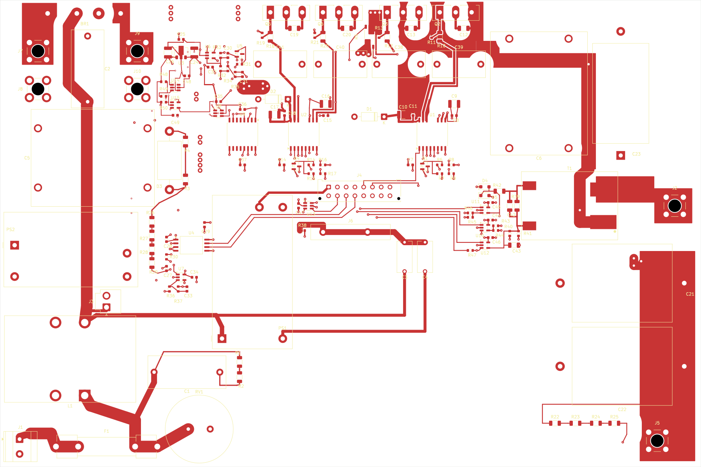
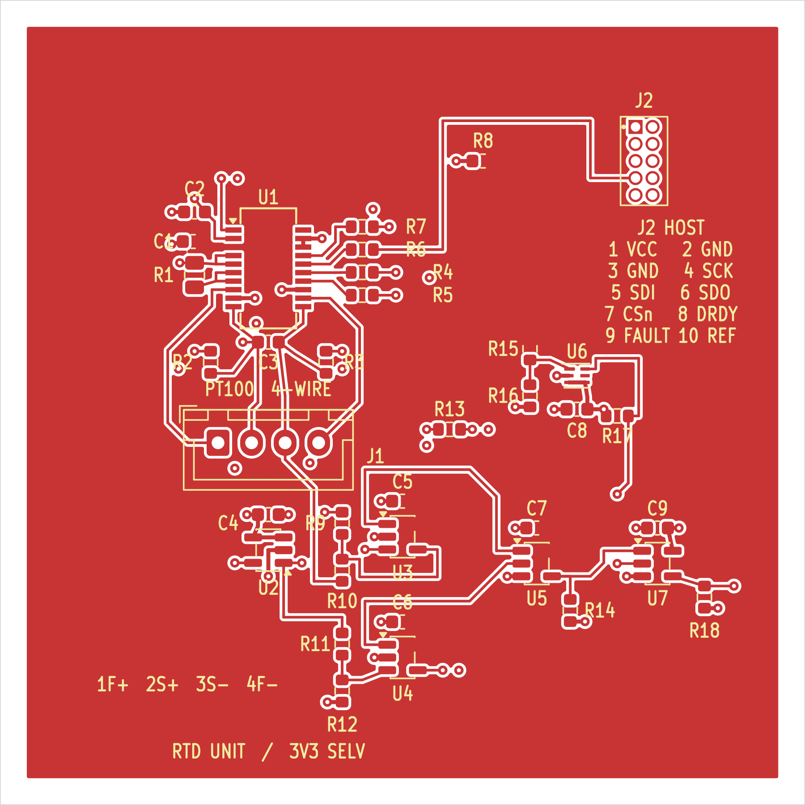
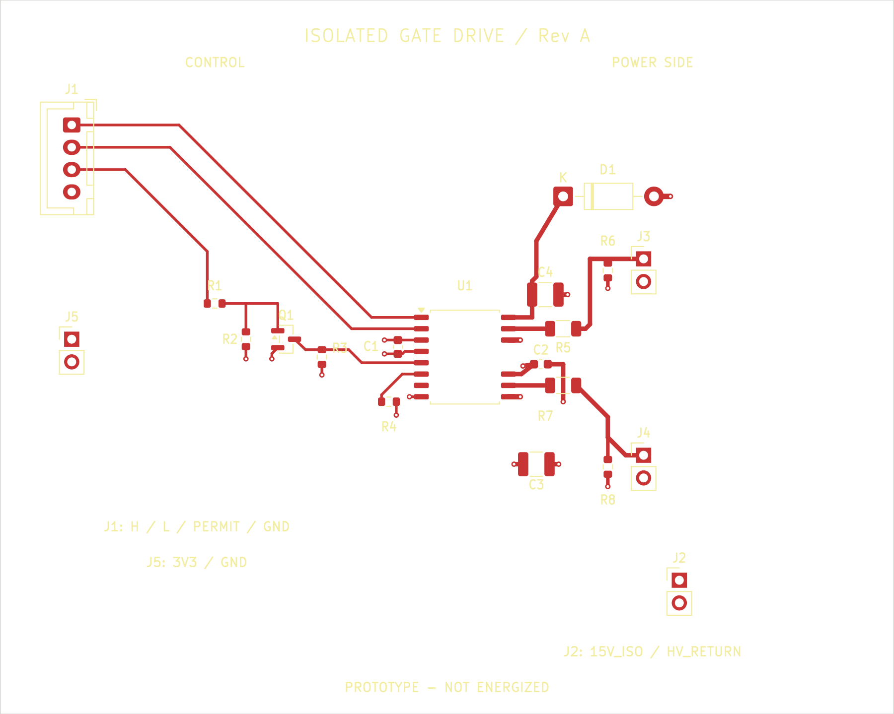
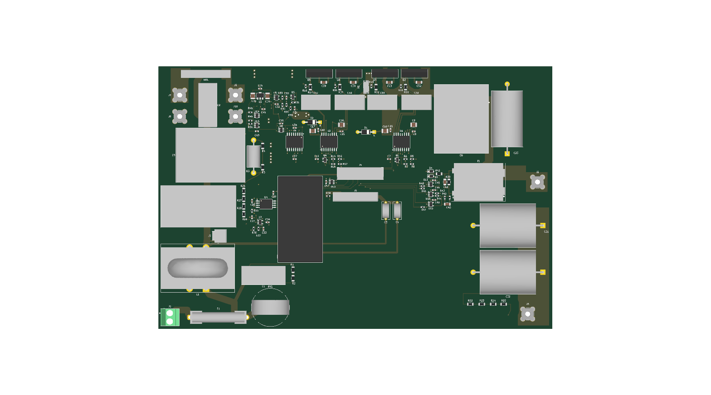

# Temper PCB design review — 2026-10-10

**The reviewed design does not meet the proposed rubric's release or first controlled-power readiness criteria.** The newest source has one confirmed critical electrical-limit violation: four TPS709 EN pins are connected to approximately 15–17 V despite a 7 V absolute maximum. Three decoupling arrangements depart from manufacturer recommendations. Operating conductor temperature, complete protection latency, assembled insulation and assembly-process evidence remain open.

This is the application of [all 160 rubric rules](PCB_DESIGN_RUBRIC.md), with a [160-row scored assessment and closure evidence](pcb-review-2026-10-10/scorecard.csv), [category arithmetic](pcb-review-2026-10-10/score-summary.json), and [preserved evidence packet](pcb-review-2026-10-10/README.md). It is a design/evidence review; no physical board was powered, fabricated, assembled or altered during this work. Scores describe evidence maturity, not a probability of failure or the quality of the engineer's work.

## Artifact identity

Reviewed repository base: `ba575413f5a39401eed1c20417ab7565fa28b509`; review started from documentation commit `a632dc55a` on `codex/pcb-design-rubric`. Full SHA-256 identities for all boards, schematics, source/netlist/BOM inputs and selected datasheets are in [identities.json](pcb-review-2026-10-10/identities.json). All six PCB hashes were unchanged at completion of evidence collection.

| Artifact | Reviewed representation | Distinction that matters |
| --- | --- | --- |
| Power native-20 | [142-part routed board](../../zapote/power-stage-120v/native-20/section.kicad_pcb) and its own schematic; four layers, configured 2 oz profile | Bootstrap gate supplies, MC78L05 HOT5. Its own schematic-to-board parity check reports zero findings. |
| Power native-21 | [Current circuit source](../../zapote/power-stage-120v/elec/src/power_stage_120v.ato), [frozen 331-part exports](../../zapote/power-stage-120v/native-21/frozen/default.csv), [ECO](../../zapote/power-stage-120v/native-21/ECO.md) | Source-only handoff; **no native-21 PCB**. Split +15/−2 V driver supplies, isolated bias transformers, TPS709s and rail monitors. The root frozen netlist matches the native-21 snapshot by full hash. |
| RTD | [Maintained 36-footprint candidate](../../zapote/rtd/unit/candidate/section.kicad_pcb) | Four layers, configured 1 oz profile; MAX31865, REF2025, analog window and supervisor logic. |
| Current sense | [Maintained 21-footprint candidate](../../zapote/current-sense/candidate/section.kicad_pcb) | Two layers, configured 2 oz profile; CT, bipolar window and fault output. |
| Thermal sense | [Maintained 27-footprint candidate](../../zapote/thermal-sense/candidate/section.kicad_pcb) | Two layers, configured 2 oz profile; two NTC channels and independent fault logic. |
| Interlock | [Maintained 25-footprint candidate](../../zapote/interlock/candidate/section.kicad_pcb) | Two layers, configured 2 oz profile; fault latch, watchdog and permit chain. |
| Gate drive | [Maintained 20-footprint candidate](../../zapote/gate-drive/candidate/section.kicad_pcb) | Two layers, configured 2 oz profile; standalone UCC21550 prototype with bootstrap. |

The five unit identities come from the [actual runner registry](../../zapote/validation/units.json). They are independent test articles, not proof of a connected appliance. Separate controller/RF studies and the retired legacy board are excluded from the scored build. RF rule EMI07 is N/A for this scope; it must be reopened when a populated controller is included. Native-21's bootstrap check is N/A, but SW09 remains applicable to native-20 and the standalone gate unit.

## Findings, ordered by consequence

“Confirmed” below means observed in the identified source, saved layout or executed checker. It does not mean a hardware failure was measured. Missing evidence and recommendations are deliberately labeled separately.

| Finding | Priority / confidence | Instance, mechanism and evidence | Required closure / responsible role |
| --- | --- | --- | --- |
| **F01 — TPS709 enable overvoltage** | **C; confirmed source defect** | Native-21 U3/U37/U38/U39 EN pin 3 is tied to the positive input rail. EN-to-GND is nominally about 15 V for U3 and 17 V for the three monitor LDOs. This exceeds both recommended and absolute limits; regulator/protection-supply operation is not electrically credible as written. REQ04 score **0**, raised from H to C for this instance. | Circuit owner: correct EN bias, reconcile ECO/source/compiled netlist, and add an exact-part EN stress check in the Rust source audit. Verify startup, partial power and protection outputs after the change. |
| **F02 — REF20 output bypass absent** | H; confirmed recommendation deviation | RTD U2 has C4 on VIN, but **no capacitor on VREF or VBIAS**. Both outputs are used, including the reference on J2.10. The family layout example recommends local output bypass; reference noise/load-step margin is unproven. DEC01/04 and ANA04 remain score 1. | Analog owner: add the recommended local networks or document a supported deviation, then test reference noise and cable/consumer load steps. This is **not** a demonstrated stability failure. |
| **F03 — AMC1311 local 1 µF banks absent** | H; confirmed recommendation deviation | Native-20 U4 has C28/C29, each 100 nF; no local parallel 1 µF on either side. HOT5 has regulator bulk elsewhere; SELV V3V3 has no 1 µF bank in these netlists. Native-21 preserves the 100 nF-only C28/C29 design. | Analog/layout owner: implement or justify the two recommended local networks, check effective capacitance and complete return geometry, then measure supply-pin ripple and analog error. |
| **F04 — gate-unit high-side small bypass absent** | H; confirmed recommendation deviation | Standalone gate U1 VDDA/VSSA has C4 = 10 µF, with no small parallel capacitor. Low-side C2 = 100 nF and C3 = 10 µF are present; input C1 = 100 nF is present. Do not incorrectly report the low-side bulk as missing. | Gate/layout owner: add or justify high-frequency bypass at the high-side pins and verify mounted supply droop/ringing. Native-20 already has both 10 µF and 100 nF at each output channel. |
| **F05 — native-20 current evaluation cannot execute** | H; confirmed input/software coverage block | Current extraction succeeds, but the Rust native-layout reader rejects zero-length HOT5 track `0a617554-d01f-5c77-bbc6-cf8dcedb8f1f`. `check-current` exits 2 before solving. This is **not** a measured copper overtemperature or open circuit. | CAD/check owner: resolve the degenerate saved item or define a tested native-equivalent input policy; preserve before/after identity and rerun without silently dropping problematic geometry. |
| **F06 — R31 silkscreen fabrication violation** | Q; confirmed configured-profile defect | Native-20 reference text at (84.525, 22.000) mm has 0.0107 mm clearance to R31 pad 2 instead of the configured 0.1500 mm; text will be clipped by the mask clearance. | Layout owner: reposition the reference, inspect final mask/silk and rerun the same profile. This is a marking/build issue, not a mains insulation violation. |
| **F07 — newest circuit has no matching routed board** | C; confirmed maturity gap | Native-20's own parity passes, but its 142-part bootstrap circuit cannot be fabricated as native-21's 331-part split-bias circuit. New isolators, transformers, gate banks and J4.16 LINE_ZC still need placement/routing and matching harness allocation. | Circuit/layout/integration owners: choose the exact build, implement the ECO on its native board, bind all outputs and reopen impacted tests. Do not reuse native-20 timing/thermal certificates as native-21 results. |
| **F08 — conductor heating and thermal margins unclosed** | C; evidence/input/model gaps | No current native-20 result was produced. Existing current/thermal studies use older native-17 geometry and imposed DC cases; waveform distribution, minimum plating, hot resistance, heat inputs and enclosure boundaries remain incomplete. | Power/thermal/fabrication owners: finish revision-matched current allocation and manufacturable geometry, derive losses, close thermal boundaries and verify assembled hot spots and voltage drop. |
| **F09 — supply-cap placement deserves another pass** | H; confirmed geometry, performance unverified | Native-20 U1/U2 input bypasses C7/C14 have straight supply-pad distances of 8.50 mm to pin 3 and 13.91 mm to pin 8; return-pad distance is 8.29 mm. Actual routes can be longer. | Layout owner: prioritize a compact input supply/return loop and inspect vias/planes. These distances are screening observations, not universal failure thresholds or inductance measurements. |
| **F10 — assembly and body geometry remain indeterminate** | H; executed coverage gaps | All five units and native-20 report an unspecified assembly process and partly unsupported native F.Fab body semantics. Native-20 includes 36 library-footprint mismatch warnings; many large parts are explicitly review-only. | Mechanical/package/assembly owners: reconcile physical bodies and exact package drawings; specify the build sequence, stencil/solder processes, restraints and tolerances; obtain assembler review. |
| **F11 — integrated protection latency and rail behavior unclosed** | C; model and hardware gaps | Unit models expose comparator applicability, shutdown-timing contracts, reset/rail-loss gaps. Native-21 adds DIS logic, an approximately 10 µs BIAS_BAD RC, new supplies and no new monitor latch. | Protection/firmware owners: budget sensor-to-current-extinction, qualify ramp/dip/reset/rail recovery and stalled firmware, and test adverse faults with residual energy accounted for. |
| **F12 — assembled insulation and EMC unqualified** | C; requirement and hardware gaps | Prototype board spacing and package certificates do not cover accessible probes, harness motion, sinks, screws, CT primary, earth bonding, contamination, leakage and final emissions/immunity. | Product electrical/mechanical owners: adopt the governing requirement matrix and inspect/test the actual installed assembly; qualify material and process records. |

### F01 reproduction and correction basis

[Native source](../../zapote/power-stage-120v/elec/src/power_stage_120v.ato) connects `u_ldo.EN` to `V15_LS`. [Monitor source](../../zapote/power-stage-120v/elec/src/f6_bias.ato) connects `ldo5.EN` to `p`. [HotLdo declaration](../../zapote/power-stage-120v/elec/src/f6_parts.ato) selects **TPS70950DBVR**, with IN = 1, GND = 2, EN = 3. The [compiled-netlist evidence](pcb-review-2026-10-10/native21-netfacts.json) independently confirms:

| Instance | EN = pin 3 | GND = pin 2 | Nominal EN relative to its own GND |
| --- | --- | --- | ---: |
| U3 / u_ldo | v15_ls | ocp_kelvin_p | approximately +15 V |
| U37 / monitor_ls.ldo5 | v15_ls | n_ls | approximately +17 V |
| U38 / bias_ha.monitor.ldo5 | p_ha | n_ha | approximately +17 V |
| U39 / bias_hb.monitor.ldo5 | p_hb | n_hb | approximately +17 V |

[TPS709 SBVS186H, sections 5 and 6.1/6.3, printed pp. 3–4](https://www.ti.com/lit/ds/symlink/tps709.pdf#page=4) limits EN to 6.5 V recommended and 7 V absolute; section 7.4, printed p. 13, describes enabling through its internal pullup with EN left floating and disallows tying EN to IN. An enabled floating EN is a manufacturer-supported candidate correction; a controlled EN circuit must also stay within its limits during startup, rail faults and back-powering. Changing the part suffix requires a fresh pin/footprint review.

This defect is in **native-21 source and compiled exports**, including an explicit ECO instruction. It is **not** on native-20's MC78L05 board. A passing source connectivity audit or rail simulation did not cover this EN stress; add a production-shaped regression for all four actual references and mutations that make an unsafe connection fail. Circuit correction was not performed as part of this assessment.

### Decoupling and placement evidence

The [supply/reference inventory](pcb-review-2026-10-10/supply-inventory.json) records **53 pin records across all 38 IC/reference footprints on the six routed boards**, including both UCC21550 VCCI pins and every isolated/floating side. It lists candidate capacitors on each exact supply/return net pair. A shared rail match does not make a remote capacitor a valid local bypass. Native-21 is inspected through its compiled nets, not assigned invented placement coordinates.

| Artifact and pins | Existing fitted network | Datasheet comparison and next check |
| --- | --- | --- |
| RTD U2 VIN4/GND2 | C4 100 nF; straight pad distances 1.74 mm supply / 2.67 mm return | Input bypass exists. Check actual loop and rail noise. |
| RTD U2 VREF5/GND2 and VBIAS1/GND2 | No capacitors connected to either output | [REF20 SBOS600F, section 9.4.1, printed p. 24](https://www.ti.com/lit/ds/symlink/ref20.pdf#page=24) uses 0.1 µF low-ESR bypass at VIN/VREF/VBIAS in its REF2030 family example. The electrical table permits a stable 0–10 µF output-capacitance range; absence therefore indicates a noise/transient-guidance deviation, **not proof of oscillation**. Verify applicability to REF2025 and actual loads. |
| Native-20 U4 VDD1/GND1 | C28 100 nF; straight distances 3.25 / 4.66 mm; C26 10 µF is regulator bulk | [AMC1311 SBAS786C, section 10, printed p. 27](https://www.ti.com/lit/ds/symlink/amc1311.pdf#page=27) recommends local 100 nF parallel 1 µF on each side and effective-capacitance checks. Bulk elsewhere does not establish the specified local arrangement. |
| Native-20 U4 VDD2/GND2 | C29 100 nF; straight distances 4.40 / 9.72 mm; no 1 µF on V3V3 | Same recommendation; examine local return/via geometry and supply-pin disturbance. Native-21 keeps the same C28/C29 values. |
| Gate unit U1 VCCI3/8, GND4 | C1 100 nF | Input bypass exists; both supply pins and return path need consideration. |
| Gate unit U1 VDDB11/VSSB9 | C2 100 nF and C3 10 µF | Both nominal network elements exist; effective capacitance and mounted loop remain open. |
| Gate unit U1 VDDA16/VSSA14 | C4 10 µF only; straight distances 3.68 / 7.57 mm | [UCC21550 SLUSE89C, section 9, printed p. 38](https://www.ti.com/lit/ds/symlink/ucc21550.pdf#page=38) suggests approximately 10 µF plus a small parallel high-frequency capacitor. Add or justify the small-cap deviation. |
| Native-20 U1/U2 VCCI3/8, GND4 | C7/C14 100 nF; 8.50 or 13.91 mm supply / 8.29 mm return | Manufacturer layout guidance calls for close low-inductance connections. Revisit placement before treating presence as sufficient. |
| Native-20 U1/U2 output supplies | Low-side and bootstrap each have nominal 10 µF + 100 nF | Unlike the standalone gate unit, network elements exist on both output sides. No measured waveform or mounted-impedance pass is claimed. |
| Native-21 four output banks | 2×10 µF, 2×1 µF, 4×100 nF, damped 220 µF polymer per driver return location | ECO requires effective minima and its rail model assumes parasitic bounds. There is no PCB to establish those bounds. The model's aggregate HF-bank ESL ≤0.1 nH needs especially careful extraction/bench corroboration. |

Distances above are Euclidean **pad-center** distances from pcbnew, checked against the saved board bytes. They are lower bounds on a connection and do not include the capacitor's internal path, trace routing, planes, vias or current crowding. They must not be multiplied or summed and called measured loop area or inductance. MAX31865 analog and digital ground pin assignments were checked against its SSOP pin table; FORCE2 is not substituted for a supply return merely because it shares ground in four-wire operation.

## Executed checks and what they establish

Tools: KiCad **10.0.4**, its framework Python/pcbnew, and the current Rust unit/board/layout runners. The [packet instructions](pcb-review-2026-10-10/README.md) retain commands and identities. These are inspection runs on unchanged artifacts, not a new DRC ceiling measurement.

| Artifact / command | Native + stackup | Configured fabrication profile | Overall result and unresolved evidence |
| --- | --- | --- | --- |
| Five units, `check-units` | All five pass native ERC/DRC and document binding; all five physical stackups pass | All five pass their own profile checks | **All five indeterminate**; hardware NOT RUN, assembly/process/body-geometry and circuit/model gaps remain. Runner exits 2. |
| Native-20, `check-board` with explicit board/schematic/profile | Stackup passes. Native aggregate fails on warnings: DRC 36 library mismatches + 3 silk overlaps; ERC 13 isolated labels + 3 ground-name warnings. Zero reported copper-spacing, unconnected and own-schematic parity findings. | **Fail:** one R31 silk-over-copper finding | Manufacturing indeterminate; runner exits 1. Aggregate failure must not be described as 39 electrical clearance errors. |
| Native-20, `check-current` with explicit board | Native extraction returns 0 with no reported extractor geometry gaps | Not a fabrication test | **Not evaluated:** Rust input rejection at zero-length HOT5 track; exits 2. No current/thermal result produced. |
| Native-21 | No board supplied; no board gate executed | Not evaluated | Source/netlist reviewed; F01 confirmed. No routing, fabrication or physical qualification claim. |

The native-20 warning counts agree with its existing documented dispositions, but modified library geometry still requires drawing-specific manufacturing review. A single inspection run cannot establish a nondeterministic DRC ceiling. No PCB was edited, so no ceiling or measurement baseline was changed.

### Unit-specific obligations preserved by the runners

| Unit | Existing useful evidence | Remaining consequential gap |
| --- | --- | --- |
| RTD | Native binding, physical stackup, fabrication profile, passive-network certificate and static rail detector | Comparator hysteresis/common-mode/input capacitance and MAX31865 force-path applicability; guaranteed brownout response; REF20 output bypass/noise; mounted RTD and final disable response. |
| Current sense | Native binding/profile and conditional bipolar DC trip analysis | CT saturation/thermal/primary-terminal qualification, reinforced barrier applicability, comparator-to-latch timing and complete fault-current coverage. Operating thermal/timing inputs are absent. |
| Thermal sense | Native binding/profile and conditional analog corner checks | Comparator common-mode/hysteresis, NTC beta extrapolation and temperature-rated connector assumptions; mounted sensor lag/self-heating, cable faults and downstream shutdown. |
| Interlock | Native binding/profile, logic connectivity and conditional latch model | Complete SENSOR_LIVE/AUX producers and receivers; HC logic margins, ramp/clock/reset/recovery/harness behavior and missing shutdown/thermal contracts. |
| Gate drive | Native binding/profile, pin contract and bypass-locality checks | Branch RMS/plating/neck/path operating inputs; bounding-box feedback is not switching-loop extraction; bootstrap bias/diode/gate charge, dead time, ringing and loaded thermal evidence. |

These gaps include missing **software geometry semantics, model applicability, contracts and input data**, as well as hardware tests. They must not be condensed to “only bench qualification remains.” Full runner receipts preserve every finding and coverage gap.

### Trace width, heat and switching paths

The current question is not settled by a trace-width table. For the actual branch waveform and minimum manufactured cross-section, calculate `R(T)` and `sum(I_RMS,n² × R_AC,n)`, include terminal/via/pad crowding and contact resistance, then apply validated thermal boundaries. The native-20 copper render has wide main paths and distributed films, but this does not allocate current or prove that narrow exits, inner paths and barrel arrays meet a temperature requirement.

[Current-runner documentation](../../zapote/layout-quality/CURRENT.md) explicitly describes seven imposed-DC two-terminal experiments at assumed 12/18 µm plating, not the complete switched operating model. [Task 04 round 4](../../zapote/power-stage-120v/validation-results/04-board-current-thermal/round4/README.md) belongs to **native-17** and reports incomplete heat inputs and mesh-sensitive peaks. None of its temperatures or resistances is accepted here as native-20 or native-21 evidence. The retained trace-width note also has the algebra issue already flagged in the rubric; do not derive acceptance widths from its displayed rearrangement.

For switching, derive the changing conduction paths in the full bridge; inspect local film-bank/switch/return paths separately from the tank cable loop. Preserve individual gate resistors and the actual source return. Before assigning a loop score ≥2, account for the device package, layer changes, shared return impedance, bias-bank recharge and installed coil/connector geometry. Gate-unit net bounding boxes cannot establish this.

[Native-21 D-33's rail campaign](../../zapote/power-stage-120v/validation-results/01-switching-parasitics/round17/delegation/out-D33/README.md) is useful conditional simulation evidence. It explicitly depends on effective bank capacitance and mounted ESL/ESR and is a source-for-layout handoff. Its successful modeled cases do not validate an EN pin omitted from that stress model, a future layout's parasitics, or the installed protection/thermal/insulation system.

## Scored application

The [CSV](pcb-review-2026-10-10/scorecard.csv) contains every rule's score, priority, evidence references, actual assessment and required closure evidence. It is one **project-level worst-applicable-instance** record per rule, with the finding/inventory/unit tables preserving the relevant instances. It is not seven independent 160-rule board certifications. Scope-sensitive exclusions are stated; missing boards and measurements remain visible.

Using the rubric's formula: **437 / 2468 weighted points = 17.71%**. There are **159 applicable rules, 48 unknowns, 74 critical rules, 19 critical unknowns and one demonstrated critical failure**. EMI07 is the sole excluded rule. REQ04's H→C escalation is explicit and changes its weight from 3 to 5. No score 3 or 4 is assigned because representative hardware/process qualification was not established. Existing narrow software/model passes do not close broader operating requirements.

| Category | Evidence maturity | Unknown / applicable | Critical unknowns |
| --- | ---: | ---: | ---: |
| REQ | 21.3% | 1 / 10 | 0 |
| CU | 0.0% | 10 / 10 | 6 |
| DEC | 20.3% | 2 / 10 | 0 |
| SW | 25.0% | 0 / 10 | 0 |
| PWR | 23.4% | 1 / 10 | 0 |
| GND | 17.5% | 3 / 10 | 0 |
| SEN | 23.2% | 1 / 10 | 0 |
| ANA | 22.9% | 1 / 10 | 0 |
| PRO | 25.0% | 0 / 10 | 0 |
| THM | 8.8% | 6 / 10 | 4 |
| PAS | 19.5% | 3 / 10 | 0 |
| EMI | 18.1% | 2 / 9 | 1 |
| ISO | 10.0% | 6 / 10 | 6 |
| FAB | 19.1% | 2 / 10 | 1 |
| ASM | 3.6% | 8 / 10 | 0 |
| TST | 21.9% | 2 / 10 | 1 |

REQ requirements; CU conductors; DEC decoupling; SW switching/gate drive; PWR power stress; GND returns; SEN sensing; ANA analog; PRO protection; THM thermal; PAS passives/magnetics; EMI interfaces/emissions; ISO insulation; FAB fabrication; ASM assembly; TST test/release.

The score identifies what must be demonstrated before a build-stage decision. Unknowns count as zero, but are not asserted design defects. A 25% category usually means intent/conditional models exist (score 1), while comprehensive layout-plus-corner evidence or representative tests are still missing. The proposed ≥80% per-category threshold is not met; neither is the minimum critical score 2 before first controlled power. The current evidence supports source/layout correction and an unpowered assembly/fit review, not an energized-build or production-release decision.

## Closure sequence

| Order | Work package / responsible role | Reviewable exit evidence |
| --- | --- | --- |
| 1 | **Circuit:** resolve F01 in current source, ECO and compiler outputs; close exact IC bypass networks or justified deviations | Exact four-device EN stress regression; compiled pin/net diff; updated datasheet/net inventory. Recheck downstream fault behavior and LDO effective output capacitance. |
| 2 | **Layout/integration:** select a build and implement native-21 ECO on its matching board, including J4.16/harness change | Hash-bound source/BOM/schematic/PCB and harness manifest; every new barrier and local bias/supply/gate loop inspected; new native/profile results. |
| 3 | **CAD/checks:** close F05/F06, package dimensions and unsupported body semantics; update check entry points to the selected revision | No silent geometry filtering; native-equivalent geometry evidence, completed declared current solves, clean marking profile or explicit disposition, physical-body/assembly coverage. |
| 4 | **Power/thermal/fabrication:** establish waveform and fault-current allocations, minimum copper/plating, hot losses and cooling limits | Segment/terminal/via bottleneck report; validated thermal network, material/supplier records and fault-clearing calculation. Defined probe method and staged test limits. |
| 5 | **Protection/analog/firmware:** close complete sensing-to-extinction and rail/reset behavior | Identified-build corner budget and low-energy fault-injection results, including stalled controller, continuing fault during reset, power loss/recovery and residual current. |
| 6 | **Mechanical/assembly/product:** close installed barriers, sink interfaces, restraint/strain and assembly process | Exact assembly/tolerance drawings, package/supplier acceptance, stencil/solder/inspection plan, governing insulation/leakage/bond requirements. |
| 7 | **Verification:** execute authorized staged operating, thermal, sensing and EMC matrix on the resulting build | Calibrated raw device-pin/IC-pin waveforms, hot resistance/temperature, fault results, installed insulation/EMC evidence; update affected rule instances and preserve build identity. |

## Visual inspection record

Inspected every copper layer of all six routed boards using native KiCad SVG exports, plus native-20's native top 3D render. Colors below show exported copper and selected markings, not an annotated domain certificate. Some unit lower-layer plots retain purple drawing-sheet decoration; it is not copper. Original SVGs are preserved beside PNG previews in the packet.

Native-20 front copper shows the main power paths, distributed film banks, sensing islands and two gate drivers. Its [In1](pcb-review-2026-10-10/renders/native20-in1-complete.png), [In2](pcb-review-2026-10-10/renders/native20-in2-complete.png) and [back copper](pcb-review-2026-10-10/renders/native20-bcu-complete.png) were also inspected. No loop-inductance or temperature value is derived from these images.

RTD supply/reference nets were checked against actual pad nets, including U2 and all nine capacitors. The reference-output capacitor finding comes from connectivity, not from a visual guess.

Gate-unit supply-cap inventory includes the back-side bulk connection. The final gate load, package/source path and harness are not represented by this standalone board alone.

The 3D render includes several simplified/review-only bodies and omits the final sink, cables and enclosure. It cannot prove mechanical interference clearance, lead fit, assembly reach, restraint or mounted insulation. Those remain F10/F12 obligations.
