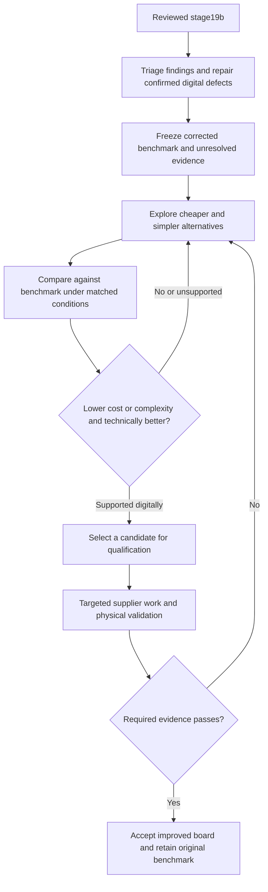

# Temper PCB benchmark and improvement strategy

Create a corrected, stable benchmark from the reviewed native-21 stage19b design, then explore alternative boards that are cheaper or simpler to manufacture **and technically better**. Keep the benchmark available as a fixed comparator throughout the exploration. Use this period to remove unnecessary cost, assembly difficulty and design complexity before committing substantial time to supplier correspondence and physical qualification.

**Current scope: record the intended approach only.** No fixes, benchmark snapshot, alternative layout, component substitution, supplier outreach or order is authorized by this write-up. The sequence below describes future work.

## Starting point

The [six-resource stage19b assessment](pcb-rubric-review-stage19b-2026-10-13/README.md) provides 179 criterion decisions, prioritized findings, trade-offs and missing evidence. Its selected routed-board SHA-256 is `b19a45530bb0f39d2d3c0412e3774b6d5a47c4238d3fee867790cce410756662`. Stage19b is the starting candidate; the corrected benchmark has not yet been created.

The aim is to avoid optimizing a moving or defective reference, while also avoiding weeks of supplier work on a design we may soon replace. A stable comparator makes it possible to distinguish an actual improvement from a changed assumption, weaker test or transfer of cost elsewhere in the cooker.

## Proposed sequence

### 1. Resolve the right fixes before freezing the benchmark

Reconcile the review findings into confirmed defects, verification gaps, accepted trade-offs, fixed historical issues and questions dependent on suppliers or physical testing. The six reports overlap; they are not six independent lists of changes that must all be applied.

Repair confirmed defects and inconsistencies that can be resolved with available design evidence. Recheck affected connectivity, geometry, rules, assembly outputs and calculations. Record why each change is necessary and which finding it closes. Do not add parts, move copper or increase margins solely to improve an ordinal rubric score.

Some findings need a measurement or supplier interpretation before a fix can be chosen. A bypass return distance is not automatically a failed rail; a CPL coordinate convention is not automatically wrong placement; a narrow thermal prediction is not an observed hot spot. Resolve the specific question where possible, and preserve the uncertainty where it cannot yet be resolved.

The result is a **corrected digital benchmark** with a clear evidence boundary. It is not automatically a fully qualified manufacturing or operating reference. If an unresolved assumption determines whether the basic architecture can work, that assumption must be tested or treated as a blocking condition rather than hidden inside the benchmark.

### 2. Freeze the benchmark as a complete design and evidence package

Preserve the exact schematic, routed PCB, selected BOM and approved alternatives, project/rules/libraries, stackup, assembly configuration and relevant enclosure/harness/filter assumptions. Retain the calculation inputs, tool versions, test conditions, outputs, rubric decisions and unresolved-item register needed to reproduce its evaluation.

The benchmark must include the cost and complexity of the **installed system**. An off-board filter, extra wiring, cooling provision, custom mechanical piece or hand assembly step remains part of the comparison even when it disappears from the PCB BOM.

Give the corrected benchmark its own identity and content hashes. Preserve stage19b as historical input. Do not silently overwrite either snapshot, repin an existing baseline or compare an experiment to whichever file happens to be newest.

Keep this first benchmark fixed during an exploration round. If later evidence reveals a material benchmark defect, retain the old package, document the correction, create a successor benchmark and regrade the candidates against it. Changing the comparator must be visible.

### 3. Explore distinct ways to improve the board

Begin with explicit hypotheses rather than one large redesign. Each experiment should identify the mechanism, expected cost or complexity reduction, expected technical benefit, affected requirements, likely adverse effects and the evidence that could disprove the claim.

Investigate both removal and rearrangement. A part may be unnecessary because it duplicates a function; it may also be necessary only because an earlier placement or architectural choice created the problem it mitigates. Removing that cause can improve behavior and reduce parts at the same time. That possibility is worth exploring, but the part's function must remain satisfied.

These are candidate investigation angles, not selected modifications:

| Angle | Possible combined benefit | What the comparison must establish |
|---|---|---|
| Commutation, gate and reference geometry | Lower parasitics and coupling; potentially less corrective circuitry | Complete current/return paths and device stress improve under the same corners; thermal and insulation requirements remain satisfied |
| Functional simplification | Fewer parts, rails, connectors or repeated functions | Every removed function is redundant or replaced adequately, including sequencing, faults, protection and diagnostics |
| BOM and package standardization | Fewer unique parts and special processes; simpler assembly and sourcing | Exact-part electrical, thermal, pulse, insulation and footprint requirements remain met; installed cost falls |
| Board construction and assembly | Less custom tooling, manual work, footprint interpretation or fabrication difficulty | The actual process becomes simpler without losing current capacity, insulation or solder quality; area/layer reductions are benefits only when supported |
| Distribution of functions between board and enclosure | Better filter placement, harness routing, cooling or service access | Total system cost and complexity improve; burdens are not merely transferred to wiring, a module or final assembly |
| Test and service access | Faster inspection, bring-up, diagnosis and repair | Access improvements are usable in the real assembly and do not create unacceptable coupling, exposure or process cost |

Start with changes that preserve the current product function and operating envelope. More substantial topology or architecture alternatives may be explored separately if they promise a meaningful combined gain. They must carry a complete requirement comparison; a lower-power or weaker-protection design cannot win by quietly changing the product.

### 4. Grade candidates against the fixed benchmark

Use the same operating cases, coil/pan assumptions, stackup/manufacturing tolerances, cooling conditions, fault cases, model fidelity and measurement definitions for both sides. When an analysis method improves, rerun the benchmark with that method instead of comparing unlike results.

Apply the 179 criteria as a traceability and evidence framework. Use physical quantities and agreed requirements for the actual decision. A higher average rubric score cannot compensate for a failed critical requirement, and missing evidence cannot count as a gain.

The working interpretation of “cheaper/simpler and better” is:

- Show a meaningful reduction in total installed cost, manufacturing/assembly complexity, or both. Do not materially worsen the other economic dimension.
- Show at least one meaningful technical improvement, such as switching margin, thermal margin, EMI behavior, sensing accuracy, fault behavior, robustness or testability.
- Preserve the product's agreed functionality and operating envelope, and satisfy every critical requirement. Cost savings cannot compensate for failing protection, insulation or another required floor.
- Record noncritical trade-offs explicitly. Smaller gains must exceed analysis, tolerance or measurement uncertainty before they count as improvements.

This is a proposed comparison rule, not a decision that every metric must improve simultaneously. Candidates with different advantages may remain on a shortlist when none clearly dominates. A final choice should expose the trade-offs rather than bury them in one weighted score.

| Comparison area | Evidence to retain for benchmark and candidate |
|---|---|
| Installed cost | Same quantity tier and costing basis; components, PCB, special fabrication, assembly, off-board hardware, harness and cooling; sensitivity to uncertain costs |
| Build complexity | Unique parts/packages, placements, connectors, custom items, process exceptions, manual operations, orientation ambiguity and inspection effort |
| Switching and power | Loss, loop/parasitic estimates, gate/rail behavior and device stress across matched operating and transient cases |
| Thermal behavior | Component and local-air temperatures, margins, thermal-path assumptions and cooling/derating requirements |
| EMC and sensing | Return/coupling paths, mode-specific filter behavior, noise/accuracy/timing budgets and relevant operating states |
| Protection and insulation | Full fault path, current extinction, stored energy, construction/material assumptions and applicable acceptance evidence |
| Assembly and service | Supplier preview disposition, footprint/sample fit, harness access, joints, test access and repair effort |
| Evidence strength | Observed design versus calculation, simulation or measurement; uncertainty, model limits and unresolved dependencies |

Avoid deleting a protection, damping, bypass or test part simply to reduce the count. Show why its original function is no longer needed or how the candidate satisfies that function with fewer burdens.

### 5. Select a candidate before concentrated external qualification

Use reproducible digital evidence and existing technical data to eliminate weak alternatives and select a small, credible shortlist. Cost estimates should identify uncertain inputs and remain estimates until appropriate quotes and process feedback exist. Reduced part count alone is not proof of lower cost or higher yield.

Defer broad supplier emailing, bespoke quotations, custom-part discussions, procurement and extensive physical qualification until the architecture and major part choices are stable enough for those answers to remain useful. Collect the precise questions during exploration so later outreach is targeted.

This does not mean all external evidence can wait. If a supplier fact is decisive to an architectural choice and cannot be bounded from available data, label the option conditional, set it aside or obtain that specific fact when authorized. Do not spend extensive optimization effort around an assumption that could invalidate the whole design.

A candidate can be **preferred on digital evidence** before it is **qualified for adoption**. Supplier responses, first-article fit/assembly and physical switching, protection, thermal, coil and EMI results can overturn the provisional preference. Preserve the benchmark until the improved board passes the required evidence for its intended use.

## What each experiment should produce

Keep a concise comparison record: benchmark and candidate identities; the proposed change and reason; affected rubric criteria; matched conditions; economic and technical deltas; uncertainty and regressions; disposition; and the next discriminating check. Retain rejected experiments and the reason they lost so the same idea is not repeatedly rediscovered.

Use early, inexpensive checks to reject poor candidates before expensive analysis or outside work. Combine individually promising changes only after checking their interactions; two gains measured separately may compete for space, heat, return paths or stability when combined.

## Decisions still needed before execution

The direction is to preserve a benchmark and require a combined economic/complexity and technical gain. Before grading experiments, agree the minimum meaningful cost saving or simplification, the target build quantities, which technical improvements matter most, and the permitted noncritical trade-offs. Fix the comparison operating envelope and decide which remaining uncertainties would block a digital benchmark or candidate preference.

The present write-up does not choose a topology, replacement part, numerical weighting or cost target. Those choices should follow the benchmark's reconciled evidence, not precede it.

## Intended outcome

A preserved corrected benchmark, an auditable set of experiments, and an improved board that has a supported cost or simplicity advantage and a supported technical advantage without weakening required behavior. Supplier and bench work then closes focused questions on a stable candidate, rather than qualifying a design while its architecture is still changing.
