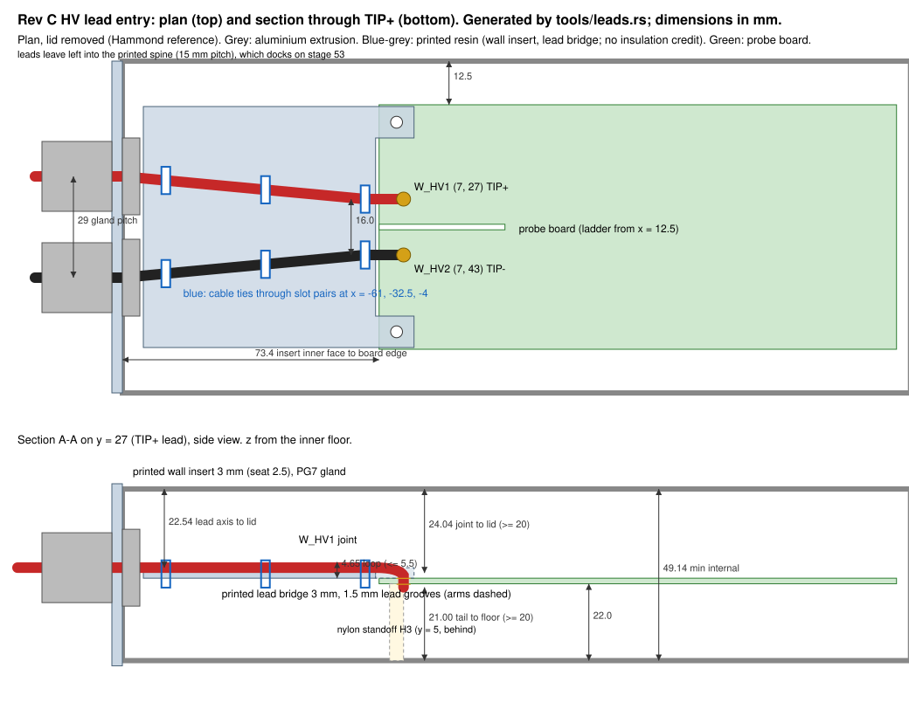

# Rev C HV input leads, tips, feedthroughs and strain relief

This page designs the last open part of the Rev C probe: the two captive HV leads from `W_HV1`/`W_HV2` to the stage-53 nodes. It is an engineering design for the prototype, not a voltage or CAT rating. Nothing here has been built or measured.

Evidence, all regenerated by `make check`:

| What | File | Tool |
|---|---|---|
| Capacitance, inductance, resonance and setback budget, with pass/fail gates | [`validation/leads/leads.txt`](../validation/leads/leads.txt) | [`tools/leads.rs`](../tools/leads.rs) |
| Stage-53 attachment points and their nearest other-net copper | [`validation/leads/stage53-probe-points.txt`](../validation/leads/stage53-probe-points.txt) | [`tools/stage53_probe_points.py`](../tools/stage53_probe_points.py) |
| Plan and section drawing | [`hv-leads-section.svg`](hv-leads-section.svg) | `tools/leads.rs` |
| FR4 tip plate and lead bridge (KiCad, Gerbers, DXF) | [`mech/`](../mech), [`procurement/tip-plate-gerbers.zip`](../procurement/tip-plate-gerbers.zip), [`procurement/lead-bridge-gerbers.zip`](../procurement/lead-bridge-gerbers.zip) | `tools/leads.rs`, [`procurement/export-mech.sh`](../procurement/export-mech.sh) |

`tools/leads.rs` holds every dimension used below. Changing a dimension there regenerates the budget, the drawing and both FR4 parts together; a failed gate stops `make check`.

## Summary of decisions

| Item | Decision |
|---|---|
| Wire | Alpha Wire **392040 RD005**, UL AWM 3239, 150 °C, **10 kV DC**, 20 AWG 10/30 tinned, 2.97 mm OD silicone. Both leads are cut from one red spool; TIP− is marked black. |
| Length | **200 mm** outside the box (gland face to tip contact): 130 mm twisted pair, then 70 mm separate tails. 84.9 mm inside, identical for both leads. |
| Shielding | **Unshielded**, twisted. See [why](#shielded-or-unshielded). |
| Tip-end plate | Hammond's 1.5 mm aluminium end plate is **replaced by a 1.6 mm copper-free FR4 plate** of the same outline, made by JLC. |
| Feedthrough and outer strain relief | One Essentra CG-PG7 nylon cable gland per lead in the FR4 plate. |
| Inner strain relief and routing | A 1.6 mm copper-free FR4 **lead bridge**, held by the existing H3/H4 nylon screws, with three cable ties per lead. |
| Board change | **None.** H3/H4 already carry the bridge; W_HV1/W_HV2 are unchanged. |
| Tips | TIP+ ends permanently in an insulated M4 ring for the J5 (RES_A) stud. TIP− ends in a 4 mm shrouded plug that takes either a fully insulated hook clip (on a pin in the free bank hole on SW_B) or a 4 mm-to-fork adapter (the J2 COIL_FEED stud). |
| Per-tip loading | **11.6 pF estimate.** The tentative 10 pF target cannot be met by any lead that reaches both bank nodes; the target is revised to **12 pF** (see [budget](#capacitance-budget)). |

## Parts and prices (2026-10-20)

Read from public distributor pages on 2026-10-20, without logging in or using a cart. The ledger is [`procurement/prices-2026-10-20.csv`](../procurement/prices-2026-10-20.csv); quantities for two probes are in [`procurement/leads-bom.csv`](../procurement/leads-bom.csv); `python3 procurement/cost.py` gives the total.

| Part | MPN | Rating and approval basis (as printed) | Source, unit price, stock | Two probes |
|---|---|---|---|---:|
| Lead wire, 100 ft red | Alpha Wire 392040 RD005 | UL AWM Style 3239, 150 °C, 10 kV DC, file E163869 (print legend). No withstand voltage stated. | DigiKey 392040RD005-ND, $664.22, 17 | 1 spool |
| Cable gland, PG7 | Essentra CG-PG7-1-BK | Nylon (PA), clamps 2.00–5.00 mm, panel hole 12.7 mm, thread 8.00 mm, IP68, −20 to 100 °C (DigiKey attributes). Not a voltage-rated part; the wire is the insulation. | DigiKey RPC3638-ND, $1.46, 7,314 | 4 |
| Gland locknut | Essentra CGLN-PG7-BK | Nylon, 19.00 mm wide, 5.00 mm thick (DigiKey attributes) | DigiKey RPC3640-ND, $0.48, 2,383 | 4 |
| TIP+ ring | TE 34108 | Ring tongue, 22–16 AWG, #8 (M4) stud, non-insulated. No voltage rating; insulated by heat-shrink (below). | Mouser 571-34108, $0.38, 25,823 | 4 |
| TIP− plug | Cal Test CT2631-0 | "1000V CAT III / 600V CAT IV P2 … With IEC rated test lead wire"; 36 A; insulation Ø4.0 mm max; set-screw (drawing P263100 rev B) | DigiKey BKCT2631-0-ND, $6.00, 2,942 | 2 |
| TIP− hook clip | Cal Test CT4466-0 | "VOLTAGE: 1000V CAT III (IEC 61010)", 5 A; nylon body; 4 mm jack; 4.80 mm opening (drawing, DigiKey) | DigiKey 1768-CT4466-0-ND, $20.00, 8 | 2 |
| TIP− fork adapter (J2) | Stäubli 23.0480-21 (B4-I/KS) | "Rated Values 1000 V, CAT II, 20 A", IEC EN 61010-031; fork slot 4.1 mm, fork width 7.5 mm (Stäubli drawing) | element14 NZ 4716554, NZD 18.13 per 2 ex GST, 7 (search listing; page not opened). Not at DigiKey or Mouser. | 1 pack of 2 |
| Heat-shrink, 3/16 in black | Raychem RNF-100-3/16-BK-SP | UL E35586 600 V, 125 °C; 2:1; recovered wall 0.51 ± 0.08 mm (TE data sheet) | DigiKey, $3.55 per metre (stock not read) | 1 m |
| Cable ties | Panduit PLT1M-C | Natural nylon, 99 mm | Mouser 644-PLT1M-C, $0.212 at 100 (minimum 100), 96,100 | 100 |
| FR4 tip plate | JLC, [`mech/tip-plate`](../mech/tip-plate/tip-plate.kicad_pcb) | Copper-free FR4, 1.6 mm, 103.12 × 53.09 mm | JLC 5 pcs, not quoted; ≤ $10.40 (the 150 × 70 mm 2-layer quote bounds it) | 1 lot |
| FR4 lead bridge | JLC, [`mech/lead-bridge`](../mech/lead-bridge/lead-bridge.kicad_pcb) | Copper-free FR4, 1.6 mm, 86.0 × 69.0 mm | JLC 5 pcs, ≤ $10.40 (same bound) | 1 lot |

**Total for two probes: $771.05**, of which the wire spool is $664.22. The Stäubli adapter is not in the USD total. Hardware already in the enclosure plan (the Hammond screws, the nylon H3/H4 screws and standoffs) is not repeated; the H3/H4 nylon screws must be 1.6 mm longer to pass through the bridge.

**The wire spool dominates the cost.** 100 ft is Alpha's smallest put-up, and only about 1.2 m is used. No UL 3239 10 kV wire in short lengths was found at DigiKey or Mouser. Buying one spool instead of a red and a black one saves $664; TIP− is identified with black heat-shrink and its black plug. The left-over wire makes replacement leads. A manufacturer-rated alternative, Pomona 6733 (printed "10,000 DC", no UL style or test voltage), would cost $41.19 per 50 ft, but it does not meet this project's rule that HV wire carry a UL style or test voltage.

## Lead wire

**Alpha Wire 392040**, from its customer specification ([PDF](https://www.alphawire.com/disteAPI/SpecPDF/DownloadProductSpecPdf?productId=392040)):

| Property | Value, as printed |
|---|---|
| Print legend | `20 AWG RU AWM STYLE 3239 150C 10KVDC VW-1 E163869` |
| UL basis | AWM Style 3239, 150 °C / 10 kV DC, UL file E163869 |
| Conductor | 20 AWG (10/30) tinned copper, 0.037 in (0.94 mm) |
| Insulation | Silicone rubber, 0.040 in (1.02 mm) nominal wall |
| Outer diameter | 0.117 ± 0.004 in (2.97 ± 0.10 mm) |
| Temperature | −40 to 150 °C |
| Bend radius | 10 × cable diameter (30 mm) |
| Pull tension | 7.9 lb (35 N) maximum |
| Colours | White, black, red, blue |

The UL style rating is the approval basis: the wire is UL-recognised AWM (appliance wiring material) Style 3239 at 10 kV DC, which is 3.3 times the ±3 kV extension and 6.7 times the ±1.5 kV guaranteed range. The specification sheet gives no spark-test or dielectric-withstand voltage. Section 7 of [qualification](qualification.md#7-leads-feedthroughs-and-tips) adds an incoming hipot for that reason.

AWM is a component recognition for wiring inside equipment, not an IEC 61010-031 probe-lead rating. The probe is used hands-off on an isolated DUT ([operating restrictions](revb-build-decision.md#fault-and-operating-requirements)), so the relevant property is that the insulation withstands the tip voltage against anything it touches. Ordinary 1 kV CAT test-lead wire is not acceptable.

**Why not the alternatives:**

- Pomona 6733 (18 AWG silicone, 3.60 mm OD) is more flexible and is printed "10,000 DC", but its data sheet gives no UL style; the voltage is a marketing figure.
- Mueller 180001 (18 AWG silicone) is UL Style 3577, rated 3000 V: equal to the extension, no margin.
- CNC Tech 3239-series silicone wire is UL 3239 but at the 3 kV DC level, with a 7 kV DC withstand: also no margin at 3 kV.

**Gauge.** 20 AWG passes a 0.94 mm conductor through the 1.6 mm W_HV hole with room for solder. A heavier gauge would add OD and capacitance and carries no current here.

**Strand count.** The 10/30 conductor is stiffer than test-lead wire. That suits a lead whose geometry is meant to stay fixed. Respect the 30 mm bend radius; do not use it as a flexing patch lead.

**Colours.** Both leads are red wire from the same spool, which also keeps their insulation from one production lot. TIP− carries black heat-shrink bands at the gland and at the plug, and a black plug. W_HV1 is `TIP +` and W_HV2 is `TIP −` on the board silk, and the plate legend matches.

## Lead length and routing

### Capacitance budget

Per-tip loading means each tip's capacitance to earth (the probe's GND, BNC shell and enclosure). From [`leads.txt`](../validation/leads/leads.txt):

| Contribution | pF | Basis |
|---|---:|---|
| Ladder, 5 × 33 pF ± 5 % in series | 6.93 | Worst case |
| Ladder copper and bodies to the enclosure | 1.00 | Reserve; not modelled |
| Tip accessory | 0.50 | Reserve |
| Internal run, 84.9 mm at mid-height between lid and floor | 1.44 | Estimate; the FR4 bridge under the lead is not modelled |
| External lead, 200 mm, axis ≥ 50 mm from earthed metal | 1.76 | Estimate: twisted section as one conductor shared by two legs, tails as lone wires |
| **Total** | **11.63** | Estimate |

**The tentative ≤ 10 pF target is not reachable.** The ladder, the reserves and the fixed 84.9 mm internal run already take 9.9 pF, leaving 0.13 pF for the external lead: 11 mm. That cannot reach both J5 and the bank's SW_B hole, which are 58.5 mm apart. The internal run cannot shrink, because the PCB-mounted panel parts fix the board at the output end, 73.4 mm from the tip-end plate (220 mm extrusion plus two 1.6 mm bezel lips, per the Hammond drawing).

The 10 pF figure was a tentative, unexplained target. What the loading actually changes is:

- **The switch-edge current** into the probe and its earth return. At 70 V/ns, 11.6 pF draws 0.81 A for the edge's duration, against 0.46 A for the ideal ladder alone.
- **Loading of the measured nodes.** At 60 kHz, 11.6 pF is 228 kΩ. Against the 0.5 µF bank this is negligible.

Neither justifies a probe that cannot reach the nodes. **Decision:** the per-tip target becomes **12 pF**, gated in `leads.rs` with the lead held ≥ 50 mm from earthed metal. Qualification measures the actual value (section 4 of [qualification](qualification.md#4-cmrr-and-loading)). At this mix of twisted and untwisted lead, the longest lead inside 12 pF would be 242 mm; 200 mm keeps 0.37 pF in hand.

**Where the lead lies matters more than its length.** A lead lying on earthed metal is bounded by a coaxial capacitance of ≤ 199 pF/m, so ≤ 49.7 pF per tip. It also puts the insulation's air wedge in a high field (see [failure modes](#failure-modes)). **Operating rule:** keep both leads ≥ 50 mm from earthed metal, including the bench, the scope and the probe enclosure.

**Lead-to-lead capacitance** loads the DUT differentially, across RES_A–SW_B or COIL_FEED–RES_A. The twisted section is bounded at ≤ 13.0 pF (both insulations at εr = 4.0, gap shorted); the air-filled estimate is 2.0 pF. Across the 0.5 µF bank or the coil this is negligible. It is symmetrical, so it converts no common mode to differential.

### Effect on CMRR

Capacitance from a tip to earth that sits *outside* the divider only loads the source. It does not change the divider ratio. The CMRR-relevant mechanisms are:

1. **Stray capacitance from a lead into the ladder.** Inside the box, any coupling from the lead to a ladder node or the tap changes that leg's ratio. At the tap, 0.0066 pF is 0.1 % of the 6.6 pF top capacitance, which alone limits CMRR to 60 dB. The internal route is therefore fixed by the lead bridge, approaches W_HV from the tip end (x < 7 mm, away from the first section at x = 12.5 mm), and is mirror-identical for both legs. Static strays are absorbed by the per-leg compensation; only *movement* after calibration matters, and the bridge prevents it.
2. **Common-mode current through the lead inductance.** With both tips at the same node, a mismatch ΔC in the two tips' loads makes the two leads carry different common-mode currents. Because the legs are twisted, that current difference sees only the pair's leakage inductance, L_dm/2. With ΔC = 1.16 pF (the ladder's ± 5 % tolerance plus 0.5 pF of tip asymmetry) the conversion is −150 dB at 60 kHz, −101 dB at 1 MHz and −73 dB at 5 MHz. A 2 mm length mismatch (the ± 1 mm cutting tolerance) adds an unequal self-inductance worth −91 dB at 5 MHz. Together: **−72 dB at 5 MHz**, gated at ≥ 60 dB.
3. **Source impedance.** RES_A, SW_B and COIL_FEED are all low-impedance at the frequencies of interest. The 0.5 µF bank couples RES_A to SW_B, and the half-bridge drives SW_B and, through T1, COIL_FEED. A loading mismatch through a low source impedance converts very little.

So, **outside the box, lead position mainly changes loading, not CMRR.** The qualification still measures CMRR against lead movement, because the calculation leaves out the ladder's distributed strays to the enclosure.

### Shielded or unshielded

Unshielded. A shield around each lead:

- Would add coax capacitance to earth along the whole length, tens of pF per tip.
- Would need its own termination and insulation at both ends, at full tip voltage on the inside.
- Would put earthed metal closer than 20 mm to the HV conductor along the whole lead, against the setback rule.

The twisted pair instead keeps the two legs geometrically equivalent: each sees the same surroundings on average. Twisting also reduces the loop area for magnetic pickup. The untwisted tails remain: their 2,049 mm² open triangle picks up an estimated 0.13 V peak from 28 A peak at 35 kHz flowing in a conductor 20 mm away (`leads.txt`). That is 0.013 % of a 1 kV bank voltage. Keep the tails short and dress them close together.

## Inductance and resonance

From `leads.txt`, all lumped at the probe end, which gives the lowest frequency:

| Mode | L | C | f₀ |
|---|---:|---:|---:|
| Differential loop: twisted 0.114 + tails 0.123 + internal 0.145 µH | 0.382 µH | Ladder/2 3.46 + lead-to-lead bound 12.96 + tip 0.50 = 16.92 pF | **62.6 MHz** |
| Common mode: pair over an earth return 300 mm away | 0.368 µH | Both tips, 23.3 pF | 54.4 MHz |
| Quarter-wave, whole lead, εr = 4 throughout | — | — | 132 MHz |

The differential resonance is gated at ≥ 10 × the 5 MHz bandwidth. The undamped LC rise at 5 MHz is **0.64 %**, and 9 × 10⁻⁵ % at 60 kHz. The output RC pole at 6.0 MHz and the amplifiers attenuate the resonance itself; tip ringing at ~60 MHz is outside the measurement band. The 5 MHz rise is a candidate calibration item for edge measurements, not a defect.

The inductances use the equal-area conductor and include low-frequency internal inductance, so they are upper estimates. The lead-to-lead capacitance is the rigorous upper bound. The true resonance is therefore at or above the tabled values.

## Tip assemblies

### Where stage 53 is reachable

[`stage53-probe-points.txt`](../validation/leads/stage53-probe-points.txt) is computed from the board-of-record copper (`82af7bd9…`, `runs-native21/s53/c53int`):

| Node | Reachable feature | Notes |
|---|---|---|
| RES_A | **J5**, Würth 7466004R M4 coil stud at (132.0, 70.5) | The bank's RES_A pads (x = 163) are under the capacitor bodies. |
| COIL_FEED | **J2**, Würth 7466004R M4 coil stud at (132.0, 85.5), 15.0 mm from J5 | T1's primary joins COIL_FEED to SW_A, so SW_A copper 2.5 mm from J2's 9 mm envelope is the same node to within the CT primary. |
| SW_B | **The unused P27.5 hole** of each bank capacitor, at x = 190.5 | The fitted TDK B32643H8104J000 uses the 22.5 mm hole (body ends at x = 187.5). The 27.5 mm hole is plated, on SW_B and open, 3 mm beyond the body. C22's hole at (190.5, 68.2) is the best: nearest other-net copper 10.6 mm (HV_RET pour, masked) and 11.1 mm (BUS_P pad of C5), and 58.5 mm from J5. Avoid C152's hole: a LINE_ZC_RAW track runs 6.9 mm from it. |

There are no test points on any of the three nodes: TP31/TP32 on SW_B are 1 mm SMD pads on the bottom, among gate-drive parts.

**Polarity.** RES_A is always on TIP+:

- **Bank voltage:** TIP+ on J5 (RES_A), TIP− on the C22 free hole (SW_B). Reads V(RES_A) − V(SW_B).
- **Coil voltage:** TIP+ on J5 (RES_A), TIP− on J2 (COIL_FEED). Reads V(RES_A) − V(COIL_FEED), the negative of the coil voltage as stage 53 defines it. Invert in the scope.

This keeps the high-voltage node on the same tip, which is fixed, screw-on and never moved between measurements. TIP− is the only tip that changes. Against earth, SW_B and COIL_FEED swing within the half-bridge's ~170 V bus plus the floating DUT's offset; RES_A carries up to the 1.79 kV F3 fault peak on top of SW_B.

### TIP+: insulated M4 ring on J5

Stage 53 requires **insulated M4 ring terminals on J2/J5** (`zapote/power-stage-120v/ASSEMBLY.md` and DECISIONS 2026-10-08, branch `codex/power-stage-integration` at `76da0493c`): the bare ring ≤ 10.0 mm wide, a DIN 125 M4 washer, a pan-head screw with head ≤ 8 mm, and exposed metal ≥ 5.0 mm apart at any rotation. The probe lug follows the same rule.

TIP+ is permanently terminated:

1. TE 34108 ring (non-insulated, #8 / M4 stud, 22–16 AWG). Crimp with a non-insulated-terminal die, or solder the barrel; then check the pull-out (qualification section 7).
2. Two layers of RNF-100 3/16 in heat-shrink over the barrel and the neck, up to the ring, overlapping the wire insulation by ≥ 10 mm. Each layer is UL-rated 600 V. This insulation is functional, like stage 53's own lug rule: the ring and barrel are at the J5 potential, and the sleeve only limits the exposed metal to the ring under the washer.
3. Check that the bare ring is ≤ 10.0 mm wide (stage 53's limit) on the received part.

Stack on J5, from the stud up: the coil's lug (it carries the current and stays on the stud face), the probe ring, the washer, the screw. The probe ring adds about 0.8 mm. Use the stage-53 screw length rule: no bottoming, nothing below the board. Torque to the stud's 1.2 N·m limit. Point the probe barrel away from J2, along the J2–J5 line, as the coil lug does.

### TIP−: shrouded 4 mm plug with two accessories

TIP− ends in a **Cal Test CT2631-0** black shrouded 4 mm plug (set-screw termination; the wire's 2.97 mm OD is inside the plug's Ø4.0 mm limit). Build the wire up to about 3.6 mm under the plug's strain relief with one layer of heat-shrink. Two accessories take the plug:

- **Hook clip, Cal Test CT4466-0**, for SW_B. Its hook (4.80 mm opening) holds a **pin soldered into C22's unused P27.5 hole** at (190.5, 68.2): a 25 mm offcut of the bank capacitors' own 0.8 mm tinned leads, soldered in the 1.2 mm plated hole the footprint drilled for exactly that lead size, standing 12 mm above the board with its top 3 mm bent 90° away from C22's body so the hook cannot ride off. The clip is rated 1000 V CAT III. On SW_B its voltage to earth stays within the half-bridge bus (~170 V) plus the isolated DUT's offset; against RES_A (up to 1.79 kV), its nearest RES_A metal is the J5 stud, 58.5 mm away.
- **Fork adapter, Stäubli 23.0480-21 (B4-I/KS)**, for J2. It turns the 4 mm plug into an insulated M4 fork (slot 4.1 mm, width 7.5 mm), clamped under J2's washer and screw like TIP+'s ring. Its bare width is inside stage 53's 10.0 mm limit, so the J2–J5 exposed metal stays ≥ 5.0 mm apart at any rotation. Fit it with the fork's open end pointing away from J5, so a loosened screw releases it away from J5. Its 1000 V CAT II rating covers COIL_FEED, which is at the SW_A potential (through T1's primary).

The clip and adapter ratings are below the probe's ±1.5 kV range. That is acceptable only because they sit on SW_B and COIL_FEED, the two low-voltage-to-earth nodes, and the probe is used hands-off. Do not move the clip to RES_A.

### Fixed geometry for calibrated CMRR

The screw-on configuration is the calibrated one. Both measurements use it:

- **Coil:** both tips on M4 studs (TIP+ ring on J5, TIP− fork adapter on J2).
- **Bank:** J5 ring and the hook clip on the C22 test pin. The clip end is the only movable part; dress its tail along the fixed path below.

Lead dress for calibration and measurement:

1. Put the probe box on the bench with its tip plate facing stage 53's y = 0 edge (the edge nearest J5), centred on x ≈ 160 mm.
2. Keep the twisted section straight and level, ≥ 50 mm above the bench, supported by an insulating block. Do not hang it from the tips.
3. Spread the tails only as far as the two nodes need.
4. Record the dress with a photograph and keep it for every calibration and measurement.

For a ground-referenced CMRR calibration (qualification section 4) the same geometry is reproduced on a fixture board: two M4 studs 15 mm apart (coil) or 58.5 mm apart (bank), joined together, at the same height and in the same position relative to the probe box.

## Feedthroughs: FR4 tip-end plate

**The aluminium tip-end panel is replaced by a copper-free FR4 plate.** The reasoning:

- The internal height is 49.14 mm. A metal plate would need a hole of at least 20 mm radius (plus the wire radius) around each lead to keep the 20 mm setback. Two such holes take the whole plate.
- With an insulating plate the nearest earthed metal at the tip end is the extrusion's lid and floor: 22.45 mm from the lead conductor, gated ≥ 20 mm.
- FR4 is a tested PCB material that JLC makes with the boards. Its copper-free board needs no new supplier. Polycarbonate or PTFE would also work, but would need a separate machining supplier.
- Printed resin is not used as an insulation barrier. No resin data sheet was found that supports it.

**What the FR4 plate gives up: the shield at the tip end.** The extrusion becomes a box open at one end. Treated as a waveguide below cutoff, the 95 mm aperture attenuates external fields by roughly 27 dB per aperture width of depth: about 38 dB at the tap, 131 mm inside (`leads.txt`; an estimate, not a shielding measurement). The ladder near the plate is already driven by the tips themselves. The qualification records the shield edge current and CMRR with the real assembly.

**Plate** ([`mech/tip-plate`](../mech/tip-plate/tip-plate.kicad_pcb), [Gerbers](../procurement/tip-plate-gerbers.zip), [DXF](../procurement/mech/tip-plate/tip-plate-outline.dxf)):

| Feature | Dimension | Source |
|---|---|---|
| Outline | 103.12 × 53.09 mm, square corners | Hammond end plate |
| Material | FR4, **1.6 mm**, no copper, white silkscreen legend | Hammond's plate is 1.50 mm aluminium |
| Screw holes | 4 × Ø4.2 mm on 95.00 × 45.47 mm, centred | Hammond: 4 × Ø0.165 in, countersunk Ø0.230 in × 82° |
| Gland holes | 2 × Ø12.7 mm (PG7), 29.0 mm apart, centred 1.84 mm above the plate centre (lead axis 26.69 mm above the inner floor) | Gland data sheet |
| Bridge-tab slot | 5.8 × 2.4 mm, centred, 0.45 mm below the plate centre | `leads.rs` |
| Legend (outside) | `TIP +` over the TIP+ gland (on the right seen from outside), `TIP −` over the other, the voltage limits and "isolated DUT only" | |

The Hammond screws are #6 flat-head thread-forming screws in an 82° countersink. Order the FR4 plate with JLC's countersunk-hole option at the four screw holes (Ø5.84 mm × 82°) and reuse the Hammond screws. If that option is not taken, use #6 pan-head thread-forming screws of the same length instead; do not seat a flat head on a plain FR4 hole. The screws are earthed through the extrusion and are ≥ 30.61 mm from either gland hole.

The polycarbonate bezel stays: it is the frame between the extrusion and the end plate (1.60 mm lip), and it is an insulator.

**Setback around the feedthroughs** (from `leads.txt`):

| From the HV conductor | To | Distance |
|---|---|---:|
| Lead conductor at the plate | Lid (nearest metal) | 22.45 mm |
| Gland-hole edge | Nearest end-plate screw edge | 30.61 mm |
| Lead conductor | Side wall | ≥ 31.46 mm |

The lead in the plate is insulated twice, by its own 1.02 mm wall and by the gland body. No exposed HV conductor is near the plate: the nearest are the W_HV joints, 78 mm inside.

## Strain relief

**Outside the box.** Each lead passes through its own nylon cable gland in the FR4 plate. The gland's seal clamps the silicone jacket, so a pull on the lead stops at the plate. Tighten the dome nut only until the lead cannot be drawn through by hand; silicone cold-flows under excessive clamp.

**Inside the box.** The FR4 lead bridge carries the lead from the plate to the board:

- Three cable ties per lead, at x = −61, −32.5 and −4 mm, each through a pair of slots that straddle the lead.
- The bridge is screwed to the board through H3/H4 with nylon M3 screws into the existing nylon standoffs, so the last tie and the solder joint cannot move relative to each other.
- From the last tie (x = −4 mm) to the joint (x = 7 mm) the lead steps down 1.6 mm onto the board with a little slack. No tension can reach W_HV1/W_HV2, even if a gland slips.
- A tab on the bridge passes through a slot in the plate, so the plate end of the bridge is located too.

The pull path is: tip → lead → gland (stops it) → plate → extrusion. If the gland slips, the next stop is the bridge ties → bridge → H3/H4 nylon screws → board and standoffs.

## Internal routing

[Plan and section view](hv-leads-section.svg), generated with these dimensions:

| Item | Value | Requirement |
|---|---:|---|
| Lead axis height (lying on the bridge) | 26.69 mm above the floor | — |
| Lead conductor to lid | 22.45 mm | ≥ 20 mm |
| Lead top above the board | 4.67 mm (1.6 mm bridge + 3.07 mm maximum OD) | ≤ 5.5 mm |
| W_HV joint to lid (fillet ≤ 1.5 mm) | 24.04 mm | ≥ 20 mm |
| W_HV tail to floor (tail ≤ 1.0 mm) | 21.00 mm | ≥ 20 mm |
| W_HV joint to side wall | 37.50 mm | ≥ 20 mm |
| Internal length, gland face to joint | 84.93 mm, both leads | Equal |

Each lead runs straight from its gland (y = 20.5 or 49.5 mm; the glands sit 29 mm apart so their 22 mm locknuts clear each other and the bridge tab) to the last tie at (−4, 27) or (−4, 43), then along the board into its W_HV hole from above. The route stays on the tip side of W_HV, clear of the ladder.

## Matched geometry

The two leads are kept matched by construction:

- **Internal:** the bridge's slot pairs, the glands and the W_HV pads are mirror images about y = 35. `leads.rs` gates that both internal routes are equal in length (84.93 mm).
- **Length:** cut both leads together to the same length, ± 1 mm. Mark the gland position on both before fitting.
- **External:** the twisted section keeps both legs in the same surroundings. Twist by hand at about one turn per 30 mm and hold the twist with two pieces of heat-shrink, at the gland end and at the start of the tails.
- **Tips:** the asymmetry between the J5 ring and the TIP− accessory is inside the 0.5 pF tip reserve and the 1.16 pF mismatch used in the CMRR estimate.

Replacing a lead means replacing both, and recalibrating.

## Assembly

Home bench, through-hole work only. JLC makes both FR4 parts.

1. **Incoming checks.** Measure the wire OD (2.87–3.07 mm) and check the print legend reads `AWM STYLE 3239 150C 10KVDC`. Hipot each lead length before fitting (qualification section 7).
2. **Cut.** Two pieces from the red spool, each 200 mm external + 84.9 mm internal + 10 mm for the tip and strip allowance = 295 mm. Cut both at once. Mark one as TIP− with a 15 mm black heat-shrink band at each end.
3. **Glands.** Fit both glands to the FR4 plate, legend outward, locknuts inside. Thread each lead through its gland from the outside: the unmarked lead through `TIP +`, the banded lead through `TIP −`. Leave the dome nuts loose.
4. **Bridge.** Fit the bridge on the board top over H3/H4 with nylon M3 screws into the nylon standoffs. Do not use metal hardware at H3/H4.
5. **Dress.** Lay each lead in its slot pairs on the bridge. Fit the three ties per lead loosely.
6. **Solder.** Strip 4 mm, tin, insert from the top into W_HV1 (TIP+) and W_HV2 (TIP−, banded), solder both sides. The insulation must end ≤ 1 mm above the pad. Trim the tail to ≤ 1.0 mm below the board. Inspect: no strands outside the joint, no solder or flux bridging toward the notch.
7. **Clean** the tip end of the board with isopropanol and dry it. The 20 mm creepage takes no credit for contamination.
8. **Tie.** Pull the slack toward the glands, leaving a gentle step between the last tie and the pad. Tighten the ties and trim them flush.
9. **Plate.** Close the plate onto the extrusion with the bridge tab through its slot, and fit the Hammond end-panel screws. Tighten the dome nuts.
10. **Twist and terminate.** Twist the external section, fit the two heat-shrink bands, then terminate the tips (TIP+ ring, TIP− plug).
11. **Check.** Measure each lead's external length from the gland face. Measure the conductor-to-lid distance through the lid opening or with the lid off: it must be ≥ 20 mm.
12. **Calibrate** in the fixed geometry, then run the section-7 qualification.

## Failure modes

**Dropped tip.** A tip that falls off its node is still tied to probe GND through its 10 MΩ leg, so it sits near earth potential. It cannot carry fault current. The risks are what it touches:

- *A hook clip* closes when released, leaving only its hook tip exposed (a few millimetres). It cannot bridge two stage-53 nodes: the nearest different-net copper around the C22 hole is 10.6 mm from its centre.
- *A ring lug* that lost its screw is the larger hazard: its 10 mm ring could bridge adjacent copper. The screw is torqued with stage 53's washer and locking method, and the ring's barrel and neck are insulated, as stage 53 requires of its own coil lugs.
- In both cases, **de-energise before re-attaching.** The leads are not hand-held probes.

**Lead touching the chassis or earth.** The wire is rated 10 kV DC, so its insulation holds at the tip voltage. But:

- Tip loading rises toward the 49.7 pF bound, and the switch-edge current into earth rises with it (about 3.5 A at 70 V/ns).
- The thin air wedge where the insulation meets metal sees a high field. At 3 kV the field in the silicone at the conductor is up to 5.7 kV/mm (19 kV/mm at the 10 kV rating). The wedge can partially discharge and erode the jacket over time.
- **Rule:** keep both leads ≥ 50 mm from earthed metal. Inspect the jacket after any contact at more than 1.5 kV.

**Tip slipping onto an adjacent node.** The probe input is 10 MΩ, so touching the wrong node reads the wrong voltage but loads nothing. The danger is a tip's bare metal **bridging** two nodes:

- *J5–J2* (RES_A–COIL_FEED, the coil voltage, ≤ 818 V peak at the 28 A no-pan fault point): the insulated-ring rule keeps exposed metal ≥ 5.0 mm apart at any rotation, as for the coil lugs.
- *SW_B hole to BUS_P/HV_RET* (bus voltage, ~170 V): ≥ 10.6 mm from the hook's 5 mm envelope. A bridge here would short a half-bridge switch, so check clip seating before energising.
- *A TIP− accessory left on J2 while TIP+ is moved*: not possible in this scheme, because TIP+ is never moved.

**Lead pulled hard.** The gland takes the load; the bridge ties are the second stop. Check the gland after any snag: the external length mark must not have moved.

**Over-voltage on a lead.** The wire and the gland are not the limit: the ladder is (± 3 kV envelope). The warning latch is the indicator.

## Stage-53 change recommendation

No stage-53 change is needed to probe the three nodes. Two changes would make it better:

1. **Now, assembly only:** solder a test pin into C22's unused P27.5 hole (190.5, 68.2) on the probe-test board(s). The hole is plated, on SW_B and open in the fitted TDK configuration. This is not a board edit. If the KNSCHA fallback (27.5 mm pitch) is fitted, the free hole is the 22.5 mm one, under the body, and the pin cannot be fitted.
2. **Next stage-53 revision:** add a third Würth 7466004R M4 stud on SW_B at the bank, mirroring J5, so that all three probe nodes are identical screw-on studs. Then the bank voltage is measured in the fixed geometry too, and the hook clip is no longer needed. Place it on the SW_B column end near C21/C22, ≥ 15 mm from J5 and ≥ 10 mm from HV_RET/BUS_P copper, and apply stage 53's own insulated-ring rule. This is a recommendation to the power-stage owner; it has not been made.

## Open risks

1. **Per-tip loading** is 11.6 pF by estimate, against a revised 12 pF target. The board and enclosure reserve is a guess. Measure it.
2. **Silicone permittivity** is not in the wire specification. The bracket 2.5–4.0 is used; the bounds hold over it.
3. **Hook-clip rating** is below the probe's guaranteed range (see [TIP−](#tip-shrouded-4-mm-plug-with-two-accessories)). It is used only on SW_B, and only hands-off.
4. **Open tip-end shield.** Measure the shield edge current and CMRR with the FR4 plate fitted.
5. **Hammond end-panel dimensions** are from the drawing; fit-check the FR4 plate against a received enclosure before ordering more than the first panel of five.
6. **The 10/30 conductor** is stiffer than test-lead wire. Watch for fatigue at the gland after repeated dressing.
