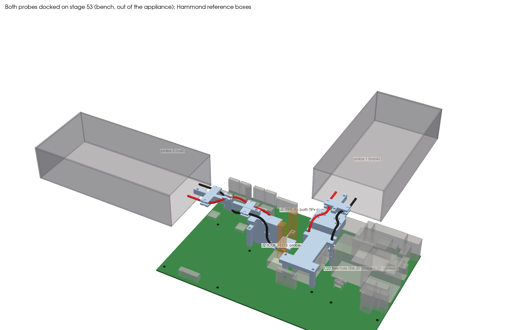
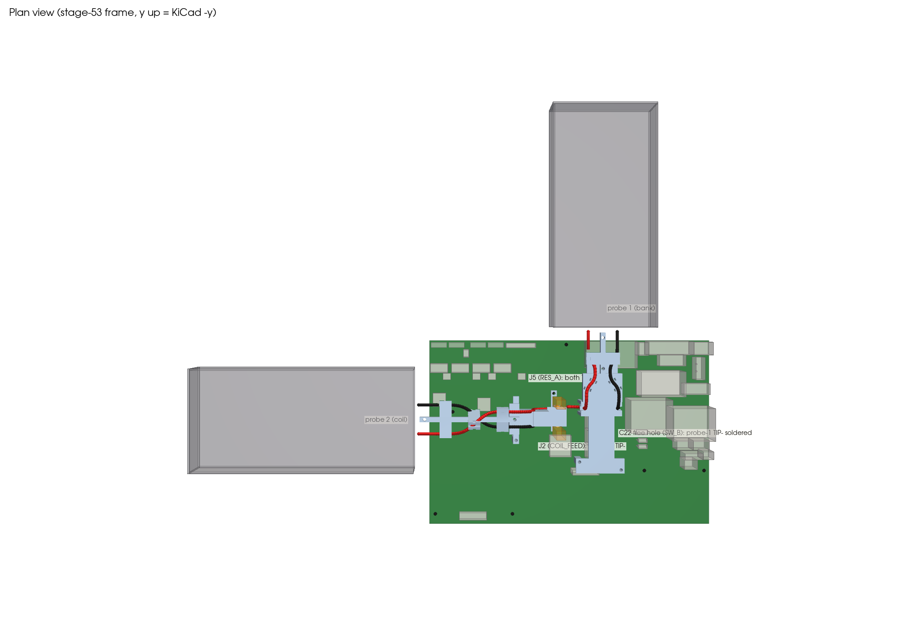
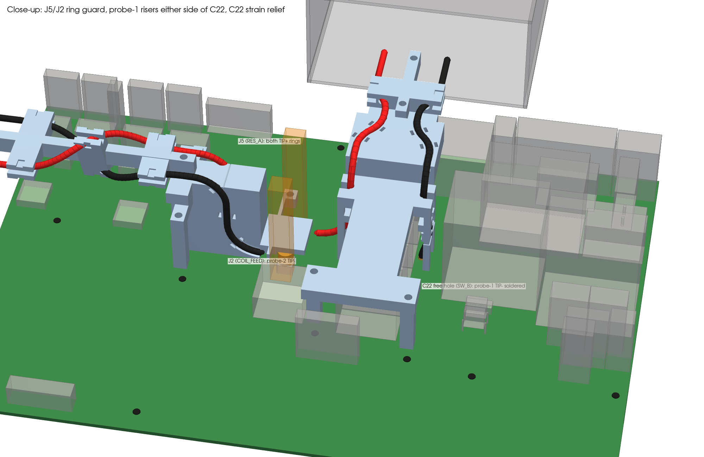

# Rev C HV input leads: option B, two dedicated probes

This page designs the captive HV leads from `W_HV1`/`W_HV2` to stage 53 under the owner's option-B decisions (2026-10-20). It is an engineering design for the prototype, not a voltage or CAT rating. Nothing here has been built or measured.

**Owner decisions.**

1. **Two dedicated probes**, each built for one measurement and docked permanently:
   - **Probe 1 (bank):** TIP+ insulated M4 ring on J5 (RES_A); TIP− soldered into C22's free plated hole (SW_B).
   - **Probe 2 (coil):** TIP+ ring on J5 (the two TIP+ rings stacked); TIP− ring on J2 (COIL_FEED).
   - No hook clips, 4 mm plugs or Stäubli adapter.
2. **The owner designs the enclosure.** The Hammond 1455N2201 stays the reference geometry in `tools/leads.rs`; [revc.md §9](revc.md#9-size-layers-enclosure) lists what any enclosure must provide.
3. **3D printing is used wherever it helps** (a friend's Formlabs printer). Every printed part is generated in CadQuery in [`mech3d/`](../mech3d/README.md).

Evidence, all regenerated by `make check` (budget, gates, cost) and `make mech3d` (parts and renders):

| What | File | Tool |
|---|---|---|
| Geometry, capacitance, inductance, resonance, pickup, setback, stud-stack and clearance gates | [`validation/leads/leads.txt`](../validation/leads/leads.txt) | [`tools/leads.rs`](../tools/leads.rs) |
| Every dimension the printed parts use | [`validation/leads/geometry.json`](../validation/leads/geometry.json) | `tools/leads.rs` |
| Stage-53 contacts and their nearest other-net copper | [`stage53-probe-points.txt`](../validation/leads/stage53-probe-points.txt) | [`tools/stage53_probe_points.py`](../tools/stage53_probe_points.py) |
| Stage-53 earthed copper (PE/SELV) and component bodies | [`stage53-earth.txt`](../validation/leads/stage53-earth.txt), [`stage53-bodies.txt`](../validation/leads/stage53-bodies.txt) | `stage53_probe_points.py --extract-earth`, [`mech3d/stage53_bodies.py`](../mech3d/stage53_bodies.py) |
| Plan and section of the lead entry | [`hv-leads-section.svg`](hv-leads-section.svg) | `tools/leads.rs` |
| Printed parts: STEP, STL, volume and resin | [`mech3d/out/`](../mech3d/out) | `mech3d/*.py` |
| Renders of every part and of both probes docked | [`mech3d/renders/`](../mech3d/renders) | [`mech3d/render.py`](../mech3d/render.py) |
| Lead, hardware and resin cost | [`validation/cost.txt`](../validation/cost.txt) | [`procurement/cost.py`](../procurement/cost.py) |

Stage-53 inputs are the board of record (`runs-native21/s53/c53int/section.kicad_pcb`, sha256 `82af7bd9…`), its STEP export and copper dump; the hashes are printed at the top of `leads.txt`. Stage-53 files are read only.

## Summary of decisions

| Item | Decision |
|---|---|
| Wire | Generic 20 AWG silicone wire sold as "10 kV" (AliExpress), OD 2.87–3.15 mm. **Unrated**: accepted per reel only after the incoming OD, conductor and 5 kV DC 60 s hipot checks ([qualification §7](qualification.md#7-leads-feedthroughs-and-tips)). Rated fallbacks: Rowe R800-1020-0-50 or Alpha 392040 (UL 3239, 10 kV DC). |
| Bench layout | Stage 53 probed out of the appliance, board top 50 mm above an insulating bench (treated as earthed), coil ≥ 300 mm from both spines. Each probe box stands on a riser so its gland axis is 50 mm above the board top (71.7 mm riser for the Hammond reference). |
| Probe 1 (bank) | Box north of stage 53, axis x = 174.25 (C22 body centre). Spine to y = 32, plan S-bend on dock-bank, risers at x = 158.0 (TIP+) and 190.5 (TIP−) in the plane y = 68.2, 3 mm outside each end of C22. TIP+ turns west to its ring on J5; TIP− jogs through a strain-relief clamp into C22's free hole. |
| Probe 2 (coil) | Box west of stage 53, axis y = 78. An 80 mm converging half twist swaps the legs, then the spine runs to x = 91 and both leads S-bend down on dock-coil in the planes y = 70.5 (J5) and 85.5 (J2) to their rings. The two legs are equal (170.3 mm insulated each). |
| External lead holders | Printed spine (rod plus snap saddles) and dock per probe. The docks screw to stage 53's nylon-only holes (H6/H7, H10/H8) on nylon standoffs. |
| Feedthrough | Printed tip-end wall insert (reference for the owner's enclosure) with two Essentra PG7 nylon glands; the internal printed lead bridge on H3/H4. |
| Shielding | Unshielded. |
| Per-tip loading | Estimates 11.71/11.72 pF (probe 1) and 11.80/11.93 pF (probe 2), against the 12 pF target. |
| Board change | None. |

## Parts, ratings and prices (2026-10-20)

Prices were read from public pages without logging in or using a cart. The ledger is [`procurement/prices-2026-10-20.csv`](../procurement/prices-2026-10-20.csv); quantities for two probes are in [`leads-bom.csv`](../procurement/leads-bom.csv) and [`printed-parts.csv`](../procurement/printed-parts.csv). Rows marked *estimate* are generic parts whose price was not read.

| Part | MPN | Rating and approval basis | Source, unit price | Two probes |
|---|---|---|---|---:|
| Lead wire | Generic 20 AWG silicone, sold as "10 kV" | **None**: no UL style, no published test voltage. Accepted on the incoming 5 kV DC 60 s hipot of a sample and of each cut lead, OD 2.87–3.15 mm, conductor bundle ≤ 1.05 mm. | AliExpress, *estimate* $15.00 per 5 m (listings need a login; not read) | 1 reel (0.97 m used) |
| Lead wire, rated fallback | Rowe R800-1020-0-50 | UL 3239, file E61355, 150 °C, 10 kV DC, VW-1 (distributor listing) | Sustainable Supply, $127.89 per 50 ft, listed sold out | if the generic wire fails |
| Lead wire, second fallback | Alpha Wire 392040 RD005 | UL AWM 3239, file E163869, 150 °C, 10 kV DC (Alpha specification); OD 2.97 ± 0.10 mm; bend radius 10 × OD | DigiKey 392040RD005-ND, $664.22 per 100 ft, 17 | — |
| Cable gland, PG7 | Essentra CG-PG7-1-BK | Nylon, clamps 2.00–5.00 mm, panel hole 12.7 mm, IP68, −20 to 100 °C. Not voltage-rated; the wire is the insulation. | DigiKey RPC3638-ND, $1.46, 7,314 | 4 |
| Gland locknut | Essentra CGLN-PG7-BK | Nylon, 19.00 mm wide, 5.00 mm thick | DigiKey RPC3640-ND, $0.48, 2,383 | 4 |
| M4 ring | TE 34108 | 22–16 AWG, #8 (M4), non-insulated; 14.58 × 7.14 mm, 0.79 mm thick. No voltage rating; sleeved with heat-shrink. | Mouser 571-34108, $0.38, 25,823 | 5 (3 used) |
| Heat-shrink, 3/16 in | Raychem RNF-100-3/16-BK-SP | UL E35586, 600 V, 125 °C; recovered wall 0.51 ± 0.08 mm | DigiKey, $3.55/m | 1 m |
| Stud screw | ISO 7045 M4 × 8 A2 pan head | Head 8 mm (stage-53 limit ≤ 8 mm) | *estimate* $0.10 | 4 (2 used) |
| Spacer washer | DIN 125 M4 A2 | 0.8 mm, 9 mm OD | *estimate* $0.05 | 4 (1 used) |
| Dock hardware | Nylon (PA66) M3: 4 × M-F 10 mm hex standoffs, 3 × M3 × 35, 4 × M3 × 16, 1 × M3 × 10, 8 nuts | Insulating; stage 53 marks H6–H10 "M3 NYLON ONLY" | *estimate* $8.00 the set | 1 |
| Cable ties | Generic nylon 2.5 × 100 mm | — | *estimate* $3.00 per 100 | 28 used |
| Jig contacts | M4 × 5 brass F-F hex standoffs; 2.4 mm brass turrets | Bench jig only | *estimate* $0.50 each | 4 + 2 |
| Trim blade | Vessel CA-18 (code 125672), zirconia | Ceramic: non-conductive tip | price not read | 1 |
| Trim tool, priced stand-in | Aven 13222 ceramic flat tuning tool | Ceramic | DigiKey 243-1013-ND, $14.79, 126 | 1 |
| Flame Retardant resin | Formlabs, 0.84 L | UL 94 V-0 at 3 mm (Formlabs). **No insulation credit.** | formlabs.com, $249 (Form 4; Form 3 $275) | 176 ml |
| Tough 2000 resin | Formlabs, 1 L | **No insulation credit.** | formlabs.com, $149 | 219 ml |

**Total for two probes: $142.43** (`validation/cost.txt`): bought parts $57.60, of which $29.60 are the *estimate* rows, plus $84.83 of resin (part volume × 1.3 for supports and raft, at the per-litre price). With the rated Rowe spool instead of the generic wire: $255.32. If the printer has no Flame Retardant resin, a whole cartridge is $249. The CA-18 blade is not in the total; the Aven tool stands in for it.

Printed parts (volumes from `mech3d/out/*.json`):

| Part | Resin | cm³ | Qty | Part | Resin | cm³ | Qty |
|---|---|---:|---:|---|---|---:|---:|
| wall-insert | FR | 16.11 | 2 | trim-guide-ct | Tough 2000 | 0.77 | 4 |
| lead-bridge | FR | 13.45 | 2 | trim-guide-rv | Tough 2000 | 0.97 | 4 |
| spine-coil | FR | 9.96 | 1 | trim-handle | Tough 2000 | 7.45 | 1 |
| spine-bank | FR | 3.80 | 1 | cal-cm-jig | Tough 2000 | 77.36 | 1 |
| dock-coil | FR | 23.43 | 1 | cal-dc-jig | Tough 2000 | 76.68 | 1 |
| dock-bank | FR | 39.16 | 1 | | | | |

## Lead wire

The owner chose a generic AliExpress 20 AWG silicone wire sold as "10 kV". It carries no UL style and no published test voltage, so **its acceptance is the incoming test, not the label**:

- **OD** 2.87–3.15 mm at both ends of each cut lead. Every OD-dependent gate in `leads.rs` is evaluated over this range.
- **Conductor bundle** ≤ 1.05 mm, so it passes the 1.2 mm C22 hole and the 1.6 mm W_HV holes. The capacitance bounds use 1.05 mm.
- **Hipot** 5 kV DC for 60 s, conductor to foil, on a sample from the reel and on every cut lead; leakage ≤ 1 µA. 5 kV is 1.67 × the 3 kV extension (`leads.txt` gate: ≥ 1.5 ×).

A reel that fails any check is rejected and the rated Rowe R800-1020-0-50 (or Alpha 392040) is bought instead. Both are UL 3239, 10 kV DC, 20 AWG 10/30, 2.97–3.05 mm OD, so every gate holds for them unchanged. One exception: Alpha specifies a bend radius of 10 × OD (30 mm), and the docks bend at 15 mm (4.8 × OD). With the Alpha wire, treat the 15 mm bends as a deviation from its specification and inspect them (see [open risks](#open-risks)).

**Insulation stress.** On earthed metal, the thinnest wall and largest conductor give 5.68 kV/mm at the conductor at 3 kV (`leads.txt`). The leads never lie on metal in this layout: the nearest earth to any external lead is 23.8 mm.

**Telling the leads apart.** All four leads come from one reel. TIP− carries a 15 mm black heat-shrink band at each end; the wall-insert legend is `TIP+` / `TIP−` at each gland. Seen from outside the box, **TIP− is on the right**. (The previous FR4 design note said the TIP+ gland was on the right seen from outside; that was wrong.)

## Geometry

Frames: stage-53 coordinates are KiCad x, y with z above the board top. `geometry.json` and the CadQuery parts use the right-handed version (Y = −KiCad y).

| | Probe 1 (bank) | Probe 2 (coil) |
|---|---|---|
| Box | North of stage 53, insert outer face 10 mm from the y = 0 edge | West of stage 53, insert outer face 10 mm from the x = 0 edge |
| Spine | Lead axis z = 50 mm, pitch 15 mm, from the 29 mm gland pitch by an S-bend; rod 41 mm, one saddle | 80 mm converging half twist (radius 14.5 → 7.5 mm), then straight; rod 100 mm, three saddles |
| Dock | dock-bank on H10/H8: plan S-bend in guide-plate grooves, turn down at x = 158.0 / 190.5 | dock-coil on H6/H7: S-bend down in face grooves at y = 70.5 / 85.5 |
| TIP+ | Turns west at z 7.5–22.5 to its ring barrel at (143, 68.2); ring on J5 under probe 2's | Ring barrel at x = 120.99, z 8.34 |
| TIP− | Jogs 3 mm east through the clamp (z 15–20), back into C22's hole | Ring barrel at x = 120.99, z 8.35, on J2 |
| Insulated length + bare metal | TIP+ 126.7 + 11.24 mm; TIP− 126.4 + 1.6 mm | 170.3 + 11.01 mm each |
| Smallest bend radius | 15.0 mm | 15.0 mm |

The two boxes are 143 mm apart and clear the stage-53 board volume and the heatsink keep-out by 12.8 mm; the two spines are 70 mm apart. Each lead clears every stage-53 body by ≥ 1.43 mm (probe 1 TIP+ to C22); the docks clear bodies and the coil-Litz keep-outs by ≥ 1.00 mm (dock-coil guard plate to the J5 Litz) and 1.20 mm (dock-bank north foot to R24).

**Internal route** (unchanged in length, printed bridge instead of FR4): 84.83 mm per lead from the gland to W_HV, mirror images about y = 35, axis 26.61 mm above the floor and 22.54 mm below the lid (≥ 20 mm), lead top 4.65 mm above the board at W_HV (≤ 5.5 mm). The bridge is 3 mm thick and its insert end rests on a ledge on the inside of the wall insert (it no longer passes a tab through a slot, because the insert centre now holds the spine socket).

## Capacitance budget

Per-tip loading is each tip's capacitance to earth. Earth here is stage-53 PE/SELV copper, J6, H1/H2, PS2 and the heatsink keep-out (both taken as earthed), both probe boxes and the bench plane 50 mm below the board. From `leads.txt`:

| Contribution | Probe 1 TIP+ / TIP− | Probe 2 TIP+ / TIP− | Basis |
|---|---:|---:|---|
| Ladder, 5 × 33 pF ± 5 % in series | 6.93 | 6.93 | Worst case |
| Board and enclosure reserve | 1.00 | 1.00 | Reserve, not modelled |
| Tip reserve | 0.50 | 0.50 | Reserve |
| Inside the box, 84.83 mm | 1.45 | 1.45 | Estimate |
| External lead (entry, spine, dock) | 1.83 / 1.85 | 1.93 / 2.05 | Estimate, resin modelled |
| **Total** | **11.71 / 11.72** | **11.80 / 11.93** | gated ≤ 12 pF |

The resin is modelled as a shell to 4 mm radius (εr 4) wrapping a share of each lead: dock grooves 0.5, spine saddles 0.75 over their 12 mm length (air between), riser clips 0.1. With every lead term at its bound (εr 5, lone conductor) the worst tip is 24.19 pF; the reserves remain estimates. Probe 2 TIP− has 0.07 pF in hand, so measure it first (qualification §4).

**Lead-to-lead capacitance** loads the DUT differentially and converts no common mode: probe 1 paired section bound 0.98 pF, dock sections bound 3.44 pF; probe 2 paired bound 3.80 pF, dock bound 2.44 pF. Across the 0.5 µF bank or the coil this is negligible.

## CMRR, resonance and pickup

Capacitance outside the divider only loads the source. The CMRR-relevant terms (`leads.txt`):

- **CM-to-DM conversion at 5 MHz** through the lead inductance, from the load mismatch (ladder ± 5 % twice, 0.5 pF tip asymmetry, the legs' computed difference) and the conductor-length difference: **probe 1 68 dB** (its legs differ by 9.9 mm of conductor because TIP+ ends in a ring 11.24 mm from J5 and TIP− in a 1.6 mm hole), **probe 2 70 dB**. Gated ≥ 60 dB.
- **Asymmetric resin.** Every printed part near the leads is mirror-symmetric about the lead axis, except the dock posts and the TIP− clamp. The largest, the clamp, shifts one leg by 0.021 pF (estimate, gated ≤ 0.1 pF inside the 0.5 pF reserve). The parts are fixed, so static strays are calibrated out; what matters is that they do not move.
- **Fixed geometry.** The lead route is set by the spine and dock, so re-docking reproduces it. Qualification measures the re-dock repeatability.

| Resonance | Probe 1 | Probe 2 |
|---|---:|---:|
| Differential (all C lumped at the probe end) | 86.4 MHz (0.405 µH, 8.38 pF) | 76.0 MHz (0.430 µH, 10.20 pF) |
| Undamped rise at 5 MHz | 0.34 % | 0.44 % |
| Common mode (earth return 100 mm away) | 80.0 MHz | 72.2 MHz |

All are gated at ≥ 10 × the 5 MHz bandwidth.

**Magnetic pickup** from stage-53 currents (28 A peak at 35 kHz, each loop part in the field of one conductor at its nearest approach): probe 1 0.179 V peak, probe 2 0.107 V peak, gated ≤ 0.2 V (0.02 % of 1 kV). Probe 1's dock loop (the 32.5 mm riser spacing round C22) dominates. For probe 2 the coil Litz rising beside the studs adds about 0.028 V by an exact flux calculation. The coil itself is assumed ≥ 300 mm away.

## Stage-53 attachment

[`stage53-probe-points.txt`](../validation/leads/stage53-probe-points.txt):

| Contact | Net | Nearest other-net copper (edge of the tip envelope) |
|---|---|---|
| J5, Würth 7466004R M4 stud at (132.0, 70.5) | RES_A | 5.11 mm (COIL_FEED/SW_A pour) |
| J2, Würth 7466004R M4 stud at (132.0, 85.5) | COIL_FEED | 2.50 mm (SW_A pour, the same node through T1's primary) |
| C22 free P27.5 hole at (190.5, 68.2), Ø1.2 mm plated | SW_B | 10.61 mm (HV_RET pour) |

**Polarity.** RES_A is always on TIP+. Probe 1 reads V(RES_A) − V(SW_B), the bank voltage. Probe 2 reads V(RES_A) − V(COIL_FEED), the negative of the coil voltage as stage 53 defines it; invert in the scope.

### J5 and J2 stud stacks

Stage 53 requires insulated M4 rings on J2/J5: bare ring ≤ 10.0 mm wide, DIN 125 washer, pan head ≤ 8 mm, exposed metal ≥ 5.0 mm apart at any rotation. The probe rings follow the same rule: TE 34108 (7.14 mm wide) with two layers of RNF-100 over the barrel and neck, overlapping the wire by 10 mm.

| Stud | Stack, from the stud face up | Stack height | Screw | Engagement (min 3.5, tip ≤ 6.5 mm below the body top) |
|---|---|---:|---|---:|
| J5 | coil lug, probe-1 ring, probe-2 ring, DIN 125 washer | 2.68–3.78 mm | ISO 7045 M4 × 8 | 3.93–5.61 mm |
| J2 | coil lug, DIN 125 spacer (stands in for the missing second ring), probe-2 ring, DIN 125 washer | 2.64–3.84 mm | ISO 7045 M4 × 8 | 3.87–5.65 mm |

**Verdict: both stacks take an M4 × 8 pan head at every tolerance corner** with flat washers. The minimum engagement holds about 4.0 kN in thread shear against about 1.5 kN of preload at the stud's 1.2 N·m limit (2.7 ×). **A DIN 127 split washer does not fit**: with it no single screw length works at every corner. If stage 53's locking method is a split washer, measure the actual stack and choose the length per stud; otherwise use flat washers and stage 53's own thread-locking method. If probe 1 is not fitted, put a DIN 125 spacer on J5 in place of its ring, so probe 2's ring stays at the height the dock is built for. The exposed-metal gap between J5 and J2 is 6.0 mm at any rotation (≥ 5.0 mm). The barrel heights differ by 0.01 mm between J5 and J2.

Torque both to 1.2 N·m. The dock-coil guard plate covers both screw heads, so neither screw can be reached or knocked with the dock fitted, and its sleeve channels stop either ring turning toward the other stud or the coil Litz.

### C22 solder joint (probe 1 TIP−)

The fitted TDK B32643H8104J000 uses the 22.5 mm pitch; the 27.5 mm hole at (190.5, 68.2) is plated, on SW_B and open. TIP− is stripped 4 mm, tinned and soldered into it from the top, with the insulation ending ≤ 1 mm above the pad and the tail ≤ 1 mm below the board. The joint carries **no tension**: the dock-bank TIP− clamp grips the lead 15 mm above the board and the 15 mm S-jog below it is slack. If the KNSCHA 27.5 mm fallback capacitor is fitted, the free hole is the 22.5 mm one, under the body, and probe 1 cannot be fitted.

### Stage-53 modification note (for the power-stage owner)

Probing with option B changes the probe-test stage-53 boards as follows. No stage-53 file has been edited; these are assembly changes, reversible by desoldering and refitting the original screws.

1. **C22's free P27.5 hole** carries probe 1's TIP− solder joint.
2. **J5** carries two probe rings above the coil lug, under a DIN 125 washer and an ISO 7045 M4 × 8 pan head (or a DIN 125 spacer in place of probe 1's ring).
3. **J2** carries a DIN 125 spacer and probe 2's ring above the coil lug, under a DIN 125 washer and an M4 × 8.
4. **H6, H7, H8 and H10** ("M3 NYLON ONLY") each take a nylon M3 M-F 10 mm standoff for the docks. This assumes the board is on the bench, out of the appliance, and that those holes are free there. H7 is 12.5 mm from the J5 stack, so its hardware must stay nylon.
5. The dock-bank north foot rests on the board top at (174.25, 35), 1.20 mm from R24. The fork legs rest on the board at x = 155 and 193.5, either side of y = 68.2.

Recommendation for the next stage-53 revision: a third M4 stud on SW_B near C21/C22, mirroring J5, so that probe 1 can be screwed on like probe 2 and calibrated off the board.

## Printed parts

**No insulation credit.** Formlabs publishes no dielectric strength or tracking index for Flame Retardant or Tough 2000, so the rated (or hipot-accepted) wire insulation and air distances are the HV design. The printed parts fix geometry only. Setbacks are air distances to metal: the J5 stack is 39.0 mm from earthed copper, J2 24.0 mm, the C22 joint 30.0 mm (≥ 20 mm).

**Resin choice.** Flame Retardant (UL 94 V-0 at 3 mm) for everything that stays on stage 53 or in the probe box. Tough 2000 for the trimmer tools and the bench jigs.

| Part | What it does |
|---|---|
| Wall insert | Replaces the tip-end panel of the reference enclosure: two PG7 gland bosses, the spine socket boss outside (8 mm wide, between the gland domes), the ledge for the bridge inside, debossed legends. The owner merges it into his enclosure. |
| Lead bridge | Carries both internal leads in 1.5 mm grooves, three ties each, clamped by the H3/H4 nylon screws through its 3 mm thickness. |
| Spines | A 5 × 8 mm rod between the leads, socketed in the insert (nylon M3 × 16 pin) and screwed to the dock seat (M3 × 16, nut trapped), with 12 mm snap saddles whose mouths are narrower than the thinnest wire. Two ties per saddle close the mouths. The rod clears the leads by 1.21 mm at the tightest twist radius. |
| dock-coil | Cradle block between the lead planes with half-depth grooves for both S-bends (wider for the last 10 mm, where the ring heat-shrink runs), three ties through the block (each holds both leads), ring-sleeve channels in the guard web, the guard plate over both studs, posts on H6/H7 with mirror stubs. |
| dock-bank | Posts on H10/H8, cross member, arm 3.5 mm over the bank caps, north foot, guide plate with grooves along both plan S-bends (two ties per lead through plate and arm), riser bridge with outward slots, fork legs with riser snap clips, the TIP− clamp (a grip channel and one tie round the east legs). |
| Trimmer guides | Snap-in lid sleeves over CT1/CT2 and RV1/RV2 that stop 2 mm above each trimmer. The RV sleeve carries a 5.03 mm collar so the shoulder-to-trimmer depth is 24.19 mm for all four. |
| Trim handle | Holds a Vessel CA-18 zirconia blade 10 mm out of a 4 mm nose. Only the ceramic blade enters the box. The handle is not an insulation barrier: trim on the calibration jig or with stage 53 de-energised. |
| Calibration jigs | A replica of stage 53's attachment region (dock holes, J5/J2 contacts on M4 brass standoffs, a turret at the C22 hole). CM jig: all contacts bused. DC jig: J5 = HI, J2 + C22 = LO. |

## Feedthroughs and strain relief

**Feedthrough.** Each lead passes its own nylon PG7 gland in the printed wall insert. The nearest metal at the tip end is the reference enclosure's lid and floor; the lead conductor is 22.54 mm from the lid, and the insert screws are 30.65 mm from the gland holes. The gland thread spans the 2.5 mm seat and the 5 mm locknut with 0.5 mm spare; the locknuts clear each other by 7.0 mm and the lid by 11.5 mm. The tip-end shield is open (the insert is resin), as it was with FR4: qualification records the shield edge current and CMRR with the real assembly.

**Pull path, outside.** A pull on a lead is taken by the dock grooves and ties, then the spine saddles, then the gland. The spine rod ties the box to the dock, so the box cannot be pulled away without the rod.

**At the tips.** The rings are clamped under the stud screws. The ring sleeves sit in the dock channels and cannot rotate. Probe 1's TIP− is gripped by the clamp, and the joint below it is slack.

**Inside the box.** The bridge ties hold the lead before W_HV, so no tension reaches the joints even if a gland slips.

## Assembly, docking and soldering

Home bench, through-hole work only. Stage 53 is de-energised, unplugged and its bank verified discharged before any step on it.

1. **Incoming checks** on the reel: OD, conductor bundle, sample hipot ([qualification §7](qualification.md#7-leads-feedthroughs-and-tips)).
2. **Cut.** Lengths are the insulated length plus 84.8 mm inside plus the termination allowance: probe 1 TIP+ 222 mm, TIP− 217 mm; probe 2 both 265 mm. Cut each probe's pair together, ± 1 mm. Hipot every cut lead. Band each TIP−.
3. **Print** the parts flat-side or edge-on as recorded in each `out/*.json`, wash, post-cure, and check the snap mouths, grooves and sleeve channels with an offcut of the wire and a sleeved ring.
4. **Box.** Fit the glands to the wall insert, locknuts inside, legend outward, TIP− on the right seen from outside. Thread the leads, fit the lead bridge on H3/H4 with nylon screws, lay the leads in its grooves with loose ties, solder W_HV1 (TIP+) and W_HV2 (TIP−) from the top. Clean, tie, close the insert onto the enclosure, tighten the dome nuts.
5. **Terminate the rings** (TIP+ of both probes, TIP− of probe 2): crimp or solder the TE 34108, then two layers of RNF-100 over the barrel and neck, overlapping the wire by 10 mm. Check the bare ring is ≤ 10 mm wide.
6. **Probe 2 (coil).** Fit nylon standoffs in H6 and H7. Stack J5 and J2 as tabled above (probe 1's ring or a spacer first on J5), point each barrel west, torque to 1.2 N·m. Lower dock-coil so the sleeves enter the guard-web channels and the leads lie in the face grooves. Fix it with M3 × 35 nylon into H6 and M3 × 10 into H7. Fit the three ties through the block.
7. **Probe 1 (bank).** Calibrate first on the jigs (below). Fit nylon standoffs in H10 and H8. Off the board, lay the leads in the guide plate, the riser slots and the riser clips (they snap in), and the TIP− clamp channel; fit the plate ties and the clamp tie. Lower dock-bank onto the posts (M3 × 35 nylon) with TIP− entering C22's hole. Fit the TIP+ ring on J5 with the J5 stack. Solder TIP− (C22 joint above).
8. **Spines.** Stand each box on its riser, insert outer face 10 mm from the board edge. Snap the leads into the saddles, put the rod into the insert socket (M3 × 16 nylon pin) and onto the dock seat (M3 × 16, nut trapped), and tie the saddles.
9. **Check.** No lead within 1 mm of a stage-53 body. Nothing metal at H6–H10. Photograph both probes docked; that photograph is the calibrated configuration.

Undocking is the reverse. Probe 1's TIP− is desoldered only to remove probe 1 for good.

## Calibration

The docked geometry is the calibrated one.

- **Probe 2.** Unscrew its rings and dock it on the calibration jigs exactly as on stage 53: same standoffs, same spine, same box position. Trim CMRR on the CM jig and the DC ratio on the DC jig, then re-dock on stage 53.
- **Probe 1.** Its TIP− is soldered, so it is calibrated on the jigs **before** the C22 joint is made, with TIP− soldered to the jig turret. Then it is moved to stage 53 with the same lead length (the joint moves from the turret to the hole; nothing is cut).
- **In-place CM check, both probes.** With stage 53 unpowered, unplugged and floating (no mains, no earth connection, bank discharged), drive the whole stage-53 board from a CM source against earth, connected at J5. At the test frequencies the bank (0.5 µF, 5.3 Ω at 60 kHz) holds RES_A and SW_B together. Against probe 1's ~222 kΩ tip loading that leaves about 2 × 10⁻⁵ of the drive as a differential residue (about −92 dB), so the reading is a CMRR check on the docked probe. Through the coil this does not hold at MHz, so use it for probe 2 only below 100 kHz.

## Failure modes

**Loose stud screw.** A ring that loses its screw stays captured: the guard plate sits 1.2 mm above the screw head and the sleeve channels stop the ring turning. De-energise before touching it.

**TIP− joint.** The clamp takes any pull. If the clamp tie fails, the S-jog and the riser clip still hold the lead. Inspect the joint after any snag.

**Lead touching metal.** The insulation holds by rating (fallback wire) or by hipot (generic wire), but the tip loading rises toward its bound and the air wedge where the insulation meets the metal sees a high field. Keep both leads ≥ 20 mm from metal. The docked layout gives 23.8 mm minimum.

**Printed part cracking.** It changes geometry, not insulation, since no resin is credited. A cracked part moves a lead, which invalidates the calibration but is not a shock path. Replace it and recalibrate. The fork legs of dock-bank are 3 × 3 mm and the weakest part; handle the dock by its arm.

**Over-voltage.** The wire, glands and parts are not the limit; the ladder is (±3 kV envelope). The warning latch is the indicator.

## Removed with option B

The FR4 tip plate and lead bridge (KiCad sources in `mech/`, their Gerber zips, DXFs and `procurement/export-mech.sh`), the Cal Test plug and hook clip, the test pin in C22's hole, and the Stäubli fork adapter are gone. Git history keeps them: see the parent of `c1f86d3ec`.

## Open risks

1. **Per-tip margin is thin**: probe 2 TIP− 11.93 pF against 12 pF. The 1.0 pF board/enclosure and 0.5 pF tip reserves are guesses, and the resin εr (4, bound 5) is unpublished. Measure per-tip C with the dock fitted.
2. **Unrated wire.** The generic silicone wire has no UL style; its basis is the incoming hipot and OD check only. The Rowe/Alpha fallbacks are rated.
3. **Bend radius.** 15 mm (4.8 × OD) is below Alpha's 10 × OD for the second fallback wire. The generic wire's own figure is unknown.
4. **Bench assumptions.** PS2 and the heatsink keep-out are treated as earthed; the coil and its Litz positions (≥ 300 mm away, Litz 8 mm outboard of each stud) are assumed. Pickup and C change if they are not.
5. **Gland envelope.** The PG7 gland and dome outside the insert (Ø20 × 20 mm) is an estimate. Fit-check it before printing the spines.
6. **Fits not yet tried.** The ring heat-shrink sleeve (5.66 mm) and barrel height are estimated. The CA-18 blade in the GKG60015 and 3296W slots is not verified, and the RV screw position comes from a sample. Print one dock and one guide first and check them.
7. **Probe 1 lead residual.** The legs differ by 9.9 mm of conductor; CM-to-DM conversion at 5 MHz is 68 dB, 8 dB inside the gate.
8. **TIP+ of probe 1** passes 1.43 mm from C22's body. That is fixed by the dock, but check it on the first fit.
9. **Split lock washers** do not fit with a single screw length (see the stud stacks above).
10. **Probe 1 calibration** relies on a pre-solder jig calibration plus the in-place CM check. No off-board recalibration is possible without desoldering.
