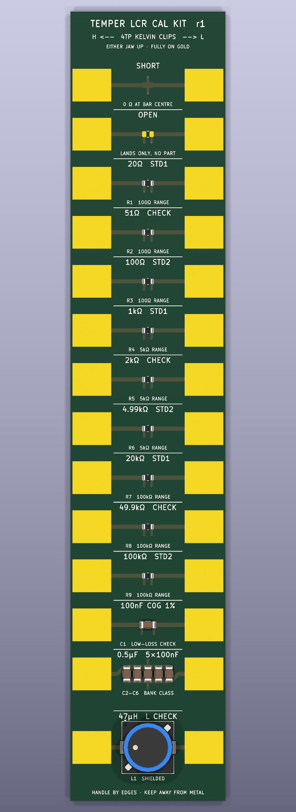

# Temper LCR cal kit r1: calibration and check-standard card

This is a 38 × 193 mm, 2-layer ENIG card carrying the standards the host's calibration model uses. It has a short and two resistors per range, an independent check resistor per range, an open, and low-loss reactive check standards. Each standard sits on one row with Kelvin tabs at both card edges, made for 4-terminal-pair Kelvin clip leads. The board is generated by `build_calkit.py`. **Every track is a hand-written coordinate list. No autorouter is used.** Status: designed and DRC-clean. **Not ordered.**

## What is on the card

| Row | Ref | Nominal | Part (LCSC) | Role |
|---|---|---|---|---|
| 1 | — | SHORT | copper bar | `calibrate` SHORT, all ranges |
| 2 | R10 (DNP) | OPEN | 0805 lands, no part, no paste | overload/leakage diagnostic (not a host standard) |
| 3 | R1 | 20 Ω | YAGEO RT0805BRB0720RL (C723660), ±0.1 % ±10 ppm/°C | 100 Ω range LOAD1 |
| 4 | R2 | 51 Ω | RESI PTFR0805Q51R0N9 (C52677567), ±0.02 % ±10 ppm/°C | 100 Ω range `validate` check |
| 5 | R3 | 100 Ω | RESI PTFR0805Q100RN9 (C7603205), ±0.02 % ±10 ppm/°C | 100 Ω range LOAD2 |
| 6 | R4 | 1 kΩ | RESI PTFR0805Q1K00N9 (C7603207) | 5 kΩ range LOAD1 |
| 7 | R5 | 2 kΩ | RESI PTFR0805Q2K00N9 (C7603208) | 5 kΩ range check |
| 8 | R6 | 4.99 kΩ | RESI PTFR0805Q4K99N9 (C7603209) | 5 kΩ range LOAD2 |
| 9 | R7 | 20 kΩ | RESI PTFR0805Q20K0N9 (C7603210) | 100 kΩ range LOAD1 |
| 10 | R8 | 49.9 kΩ | RESI PTFR0805Q49K9N9 (C47116076) | 100 kΩ range check |
| 11 | R9 | 100 kΩ | RESI PTFR0805Q100KN9 (C23067433) | 100 kΩ range LOAD2 |
| 12 | C1 | 100 nF | Murata GCM31C5C1H104FA16L (C1864297), C0G ±1 % 50 V 1206 | one resonant capacitor; tan δ ≈ 0 phase check |
| 13 | C2–C6 | 0.5 µF | 5 × the same Murata C0G part | Temper's five-capacitor bank class |
| 14 | L1 | 47 µH | TDK SLF12575T-470M2R7-PF (C81468), shielded ferrite, 63 mΩ DCR | coil-class L/Q transfer check |

All RESI parts are ±0.02 % ±10 ppm/°C thin-film 0805. Each row's front silk gives the nominal value and role. The back carries a write-in field (`R3 = ______ @ __ °C`) for the characterized value. The header back has S/N, DMM, date and operator fields.

**Matching the host.** `temper-lcr calibrate` takes a short and two real resistors per range, and `validate` takes one more real resistor (`host/src/lib.rs` `calibration_coefficients`, `host/src/rev_e.rs` `calibrate_e`). `docs/bring-up.md` and `host/README.md` name 20 Ω and 100 Ω for the 100 Ω range plus an independent ~47 Ω check. That range is the one Temper's coil and capacitors use. This card uses 51 Ω, the nearest value in stock in the same 0.02 % family. The 5 kΩ and 100 kΩ ranges use the same 1 : 5 spacing with a check standard in between. The host accepts only command-line ohms, real-valued, with no short residual. [CHARACTERIZE.md](CHARACTERIZE.md) §1 lists exactly what it does and does not take.

**Choosing the parts.** Searched JLC's parts API (2026-10-21) for in-stock thin film at ≤ 15 ppm/°C. The only in-stock 20 Ω at ≤ 10 ppm/°C was Yageo RT 0.1 %. The DMM characterization sets the value, so tolerance does not matter; TCR and stability do. The best stocked families were RESI PTFR…Q (0.02 %, 10 ppm/°C), Stackpole RNCF (0.01 %, 5 ppm/°C, but only 100 Ω / 24.9 Ω / 2 kΩ / 4.99 kΩ in stock), and Vishay TNPU (5 ppm/°C, tens in stock, $3–5 each). PTFR covers every other value from one family. The largest C0G in stock was 100 nF, and the ±1 % Murata GCM part is the only 1 % one. No SMD film capacitor was a better choice: C0G loss is lower than PPS or PP film.

## Design

**Kelvin tabs, the reference plane, and lead dress.** Each tab is a 9.5 × 8 mm gold land on *both* faces of the card edge. The top land (F.Cu) and bottom land (B.Cu) are separate copper. The top path runs as a 1.0 mm F.Cu track to the component land. The bottom path runs as a 1.0 mm B.Cu track directly underneath, then jogs 45° to a via 2 mm (0805), 2.2 mm (1206) or 3 mm (L1) off the land, then a short F.Cu stub into the land.

A Kelvin clip's two insulated jaws therefore land on two paths that meet only at the component land. Clip contact resistance, tab and trace copper all sit outside the 4-wire measurement, which removes the virtual-instrument README's per-insertion contact term (§2 item 2). Either jaw may be force or sense. Every row has the same tab spacing (27.5 mm centre to centre) and the same trace path, so lead dress is identical across rows and the short's residual inductance matches the loads'.

`check_kelvin.py` checks this on KiCad's own copper polygons. With each reference-plane item removed, the four lands of every standard must be four separate copper islands. DRC cannot see this, because each side is one net. A mutation test (an extra 0.4 mm track joining a top path to its via outside the land) makes R3 FAIL, so the check is live.

**SHORT.** The SHORT row uses the same tabs and the same top-path tracks into a 1.4 mm bar one 0805 land pitch long. The two bottom paths enter the bar at its centre from opposite sides, at the same x. Current flows along the bar, so both sense points lie on one equipotential and the short reads 0 Ω, as the host assumes. A short with sense at the land ends would read about 0.6 mΩ of bar.

**OPEN.** The OPEN row has the same lands as the resistors (an 0805 footprint with the paste aperture removed, DNP), so its stray capacitance matches theirs.

**Bank (C2–C6).** Five 1206 C0G parts sit side by side between two 1.6 mm rails. The feed is anti-parallel: H enters the top rail at its left end and L leaves the bottom rail at its right end, so every capacitor sees the same rail length. Sense points are at the rail centres. For rail segments of about 0.8 mΩ, the sense voltage is the bank's minus 0.4 × R_seg ≈ −0.3 mΩ (nodal calculation, equal capacitors). At 50 kHz that is −5×10⁻⁵ in tan δ, below the 3×10⁻⁴ resolution.

**L1.** A PCB air-core spiral would make a computable inductor, but in the card's area 30–80 µH comes with Q ≈ 1–3: 37 turns of 0.2 mm 1 oz copper in 40 mm gives ~38 µH and ~9 Ω. That is far from the coil's Q (11.8 Ω/0.1–0.2 Ω ≈ 60–100 at 40 kHz). Its field would also couple into the leads and to any nearby metal.

A closed-path shielded ferrite drum (ferrite drum plus sleeve) keeps its field inside. Its Q is coil-like: 63 mΩ DCR against 11.8 Ω at 40 kHz gives Q_DC ≈ 190, and an ESTIMATE of ≈ 100 with winding proximity loss. It is therefore a **transfer standard**: L ±20 %, R(f) ≥ DCR. It gets its true value only from one measurement on a reference LCR meter, then tracks drift. It sits on the last row, 15 mm from the bank, with extra space around it.

**Thermal.** Rows are 12 mm apart, with no heat source on the card; self-heating is ≤ 0.1 mW. Every land pair is symmetric about the component column. Characterize and use at a recorded card temperature ([CHARACTERIZE.md](CHARACTERIZE.md) §5).

**9 µF bus capacitor at 1 kHz.** C0G cannot reach this; it would take about 90 of the 100 nF parts. Check it with a characterized film capacitor clipped directly.

## Files

| Path | What |
|---|---|
| `build_calkit.py` | Generator (KiCad Python): footprints, hand-specified tracks, silk, outline, project rules |
| `check_kelvin.py` | Kelvin topology audit on native copper geometry |
| `package_calkit.py` | JLC BOM/CPL, cross-checked against `kicad-cli pcb export pos` |
| `fetch_jlc_parts.py` | JLC parts-API snapshot → `manufacturing/jlc-parts-<date>.json` |
| `order_estimate.py` | Order estimate → `manufacturing/order-estimate-5.json` |
| `rebuild.sh` | Whole pipeline: generate → DRC → Kelvin audit → Gerbers/drill → BOM/CPL → estimate → renders. Set `CALKIT_FETCH_PARTS=1` to refresh prices |
| `calkit.kicad_pcb`, `calkit.kicad_pro`, `CalKit.pretty/`, `fp-lib-table` | Native board, rules, vendored KiCad 10 footprints plus `KelvinTab_9.5x8` and the paste-free OPEN land |
| `manufacturing/gerbers/`, `calkit-gerbers.zip` | Gerbers (F/B Cu, mask, silk, F.Paste, Edge.Cuts) and Excellon drill. The zip is gitignored (`*.zip`); `rebuild.sh` remakes it |
| `manufacturing/bom-jlcpcb.csv`, `cpl-jlcpcb.csv`, `bom-complete.csv` | JLC assembly files (same columns as `../manufacturing/`) |
| `manufacturing/drc.json`, `drc.rpt`, `kelvin-audit.json`, `drill-report.txt` | Verification records |
| `previews/render-top.png`, `render-bottom.png`, `front.svg` | Inspection previews |
| `CHARACTERIZE.md` | DMM characterization procedure, uncertainty, and how the host consumes values |

## Verification (2026-10-21, KiCad 10.0.4)

- `kicad-cli pcb drc --severity-all --all-track-errors`: **0 violations, 0 unconnected, 0 footprint errors**. Rules: 0.2 mm clearance and track width, 0.3/0.6 mm vias, 0.4 mm copper to edge.
- Kelvin audit: **14/14 standards PASS**.
- Native position parity (generator against `kicad-cli` pos export): PASS. There are 16 placements, all top side, and 28 vias (0.3 mm drill).

## Fabrication and assembly

- 2 layers, FR-4 1.6 mm, 1 oz, **ENIG** (required: the tabs are the contact surface), green mask, white silk, tented vias. The outline is a plain rectangle with no slots.
- ENIG area: the tabs are 29 % of each face, about at JLC's 30 % threshold for an area fee, worth under $1 for 5 cards if charged. Hard gold would wear better under repeated clipping; it is optional.
- JLC Economic PCBA, top side only. C2–C6 are at 90°. All parts are 2-terminal and non-polar, but check L1 and C2–C6 in JLC's placement preview.
- Drill/place origin is the lower-left outline corner, with Y up.

**5-card estimate (`order_estimate.py`):**

| Item | USD |
|---|---|
| PCB fabrication (JLC instant quote, 2026-10-21, 38 × 193 mm, qty 5, ENIG 1 µ", 3 days): engineering $4.00 + ENIG $17.40 + board $3.60 | 25.00 |
| Parts (11 lines, all JLC *extended*; prices from the 2026-10-21 snapshot) | 44.46 |
| Economic setup + stencil | 9.71 |
| Extended-part fee, 11 × $3.07 | 33.77 |
| Joints (32/card) + placement confirmation | 0.71 |
| **Total** | **113.64 (≈ $22.73 per card)** |

Shipping, tax and duty are excluded. The uploaded BOM quote is authoritative. Leaving out the 5 kΩ and 100 kΩ rows (R4–R9) at upload saves 6 lines (about $18 in fees plus $18 in parts); their lands remain on the card.

**Kelvin clip leads (not on the card).** These are 4-BNC Kelvin clip sets for the meter's 4TP front end.

- Tonghui TH26011AS: about US $72 on an eBay listing from a Shenzhen seller, the only listing naming that model ([ebay.de/itm/286529773017](https://www.ebay.de/itm/286529773017)).
- Generic 4-BNC Kelvin clip sets: US $13–35 ([ebay.de/itm/144535591408](https://www.ebay.de/itm/144535591408), [ebay.de/itm/166829867544](https://www.ebay.de/itm/166829867544)).
- B&K Precision TL889A: $169 at DigiKey ([electronicspecifier.com](https://electronicspecifier.com/product-centre/distributors/digi-key/part/599f3ae103aac6a1cdb9b5dc)).
- Keysight 16089B: about $1,491–1,707 ([TestEquity](https://testequity.com/product/12700-4-16089B), [Transcat](https://www.transcat.com/keysight-16089b), [Valuetronics](https://valuetronics.com/products/16089b-keysight-accessory-new)).
- No price was found for the Sourcetronic ST26011C. Its sibling, the ST26004S-1, was listed at €51.57 ex VAT and is retired ([eleshop.eu](https://eleshop.eu/sourcetronic-st26004s-1-kelvin-test-leads.html)).

These sets end in four loose BNC plugs, so the 22 mm jack pitch does not constrain them. Their jaw width was not found; the tabs assume a jaw no wider than 8 mm.

## Open questions

1. **Kelvin jaw size.** The tabs are 8 mm along the edge, with 4 mm of bare FR-4 between rows. Confirm on the chosen leads that one jaw cannot touch two tabs. Touching a neighbour's tab on the same side is harmless, since that standard's other end floats, but it adds a little capacitance.
2. **C0G expected tan δ.** Read Murata SimSurfing for GCM31C5C1H104FA16L ESR at 35–60 kHz to turn the C1/bank check from a bound (≤ 1×10⁻³) into an expected value.
3. **L1's reference value.** It needs one measurement on a borrowed reference LCR meter, or L1 stays a stability check only (L within ±20 %, R ≥ DCR).
4. **RESI PTFR long-term stability.** The datasheet was not retrievable (the LCSC link returns HTML). The 6-month recharacterization interval in CHARACTERIZE.md is an ESTIMATE.
5. **A host input for characterized values.** Today they are retyped on the command line, and the 100 kΩ standards' phase is ignored. A standards file (value, uncertainty, temperature, optional series L / shunt C) read by `calibrate`/`validate` would remove transcription errors. That is a host change, not done here.
