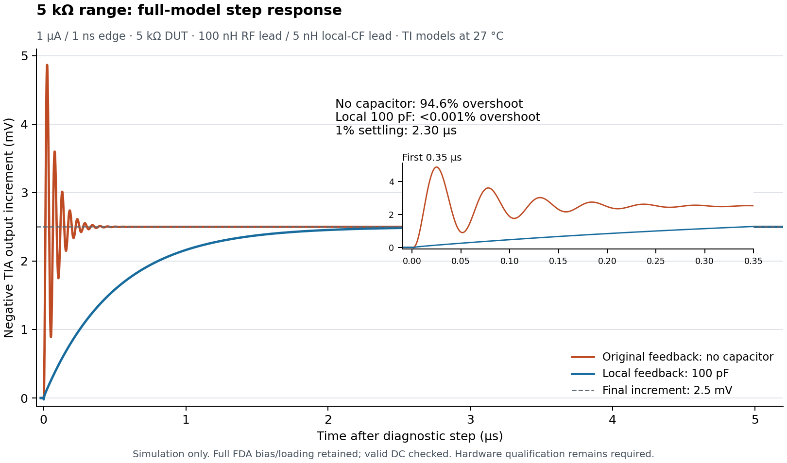

# Rev C full-chain stability and acquisition evidence

The coupled manufacturer-model convergence problem is resolved without removing the FDA's real DC bias or its load on the TI analog core. The investigation found two circuit concerns: inadequate TIA compensation and insufficient ADC-driver loop margin. Revision C corrects both. Revision B is superseded and must not be ordered from its old files.

This is an engineering prototype supported by simulation, not a physically qualified instrument. Acceptance requires a true, finite unsaturated operating point; at least 45° at relevant descending unity crossings, with approximately 60° preferred nominally; no sustained or growing response in the tested disturbances; and bounded ADC charge recovery at 1 MSPS. Multiple crossings are retained rather than reduced to an arbitrary first-crossing margin. These criteria apply only to the stated models and test envelope.

## Final circuit and useful bandwidth

The TIDA-060029 source resistor, matched 100 Ω / 5 kΩ / 100 kΩ feedback resistors, voltage followers and TIA architecture remain. One **100 pF C0G ±5% capacitor, C104, connects directly between U7's TIA output and inverting-input nets on all three ranges**. The selected RF resistor has its own jumper path. Remote C41 and C105 are removed. This is an explicit compensation change from the TI reference.

Putting the capacitor beside U7 separates its high-frequency feedback path from the jumper inductance. The local copper path is approximately 4.45 mm, entirely on the front layer with no vias. Its total inductance is not extracted or measured; the simulation includes 5 nH and a separate 10 nH sensitivity check. The resistor/jumper branch is tested with 100 nH. The previous shared RF/CF jumper arrangement failed the 45° criterion at 50 nH, so the final design does not depend on an unsupported 20 nH jumper bound. [Geometry receipt](../validation/feedback-routing/README.md) documents the physical route.

At measurement frequencies, the host uses `Zf = RF / (1 + jωRF·100pF)`. Calibration is tied to this model and rejects previous per-range-capacitor identities. The bandwidth tradeoff is deliberate:

| Range | Feedback pole | Feedback magnitude at 100 kHz | Use |
|---|---:|---:|---|
| 100 Ω | 15.92 MHz | 100.0 Ω | Stage53 coil and capacitor-bank tests; little measurement-band attenuation |
| 5 kΩ | 318.3 kHz | 4.77 kΩ | General components; modest attenuation at 100 kHz |
| 100 kΩ | 15.92 kHz | 15.72 kΩ | Prefer ≤10 kHz for high-impedance sensitivity; higher-frequency results require calibration and have reduced signal-to-noise ratio |

The FDA revision follows the complete [ADS9224REVM guide, SBAU315B](https://www.ti.com/lit/pdf/SBAU315), pages 6 and 26. Each THS4551 output now drives **22 Ω before the feedback takeoff**, then **4.32 Ω** to the ADC filter. Each 1 kΩ feedback resistor has 100 pF in parallel. The 330 pF-to-ground and 3.3 nF differential ADC capacitors remain. The EVM uses 10 Ω inside its feedback loop; 22 Ω was selected because both independent TI models retain better corner margin.

The RGT FB pads are optional taps through internal 3.3 Ω branches, not series resistors in the main OUT paths. They are left unconnected with the external post-resistor feedback arrangement. This follows the manufacturer's functional diagram and conditional feedback-trace guidance; it is an electrical inference, not an explicit vendor “leave NC” instruction. REFby2 remains directly connected to both VOCM inputs with its local 1 µF capacitor; the EVM's separate 100 Ω / 100 nF VOCM branches are not copied.

## Numerical convergence and guards

The official OPA810, OPA2810 and 2021 THS4551 GWL libraries remain unmodified and hash-recorded. The SPARSE solver fails on the stiff coupled network; KLU resolves that numerical limitation. Exact one-line solver A/B decks and logs are preserved in `validation/solver-resolution/gear.cir` and `klu.cir`.

A second failure could look successful: transient operating-point fallback left the FDA model's internal MID reference near zero rather than 2.499998750 V at a 5 V supply. Its artificial internal 1 F capacitor and 1 MΩ divider make a short fallback transient inadequate. The AC-coupling node could also retain a false DC offset. The retained negative regression rejects these states; a successful exit code alone is insufficient.

The harness uses ngspice 45.2, PSpice compatibility, KLU, `reltol=1e-5`, `abstol=1e-12`, and `vntol=1e-7`. Resistor-node `.nodeset` guesses are released during Newton iteration. They are not forced initial conditions. `optran 1 0 0 0 0 0` disables gmin/source stepping and transient-OP fallback. For order-sensitive matrices, a deterministic bounded declaration-order search preserves every component line, connection and value; its regression checks electrical identity. Every accepted run checks internal bias, AC-input DC, finite data, complete row counts and absence of aborted analysis. Old output arrays are removed before reruns.

Current exact-network transient evidence is in [the fixed-local solver directory](../validation/solver-resolution-fixed-local/README.md). The earlier `solver-resolution-rev-c-final` directory records the superseded per-range compensation, despite its historical name. Its successful convergence evidence remains useful, but its performance numbers are not silently transferred to the final circuit.

## Loop measurement and results

The full-chain TIA analysis uses two independent current injections and a two-port impedance matrix. It removes the finite bridge admittance and evaluates the bilateral Tian return ratio `(Y12 + Y21)/(Y11 + Y22)`, retaining reverse loading through input capacitance and the closed circuit. A simple series-voltage probe at the summing input would not safely neglect that loading near MHz crossings.

The [analytical oracle](../validation/stability-full-chain/return-ratio-oracle/README.md) tests known stable, unstable and multiple-crossing loops, inversion/de-embedding, phase branches and finite-band limitations. Bridge-value tests use actual 1/10/100/1000 Ω resistances. Near unity, the final network's normalized complex return varies below 1.75×10⁻⁶; at very high low-frequency gain, subtractive cancellation reaches 1.53%. The DC-node change is at most 1.52 nV and crossing angles agree within 10⁻⁷ degrees. [Current invariance receipt](../validation/stability-full-chain/bridge-invariance-fixed.md). This is an explicit numerical limitation, not a claim of global invariance. All crossings are enumerated. An upward crossing's signed angular separation from −1 is not itself an instability verdict. No open-loop right-half-plane pole count is inferred, so no blanket Nyquist certificate is claimed.

A separate check cuts the ideal zero-current input of each amplifier's internal forward controlled source. Only a clearly named derived probe copy is instrumented; official model files remain untouched. Physical port capacitance, external feedback and output loading remain. The source, source follower, HIGH follower, LOW follower and TIA loops are checked on all three ranges, with other loops closed. [Current internal-loop results](../validation/stability-full-chain/internal-loops-fixed.md).

| Range | Matched-load TIA margin | Minimum across final load, paired-corner and lead studies |
|---|---:|---:|
| 100 Ω | 64.46° | **49.29°** |
| 5 kΩ | 58.66° | **58.05°** |
| 100 kΩ | 58.50° | **57.88°** |

All 174 TIA cases pass the stated 45° criterion. The other amplifier loops have minimum modeled margins of 76.40° (source), 57.04° (source follower), 56.00° (HIGH follower), and 57.69° (LOW follower). These conditional loop checks keep the remaining loops closed. See the [complete final summary](../validation/stability-full-chain/fixed-summary.md) and [independent 5 kΩ replay](../validation/independent-full-chain-fixed-cf-rev-c/README.md).

The final 42-case grid covers all three ranges with matched resistance, a 10 mΩ short, a 1 TΩ open, 100 nF, 500 nF, 9 µF, and a 50 µH + 0.5 Ω illustrative coil. Each is tested with 0 or 100 pF from each DUT terminal to ground. It includes 5 nH in the local capacitor branch and 100 nH in the RF/jumper branch. Another 84 paired extremes vary local capacitance ±5%, RG/RF opposed ±0.1%, and analog/FDA rails ±5%. These are paired corners, not every independent mismatch or semiconductor process corner. A separate 48-case open/short study varies local inductance 0/10 nH and RF-branch inductance 0/100 nH. These are lumped sensitivity assumptions, not extracted parasitics.

The deliberately mismatched high-range coil has narrow multiple-crossing features. Its final AC mesh is 19200 points/decade (other coil cases use 4800), with a sample-to-sample return-difference angle check. Use the 100 Ω range for the intended stage53 coil measurement.

Both final FDA differential loops remain approximately 63.77° in the coupled circuit on all ranges. Standalone controlled-source cuts using the current GWL and original 2016 TI models give 63.76° and 60.38° nominally. Across 64 combined corners per model, minima are **62.57° and 59.19°**. The older model explicitly contains internal 0.6 pF capacitors; guessed capacitors were not added to the newer model. [Independent FDA evidence](../validation/fda-independent/README.md).

The FDA common-mode input-port calculation checks external coupling only; it does not open the internal common-mode servo and cannot certify that servo's phase margin. Small VOCM and ADC charge disturbances provide separate time-domain checks, not physical startup qualification.

## Time-domain and acquisition checks

The final full chain passes true-DC and finite-data checks for all retained pulse and sine cases. Internal FDA references remain correct, output-current KCL residuals are at most 1.1 pA, and no analog output/headroom guard fails. The physical FDA output common mode is approximately 2.048 V; the post-22 Ω feedback/ADC common mode is approximately 2.025 V because the real input-resistor networks draw current. That load is retained.

With a fast 1 µA local HI-to-LO disturbance on matched 5 kΩ, the uncompensated comparison overshoots 94.56%. The final local 100 pF circuit is essentially monotonic (modeled overshoot below 0.0001%). The last excursion outside 1% changes from 293 ns to 2.30 µs: compensation trades speed for damping. The matched 100 kΩ case settles within 1% in 45.98 µs. On the 100 Ω open fixture with 100 pF to ground per terminal, paired supply/capacitance corners have at most 0.733% rising overshoot and 30.52 ns 1%-of-peak settling. These pulse tests include 100 nH in RF and 5 nH in the local capacitor path.

Three matched-range 100 kHz sine tests give ADC channel-A peaks of about 0.699 V. Channel-B peaks are 0.6993 V, 0.6671 V and 0.1097 V for 100 Ω / 5 kΩ / 100 kΩ. The high-range ratio 0.1572 demonstrates the expected sensitivity reduction; it is not corrected away as if signal-to-noise ratio were unchanged. ADC inputs remain 1.659–2.392 V in these tests.

A 10 mV VOCM step on the final coupled 5 kΩ circuit is bounded, with 45.72% common-mode overshoot and approximately 1.50 µs 1% settling. Differential glitches are below 0.40 µV. This checks a small disturbance, not the internal common-mode servo's loop margin or power-up behavior. Exact cases and metrics are in the [current transient evidence](../validation/solver-resolution-fixed-local/README.md).

The stage53 load-equivalent tests use 12 sine cycles, extended to 30 cycles for the 500 nF load to remove startup residual: 100 nF and 500 nF at 50 kHz, 9 µF at 1 kHz, and 50 µH + 0.5 Ω at 50 kHz. All pass true-DC, finite-waveform, current and ADC-headroom checks. Nominal, uncalibrated complex results are approximately −0.028 − j31.831 Ω, −0.0057 − j6.366 Ω, −0.0006 − j17.684 Ω, and 0.514 + j15.708 Ω. The small spurious real terms on ideal capacitors show why phase/fixture calibration is required before interpreting ESR. These are ideal load equivalents, not measurements of the stage53 board. [Stage53-equivalent results](../validation/solver-resolution-fixed-local/stage53-results.md).

The ADC switching model is a separate bounded test using the ADS9224R's documented 120 Ω switch resistance, 16 pF sampling capacitance and 1 pF pin capacitance. Five exact FDA copies receive different capacitor reset states and are compared with a sixth, continuously tracking reference. At 1 MSPS with a conservative 640 ns acquisition window, the worst differential recovery error is **0.9166 µV**, below a 62.5 µV half-LSB comparison. Actual ADC pins stay about 1.039–3.013 V, and instantaneous common mode about 1.923–2.130 V, inside the specified windows. Halving the timestep confirms the result.

A deliberately shortened 140 ns acquisition control gives **66.45 µV** and fails the threshold. This is a reason not to advertise a 3 MSPS upgrade. The model omits real charge injection, some switch parasitics, reference disturbance and noise; it does not prove physical 16-bit accuracy. This standalone test depends on the unchanged final FDA/filter network, not the TIA capacitor location. [Switched-load evidence](../validation/adc-switched-load/README.md).

## Limits and pre-order disposition

These are typical manufacturer macros at 27°C with ideal supply/reference sources and stated lumped loads. They do not establish process corners, broad temperature behavior, extracted PCB parasitics, regulator stability, switching pickup, ADC nonlinearity, source noise, fixture accuracy, or physical startup/overload recovery. KLU does not support small-signal noise analysis; none is presented as a noise qualification.

The AD9833 is represented by a sine source with nominal 200 Ω output resistance. Its digital feedthrough and DAC harmonics are omitted. The actual reconstruction filter, AC coupling and gain are included. Source settling, noise sweeps, range-specific ringing checks, acquisition integrity and independent calibration standards remain required in [bring-up](bring-up.md).

The corrected revision C files are suitable for an engineering-prototype order after the assembler accepts the specified filled/capped via-in-pad process and placement preview. The original convergence issue and the tested stability concerns are resolved within the stated simulation envelope. This is not a production release or a guarantee of physical stability: scope qualification on every range remains a bring-up gate before relying on measurements.

No manufacturing files have been uploaded and no order has been placed. The prior compensation experiments and rejected lead-inductance assumptions remain in [development history](analog-development-rev-c.md), clearly separate from this final circuit.
