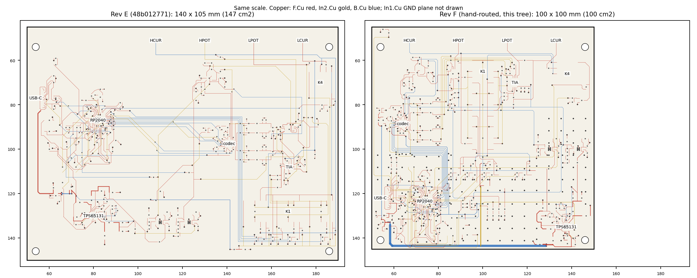

# Rev F before/after: the Rev E circuit on 100 × 100 mm

Rev F is the Rev E circuit (same netlist, same BOM) re-laid from 140 × 105 mm to 100 × 100 mm, so that the enclosure shrinks from about 150 × 115 × 36 mm to about 110 × 110 × 36 mm. The plan and the decisions are in [rev-f-plan.md](rev-f-plan.md).

**Method.** Placement is in `cad/tools/rev_f.py` and the routing is by hand in `cad/tools/rev_f_routes.py`: explicit coordinates and pad references, plus Rev E's own hand routes, carried over by coordinate transform inside five rigid groups. **No autorouter, no path search.** The board is commit `ce2c03af5` on `study/lcr-rev-f-100`. That is the first fully routed board, `418377699`, with C104 moved under U7.1/U7.2 to shrink the TIA feedback-cap loop.

**Verdict.** **Rev F is a viable replacement for Rev E on the evidence below. It is not ordered.** The Rev F package sits in `manufacturing/rev-f/`; Rev E's `manufacturing/` is unchanged.

- **Build gates:** all clean.
- **Gate G1:** the extracted node capacitances pass (source 11.7 ≤ 13.7 pF, tia 14.0 ≤ 14.7 pF at the high corner, after the GND pours and teardrops of §10; 11.4 / 13.6 before them).
- **Stability:** every loop's worst phase margin over the 360-case matrix is at or above Rev E's, with the lossless or the lossy lead model (after §10: drive +0.9°, TIA +0.1°, HIGH +0.5°, LOW +0.7°).
- **min |1+T|:** at or above Rev E's in every loop once the matrix resolves narrow dips (§3).
- **Fabrication:** JLC's quote page reads **$25.70 for five boards against $52.40** for the Rev E outline, same day, same options.
- **What it costs:**
  - a 5 V trunk three times longer (23 mV at 0.46 A on the 2.0 mm strip, PASS);
  - the TIA's C104 loop sits nearer the switcher (+6 dB relative near-field pickup; not a bound);
  - the box wall runs about 1.6 K warmer (8.0 vs 6.4 K rise, estimate).
- **Enclosure:** the footprint shrinks by 30 %.



`python3 validation/rev-f/before_after.py` draws this figure from git (Rev E, `48b012771`) and from this tree (Rev F). The KiCad front render of Rev F is `validation/rev-f/pcb-front.svg`; Rev E's is `previews/pcb-front.svg`.

## 1. Build gates

| Check | Rev E | Rev F |
|---|---|---|
| Outline | 140 × 105 mm (147 cm²) | **100 × 100 mm (100 cm²), −32 %** |
| ERC / DRC / unconnected / parity | 0 / 0 / 0 / 0 | **0 / 0 / 0 / 0** (`validation/rev-f/erc.json`, `drc.json`) |
| Vias in SMT lands | 33 exposed-pad thermal vias, tented | the same 33, tented; every via 0.3 mm drill, ≥ 0.45 mm pad (`audit_dfm.py`, `validation/rev-f/via-in-pad-process.json`) |
| Independent check (`independent_check.py`) | 0 findings | **632 pins, 0 findings** |
| OPA2810 bypass, pin to cap pad (U6 C50 / C51, U7 C52 / C53) | 2.05 / 2.03, 2.05 / 2.03 mm | **1.85 / 1.65, 1.80 / 1.77 mm** |
| Codec decoupling; LDO CIN / COUT; CONV_FBP / CONV_FBN | 1.27–3.87 mm; 5.58 / 6.13 mm; 9.1 / 16.1 mm | identical (rigid groups) |
| Switcher to nearest analog IC (centres) | 64.6 mm (D3–U14) | 63.6 mm (D3–U7) |
| U15 → C103 (codec 5VA filter) | about 37 mm | **2.08 mm** |
| C80 (switcher input bulk) → U13 | 16.4 mm | 14.3 mm (plan gate said ≤ 10 mm; amended, see the plan's Decisions) |
| TIA C104 loop area (U7.1–C104–U7.2, routed copper) | 1.85 mm² | **1.64 mm²** (first route 3.33 mm²; C104 now under the pins, courtyards abutting) |

Layout audit numbers: `validation/layout-audit-rev-f.json` (`LCR_REV=f <kicad-python> cad/tools/audit_layout.py`).

## 2. Extracted parasitics (gate G1)

`sh validation/layout-parasitics/run_reve.sh revf` exports the board of commit `ce2c03af5` (SHA-256 `0d239406…197b`). It runs 30 FD solves, two at a time: 21 min wall on this Mac (1269 s, peak about 5 GB per solve). It then writes `extracted_revf.json` and `stability-full-chain/revf_extracted.rs`. The method is the same as Rev E's `reve_bnc`:

- a whole-board solve at 0.2 mm (`revf` window 72 × 51 mm, a plain box, smaller than Rev E's L-domain);
- a thin-prepreg 1080 solve for the high corner;
- grid-convergence zooms on the Rev F features (`fd3d.WINDOWS` `revf_*`: U7, the K1 relay flanks, the DUT_HI/SOURCE_BUF pair, the BNC band, the LCUR corner, the LPOT/LCUR verticals).

The C104 move changes TIA_OUT and TIA_SUM copper inside three zooms and the whole board, so the full extraction was rerun.

Values are in pF to ground, nominal / high, worst range. "Rev F forecast" is phase 1's closed-form estimate. "Rev F, first route" is `418377699`.

| Node | Rev E (`reve_bnc`) | Rev F forecast | Rev F, first route | **Rev F (`ce2c03af5`)** |
|---|---|---|---|---|
| source (SOURCE_BUF + selected RG) | 9.38 / 13.72 | 6.69 / 10.05 | 6.07 / 11.29 | **6.07 / 11.39** (G1 ≤ 13.7: PASS) |
| tia (TIA_OUT + selected RF) | 10.21 / 14.70 | 7.35 / 10.59 | 8.03 / 14.01 | **7.87 / 13.63** (G1 ≤ 14.7: PASS) |
| sum (TIA_SUM) | 0.94 / 1.09 | 0.69 / 0.80 | 0.75 / 0.94 | 0.68 / 0.86 |
| sum ↔ tia | 0.225 / 0.345 | | 0.167 / 0.282 | 0.243 / 0.384 |
| low (DUT_LO, LCUR jack included) | 7.45 / 10.89 | 6.08 / 8.88 | 7.74 / 13.71 | **7.74 / 13.80** |
| hi (DUT_HI, HCUR jack included) | 12.93 / 16.49 | 12.21 / 15.58 | 11.81 / 19.09 | 11.81 / **19.23** |
| hpot / lpot | 8.87 / 10.86 nom | 5.83 / 7.25 nom | 4.42 / 5.12 nom | 4.42 / 5.12 nom |
| tia ↔ unselected RF | 0.90 / 1.11 | | 0.11 / 0.15 | 0.10 / 0.13 |
| srcdrv | 1.28 / 1.55 | 1.03 nom | 0.51 / 0.91 | 0.51 / 0.92 |

**Loop inductance** (free-space "high" value including the OPA2810 package, the value the harness uses):

| Loop | Rev E | Rev F, first route | **Rev F** |
|---|---|---|---|
| RF branch, 100 Ω / 5 kΩ / 100 kΩ | 64.9 / 64.4 / 92.4 nH | 25.5 / 28.2 / 53.3 nH | **26.4 / 28.8 / 54.0 nH** |
| C104 | 5.04 nH | 3.86 nH | **2.44 nH** |

C104 now sits between the pins and the summing bar. Its loop is smaller, but the TIA_SUM–TIA_OUT mutual capacitance rises from 0.28 to 0.38 pF at the high corner (Rev E 0.35). That 0.04 pF in parallel with the 100 pF C104 is immaterial; the matrix includes it.

**Reading the high corner.** The high corner scales the nominal by (1 + U), where U is the grid uncertainty. For Rev F, U is 0.22; Rev E's was 0.12. It is set by the spread of the zoom ratios. The widest ratio is the TIA_OUT–RF100K mutual in the relay zoom: the two In2 buses overlap only about 3 mm inside that window, so their ratio is poorly resolved. Rev F's high corner is therefore more pessimistic than Rev E's in proportion.

- This is largely why DUT_LO and DUT_HI come out above Rev E at the high corner (13.8 vs 10.9 pF and 19.2 vs 16.5 pF), while their nominal values are +4 % and −9 %.
- Both nodes are on the Kelvin current side, and the stability matrix below carries their high values.
- The forecast under-called DUT_LO (8.9 pF high). The routed LCUR path runs from J9 past R106, 17 mm down x 122.6 and 8 mm across to R94, and its zoom grid factor is 1.20 (Rev E 0.93).

## 3. Stability: 360-case matrix on the extracted board

`sh validation/rev-f-floorplan/run_matrix.sh MODE 8` runs the `kelvincng100` grid: no cable, four 1 m coax, 100–1000 pF lumped, K4 closed, nominal and stress relay sets, three ranges. The tables are `stability-full-chain/matrix-final_MODE.md` and `summary-MODE.md`. The per-case decks of `revfcng100` are committed, as Rev E's `kelvincng100` decks are.

Two harness changes since the first report, both applied to both boards:

1. **Resonance-resolving refinement.** `loop_matrix.rs` now re-sweeps the three deepest local minima of |1+T| on a dense linear grid, two levels deep. Before, the 120-points-per-decade grid (1.9 % steps) could step over a narrow line resonance of the 1 m coax. Rerunning `kelvincng100` with it leaves every committed Rev E deck byte-identical and every phase margin unchanged. Only the minima move.
2. **Lossy leads.** In `kelvinlossycng100` / `revflossycng100`, the four 1 m leads are lossy RG-58: Belden 8259 (`sources/cable/`).
   - `coax_model.py` fits the datasheet attenuation with skin-effect R ∝ √f plus a dielectric-equivalent G ∝ f.
   - Both are realised as SPICE Foster / Debye networks per 5 cm section.
   - The fit is within 4.1 % of the datasheet over 10–1000 MHz.
   - RG-58 is the lower-loss choice. RG-316, also filed, has about 1.5× the attenuation and would damp the leads more.

**Worst phase margin, worst of 90 cases per loop:**

| Loop | Rev E lossless (`kelvincng100`) | **Rev F lossless (`revfcng100`)** | Rev E lossy (`kelvinlossycng100`) | **Rev F lossy (`revflossycng100`)** |
|---|---|---|---|---|
| drive (source driver) | 46.83° | **47.84°** | 46.84° | **47.84°** |
| TIA | 57.21° | **57.32°** | 57.58° | **57.73°** |
| HIGH follower | 57.05° | **57.56°** | 57.03° | **57.54°** |
| LOW follower | 55.89° | **56.71°** | 55.87° | **56.69°** |

**Minimum |1+T|, worst case per loop.** "Grid" is the old 120-per-decade sampling; "refined" includes the re-sweep.

| Loop | Rev E grid (committed before) | Rev E refined, lossless | Rev E refined, lossy | Rev F refined, lossless | **Rev F refined, lossy** |
|---|---|---|---|---|---|
| drive | 0.588 | 0.588 | 0.589 | 0.594 | **0.597** |
| TIA | 0.491 | 0.491 | 0.527 | 0.496 | **0.534** |
| HIGH | **0.610** | **0.179** | 0.552 | 0.193 | **0.553** |
| LOW | 0.643 | 0.643 | 0.662 | 0.652 | **0.672** |

Negative-real-axis crossings left of −1: 0 in all four runs (1440 rows).

**Rev E's committed HIGH-follower min |1+T| of 0.610 was under-sampled.** With the lossless lead model, the true minimum is 0.179 at about 87 MHz: a half-wave resonance of the 1 m HPOT coax, narrower than one grid step. The first Rev F report's 0.221 was the same effect, sampled closer to the peak.

- With the datasheet-fitted lossy RG-58, the dip damps to 0.552 (Rev E) and 0.553 (Rev F).
- Real cable is the lossy case. The lossless figure is an idealised worst case, not a bound.
- `validation/rev-f/resonance_zoom.py` re-sweeps the worst lossy case of each loop on a 10 kHz grid from 10 to 300 MHz and reproduces the matrix's refined minima to the third decimal (`validation/rev-f/resonance-zoom.txt`).
- This is a Rev E finding as much as a Rev F one. The Rev E documents elsewhere still quote the grid figure.

**Reading.**

- Rev F is at or above Rev E in every loop and in both lead models.
- Moving C104 lifted the TIA from −0.02° to +0.11° against Rev E (C104 loop L 3.86 → 2.44 nH).
- The drive loop gains 1.0° from shorter SOURCE_BUF copper and RF leads.
- The stress relay-contact estimates still set the drive floor.

## 4. Power: 5 V trunk, USB budget

`validation/power-spurs/regulator_check.py`, Rev E from the Rev E tree (`regulator_check.json`), Rev F with `LCR_CPL=../rev-f/cpl-jlcpcb.csv` (`regulator_check-rev-f.json`). Both: **48 PASS, 2 FLAG, 0 FAIL**, the same two FLAGs.

| Row | Rev E | Rev F |
|---|---|---|
| 5 V trunk U16.6 → U13.5/6, least-resistance copper path at 60 °C | 43.1 mΩ over 33.5 mm, 19.4 mV at 0.45 A | **84.2 mΩ over 110.5 mm, 37.9 mV at 0.45 A** |
| TPS65131 VIN minimum (USB 4.75 V worst case, after entry and trunk) | 4.300 V | 4.281 V |
| TPS65131 duty cycle, all corners at 2× load | 0.612–0.780 | 0.612–0.781 (limit 0.875) |
| Inductor current at 2× load | 0.379–0.548 A | 0.381–0.550 A (limit 1.8 A) |
| TPS2553 current limit (R110 24 k ± 1 %) | 0.989 / 1.074 / 1.170 A | unchanged |
| USB input budget | 0.45 A estimate vs 0.5 A Default USB Power | unchanged |
| FLAG: USB unconfigured draw | 0.45 A from attach vs 100 mA (USB 2.0 §7.2.1); firmware declares self-powered | unchanged; layout-independent |
| FLAG: R95/R96 headroom with divider TCR | 0.97 V at the worst corner (≥ 0.6 V dropout, < 1 V PSRR condition) | unchanged |

The trunk is longer than the plan's 99 mm Manhattan estimate (the 1.0 mm B.Cu run follows the bottom edge to clear the digital block), and the plan's 22 mV was at 25 °C on width alone. The check's figure is the least-resistance single path, an upper estimate for the strip model. The 19 mV extra drop moves the converter corner by 0.001 in duty cycle.

## 5. Switcher pickup (relative, not a bound)

`python3 validation/power-spurs/switcher_pickup.py --rev-f ../..` → `switcher_pickup-rev-f.json`. It compares the mutual inductance from the TPS65131 switch loops and L1/L2 into each victim loop, Rev F against Rev E, routed copper on both. **It is a RELATIVE estimate and not a bound**: the absolute leakage of the switcher is unknown, and the In1 plane's shielding, conducted and capacitive paths and the enclosure are not modelled (the same plane on both boards is taken to cancel in the ratio).

| Victim loop | Area Rev E / Rev F (mm²) | Sum of switch loops | L1 / L2 dipole |
|---|---|---|---|
| TIA C104 loop (U7.1–C104–U7.2) | 1.85 / 1.64 | **+6.0 dB** (first route, 3.33 mm²: +12.2 dB) | +6.1 / +6.0 dB |
| TIA RF100K loop (U7.1–K3–R45–U7.2) | 149.6 / 74.7 | +4.3 dB | +4.5 / +2.6 dB |
| Codec ch1 / ch2 input legs | 15.1 / 15.6 (unchanged) | −3.2 / −3.8 dB | −1.7…−5.4 dB |
| U6 EXCITE input | 572 / 2.1 | −42.1 dB | −41.9 / −41.2 dB |
| HPOT input | 588 / 19.9 | −28.8 dB | −28.3 / −28.0 dB |
| LPOT input | 457 / 8.7 | −23.3 dB | −23.5 / −22.2 dB |

The per-source "worst" column in the JSON reaches +26 / +36 dB for the boost on-phase loop into the TIA loops. That source's coupling into these victims is near zero on Rev E (its contributions cancel), so the ratio is large but the absolute term stays small beside the other loops; the summed figure above is the one to read.

What moved:

- **Distance.** The TIA is about 22 mm nearer the switcher (85 → 63 mm from the boost hot loop). By 1/r³ alone that is about +8 dB.
- **C104 loop area.** On the first route it had grown to 3.33 mm², because U7 is turned 90° from its Rev E pose. With C104 under the pins it is 1.64 mm², below Rev E's 1.85 mm², which leaves +6 dB in total.
- **Kelvin input loops.** These collapse because the jacks now drop straight onto the followers.

**Harmonic collisions** are a property of the frequency plan, not the layout, and are unchanged: with fsw free-running in 1.25–1.50 MHz, a switcher harmonic lands on a test tone with probability 9.1e-4 (8 fs modulator) down to 9.6e-5 (64 fs) per frequency, about twice that at 85 kHz (transition-band image). The near-field ratios above scale the error **if** a collision happens; the source-off check (R-E2) sees a collided line, so it fails a capture rather than biasing it.

## 6. Cost

**Fabrication: JLC quote page, read 2026-10-29.**

- **How it was read:** in Chrome, signed out, with no Gerber uploaded and nothing added to the cart (`manufacturing/rev-f/fab-quote.json`).
- **Options:** 4 layers, FR4 TG135 (FR-4 Standard TG 135–140), JLC04161H-7628 stackup, ENIG 1 u", 1 / 0.5 oz, 1.6 mm, 0.3 mm min via, qty 5, 3–4 day build.
- **Via covering:** "Tented" is greyed out on the page for this configuration. Its free default is "Plugged" ($0). `FABRICATION.md`'s "Tented is JLC's default" no longer matches the page; confirm the covering at upload.

| Line | Rev E outline, 140 × 105 mm | **Rev F, 100 × 100 mm** |
|---|---|---|
| Engineering fee | $25.00 | no line (special offer) |
| Board | $9.10 | **$8.00 special offer** |
| Surface finish, ENIG | $18.30 | **$17.70** |
| **Fabrication, 5 boards** | **$52.40** | **$25.70** |

Rev E's committed estimate used $51.90, the 140 × 100 mm quote of 2026-10-20.

**Order estimate** (`manufacturing/rev-f/order-estimate-{2,5}.json`, `cad/package_rev_f.sh`):

| | 2 boards | 5 boards |
|---|---|---|
| Rev E, committed (standard assembly + JLC hand fit, $51.90 fabrication) | $357.77 | $485.80 |
| **Rev F** (same parts and joints, $25.70 fabrication) | **$331.57** | **$459.60** |
| Rev F with the indicator LEDs (2026-10-29: D4 side-view C160472, extended; D15–D20 at about 0.5 mA on resistor values already on the BOM; `manufacturing/order-estimate-{2,5}.json`) | $338.26 | $466.68 |

Assembly is identical: 23 extended and 39 basic/preferred lines, the same joints. The indicator-LED change (last row) adds one extended line ($3.07), two basic lines ($1.53 each, standard assembly) and 12 placements: +$6.69 / +$7.08. With economic assembly and the hand fit the totals are $235.05 / $363.47. The saving is the fabrication line, about $26 per order. JLC fabricates at least five, so the line is the same for two boards. Shipping, tax and coupons are excluded. Re-quote with the Gerbers at upload.

## 7. Enclosure

| | Rev E | Rev F |
|---|---|---|
| Board | 140 × 105 mm | 100 × 100 mm |
| Enclosure (outside, about) | 150 × 115 × 36 mm | **110 × 110 × 36 mm, −30 % footprint** |
| Mounting holes (M3) | 132 × 92 mm pattern | 92 × 87 mm pattern, same insets |
| BNC centres from the left board edge | 58 / 80 / 102 / 124 mm | 17 / 39 / 61 / 83 mm (same 22 mm pitch and order) |
| USB-C cut-out, centre behind the front (jack) edge | 32 mm, left wall | 77 mm, left wall |

The jacks' reach in front of the board edge (18.5 mm, SAMZO drawing BNCKYWE-P03900; earlier text said 12 mm, from the footprint's fab outline), the panel order (HCUR, HPOT, LPOT, LCUR), the leads and the cal kit do not change.

## 8. Thermal (estimate, not a bound)

`python3 validation/rev-f/enclosure_thermal.py` → `validation/rev-f/enclosure-thermal.json`. The model:

- 2.3 W through an isothermal aluminium box;
- still air at 25 °C;
- Churchill–Chu correlation for the walls, 0.54 Ra^¼ for the top;
- the bottom either adiabatic (on a table) or 0.27 Ra^¼ (on feet);
- radiation with emissivity from `sources/thermal/` (Engineering ToolBox: anodised 0.77, black anodise 0.88, bare sheet 0.09).

| Box wall rise above ambient | Rev E 150 × 115 × 36 | **Rev F 110 × 110 × 36** | Rev F − Rev E |
|---|---|---|---|
| anodised 0.77, on a table | 6.4 K | **8.0 K** | +1.6 K |
| anodised 0.77, on feet | 4.9 K | 6.3 K | +1.4 K |
| black anodise 0.88, on a table | 6.1 K | 7.6 K | +1.5 K |
| bare sheet 0.09, on a table | 10.2 K | 12.5 K | +2.3 K |

**Limits.**

- The model gives the box wall only. The board-to-wall path inside the box (internal air, radiation, standoffs) is not modelled, so part temperatures are not computed. That needs a cavity model or a bench thermocouple.
- The hottest parts, the U11/U12 LDOs, add RθJA × P = 15–16 K above their local air (regulator_check's 0.24 / 0.26 W at 2× load, JEDEC-board RθJA 63 °C/W).
- What matters for the measurement is drift between calibration and use. The K4 reference check tracks ratio drift.

## 9. Residual risks

1. **Coax lead resonance on the HIGH follower (both revisions).**
   - With an idealised lossless 1 m HPOT lead, |1+T| reaches 0.18–0.19 near 87–89 MHz.
   - With the datasheet-fitted lossy RG-58 it is 0.55, and nothing encircles −1 in either model.
   - The lossy model is fitted to nominal attenuation, and the fit runs up to 4 % low at 50 MHz, which is the conservative side.
   - A bench check with the real leads (step response or a network-analyser sweep of the HIGH loop) remains the confirmation.
2. **Switcher near-field pickup into the TIA** is up +6.0 dB (C104 loop) and +4.3 dB (RF100K loop), relative to an unknown absolute level.
   - It matters only when a switcher harmonic collides with a test tone (≤ 9.1e-4 per frequency, unchanged).
   - The source-off check catches a collision.
3. **The high-corner parasitics carry a wider grid uncertainty** (U 0.22 vs 0.12; see §2). The matrix is run at that pessimistic corner and passes, so this makes the result conservative, not optimistic.
4. **5 V trunk 110 mm** (84 mΩ at 60 °C, 38 mV at 0.45 A). It passes, with VIN ≥ 4.28 V and duty ≤ 0.781 of 0.875.
5. **Thermal**: the box wall runs about 1.6 K warmer than Rev E's (§8). Part temperatures inside are not computed.
6. **Not rerun for Rev F** (layout-independent or assumed-strays inputs): `source_stage.py` (U5 strays are assumed values, not extracted), `rev_e_spurs.py`, `rail_monitor_window.py` (same dividers), the accuracy map, and the visual-review receipt. `regulator_check-rev-f.json` predates the C104 move, which touches none of its rows.
7. **Fabrication options**: "Tented" vias are not selectable on today's quote page (§6). Confirm the via covering and re-quote with the Gerbers at upload; the JLC placement preview is still required for the CPL.

## 10. Review craft pass (2026-10-29)

After a mock professional review, the board got the craft fixes a layout reviewer asks for. Each has a permanent check (pre-DRC, a `cad/tools` script or an assert in `rev_f.py`), and every pass and check lives in one pure module, `cad/tools/craft.py`, with `cad/tools/test_craft.py` (28 synthetic cases). Before = `ae4525852`, after = this tree. Decisions and reasons are rows in [rev-f-plan.md](rev-f-plan.md).

| Item | Before | After |
|---|---|---|
| T-junctions onto a segment | 53 | **0** |
| 90° bends (not at a via or in a land) | 140 | **8**, each a listed exception (no 45° cut fits) |
| Track leaving a land off its axis | 246 | **24** ends, all listed exceptions |
| Vias (all 0.30 mm drill) | 307: 198 × 0.45, 27 × 0.55, 82 × 0.60 mm | **425**: 36 × 0.45, 27 × 0.55, 362 × 0.60 mm (118 GND stitching) |
| Copper: F / In1 / In2 / B | 11 / 96 / 4.6 / 5.9 % | 12 / 96 / **46 / 46.5 %** (GND pours off the analog core, 1.7 mm off every analog net) |
| I2S BCLK return loop (reference height × run) | 84.0 mm² (1.29 mm) | **40.8 mm²** (0.63 mm); USB_DP 32.1 → 20.6 mm² |
| 5 V trunk U16 → U13 | 84.2 mΩ, 38.9 mV | **49.8 mΩ, 23.0 mV** (2.0 mm B.Cu strip) |
| IPC-2152 supply check (10 °C rise) | none | 7 nets, 0 FAIL |
| Teardrops | none | 939 (KiCad's generator, deterministic rebuild) |
| References on silk | 7 (IC, by hand) | **190 of 216**; all on `manufacturing/assembly-top.pdf` |
| Relay-coil test pads | none | TP10–TP14 at the drivers, ≥ 10.7 mm from analog copper |
| Fabrication drawing | order notes only | `manufacturing/fab-drawing.pdf` + Dwgs.User Gerber |
| G1, high corner: source / tia | 11.39 / 13.63 pF | **11.68 / 14.02 pF** (≤ 13.7 / 14.7) |
| Worst PM drive / TIA / HIGH / LOW (lossless) | 47.84 / 57.32 / 57.56 / 56.71° | **47.76 / 57.28 / 57.57 / 56.61°** (Rev E 46.83 / 57.21 / 57.05 / 55.89°) |
| TIA C104 loop, switcher pickup vs Rev E | +6.0 dB | +4.5 dB (chamfers shortened the loop) |

The pours and teardrops cost G1 margin: the tia node rises 0.39 pF at the high corner (DUT_LO +0.62, LPOT +0.46 pF), leaving 0.68 pF to the 14.7 pF gate. The matrix moves by at most 0.1°. C80's GND return via moved from 1.23 to 2.14 mm when the trunk widened (`layout-audit-rev-f.json`).

## Reproduce

```sh
cd instruments/lcr-meter
python3 cad/tools/rev_f.py --check               # placement + routes -> cad/design.json, cad/routing.json, pre-DRC
LCR_SKIP_ARCHIVE=1 sh cad/rebuild.sh               # rebuild (ERC/DRC/DFM, Gerbers, drawings) -> manufacturing/
<kicad-python> validation/independent_check.py f
LCR_REV=f <kicad-python> cad/tools/audit_layout.py
sh validation/layout-parasitics/run_reve.sh revf  # FD extraction -> extracted_revf.json, stability-full-chain/revf_extracted.rs
(cd validation/stability-full-chain && python3 coax_model.py)   # lossy RG-58 networks -> coax_lossy.rs
for m in kelvincng100 revfcng100 kelvinlossycng100 revflossycng100; do sh validation/rev-f-floorplan/run_matrix.sh $m 8; done
cd validation/stability-full-chain && for m in revfcng100 revflossycng100; do python3 kelvin_summary.py matrix-final_$m.md > summary-$m.md; done; cd ../..
python3 validation/rev-f/resonance_zoom.py <case> 10 300 29001    # needs that case's .cir (run before deleting scratch)
python3 validation/rev-f/enclosure_thermal.py
cd validation/power-spurs && python3 switcher_pickup.py --rev-f ../.. --out switcher_pickup-rev-f.json
LCR_CPL=../rev-f/cpl-jlcpcb.csv LCR_OUT=regulator_check-rev-f.json python3 regulator_check.py; cd ../..
python3 validation/rev-f/before_after.py
```
