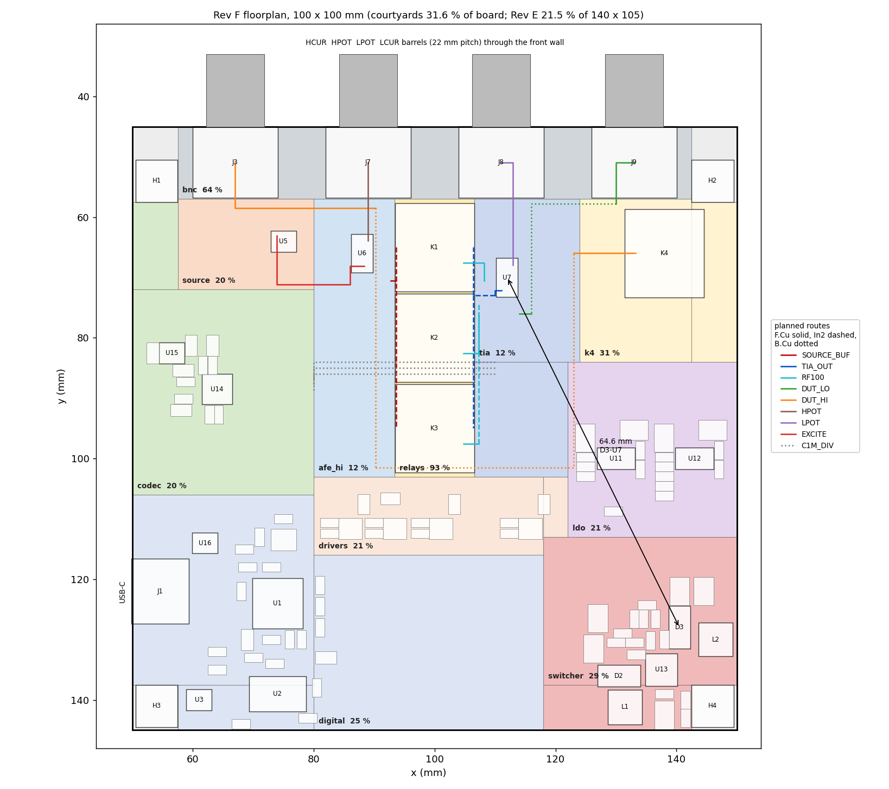

# Rev F plan: the Rev E circuit on a 100 × 100 mm board

Rev F moves the Rev E circuit, unchanged, from 140 × 105 mm to 100 × 100 mm, so that the machined enclosure can shrink from about 150 × 115 × 36 mm to about 110 × 110 × 36 mm. The netlist and BOM stay the same. Only placement, routing, the outline, the holes and the silk change.

**Phase 1 (this document): floorplan and go/no-go.** Nothing has been placed or routed yet. Every number here comes from `validation/rev-f-floorplan/floorplan.py` (about 0.5 s) and the forecast harness runs listed under [Reproduce](#reproduce). The capacitance and inductance values are **forecasts**: closed-form estimates for deciding whether to proceed. They are not extractions. Phase 3 replaces them with an FD extraction of the routed board.

**Recommendation: GO to phase 2**, subject to the gates in [Phase 2 gates](#phase-2-gates).

## 1. Inventory

Source: the Rev E board at the branch point (`48b012771`, SHA-256 `1615e9fc…7f59`), dumped once by `cad/tools/rev_f_inventory.py` (KiCad Python) to `validation/rev-f-floorplan/rev-e-inventory.json`.

- 208 footprints. Courtyards total **3157 mm²**: 21.5 % of Rev E's 14,700 mm², and **31.6 %** of the 10,000 mm² Rev F board.
- **Fixed edge items:**
  - four BNC jacks (657 mm² of courtyard), one edge, 22 mm pitch;
  - USB-C J1, on a side edge;
  - four M3 holes (149 mm²).
- **Large bodies:** four TQ2SA relays, 188 mm² each (753 mm² in total).

| Block | Parts | Courtyard mm² | Rev F block mm² | Rev F fill | Rev E fill, same parts (bounding box) |
|---|---:|---:|---:|---:|---|
| BNC band (J3, J7, J8, J9) | 4 | 657 | 1020 | 64 % | 69 % (80 × 12 mm) |
| Relay column K1–K3 | 3 | 565 | 607 | 93 % | 97 % (the Rev E row, 44 × 13 mm) |
| K4 + driver + R107 | 6 | 216 | 698 | 31 % | 65 % |
| Switcher (U13 island) | 24 | 279 | 968 | 29 % | **38 %** (27 × 27 mm) |
| Digital (RP2040, flash, USB, U3, U16, J4–J6 lands) | 49 | 547 | 2216 | 25 % | 19 % |
| LDO pair (U11, U12) | 22 | 168 | 812 | 21 % | 17 % |
| Relay drivers + VRLY filter | 18 | 111 | 534 | 21 % | 20 % |
| Codec (U14, U15, four input legs, FB1) | 35 | 227 | 1129 | 20 % | 11 % |
| Source (U5 difference stage) | 13 | 68 | 338 | 20 % | 23 % |
| HIGH side (U6, R104, R105, RG resistors) | 13 | 77 | 616 | 12 % | 2 % |
| TIA (U7, RF resistors, C104, R94, C78, R106, leg resistors) | 17 | 94 | 762 | 12 % | 8 % |

The **density check** compares each Rev F block of at least 10 parts with the densest such block Rev E already routes at DRC 0 with the same rules: the switcher island at 38 %. Every Rev F block is at or below it; the densest is digital at 25 %. The relay column (93 %) is compared with the Rev E relay row (97 %). The 12 blocks tile the board exactly. Each anchored part lies inside its block, inside the outline (J1 overhangs by the same 0.2 mm lip as on Rev E), and clear of every other courtyard.

## 2. Floorplan



Board coordinates x 50–150, y 45–145 mm. The top edge (y 45) carries the jacks, as on Rev E. Drill/place origin is (50, 145).

| Item | Rev F position (x, y, rotation) | Rev E | Note |
|---|---|---|---|
| J3 HCUR, J7 HPOT, J8 LPOT, J9 LCUR | (67 / 89 / 111 / 133, 51, 0) | (108 / 130 / 152 / 174, 51) | 22 mm pitch and order unchanged. Centres 17 / 39 / 61 / 83 mm from the left edge |
| H1–H4, M3 | (54, 54), (146, 54), (54, 141), (146, 141) | 132 × 92 mm pattern | **92 × 87 mm** pattern; same insets (4 mm sides and bottom, 9 mm top) |
| J1 USB-C | (54, 122, −90), left edge | (54, 77, −90), left edge | Same wall; centre 77 mm from the front edge (Rev E 32 mm) |
| K1 100 Ω, K2 5 kΩ, K3 100 kΩ | (100, 65 / 80 / 95, 270) | row at y 128 | Vertical column. Pins 1–5 (COM1 = SOURCE_BUF, NO1 = RGx) face U6; pins 6–10 (COM2 = TIA_OUT, NO2 = RFx) face U7 |
| K4 reference | (138, 66, 90) | (182, 70, 0) | LCUR corner. COM2 (DUT_HI) and NO2 (REF_A) on its west side; R107 to DUT_LO beside J9 |
| U6 (source follower + HIGH follower) | (88, 66, 90) | (168, 91, 180) | HPOT drops straight from J7 to U6.5 |
| U7 (TIA + LOW follower) | (112, 70, 90) | (168, 108, 0) | LPOT drops straight from J8 to U7.5; TIA pins face the relay column |
| U5 source stage | (75, 64, 0) | (132, 68, 0) | Between the codec DAC pins and U6.3 |
| U14 codec core (with U15) | U14 (64, 88.5) | (141, 97.5) | Rigid copy of the Rev E codec core |
| U1/U2 RP2040 core | U1 (74, 124, 180) | (82, 87, 180) | Rigid copy |
| U11/U12 LDO pair | U11 (130, 100) | (110, 133) | Rigid copy |
| U13 switcher island | U13 (137.5, 135), quarter turn | (80, 130) | Rigid copy, rotated 90° |
| Relay drivers Q2–Q5 | Q3 (86, 111.6) | (156.6, 140.6) | Rigid copy of the Rev E driver row |

**Keep-outs**, carried from Rev E:

- In1 stays solid GND.
- The op-amp input relief voids (In1, In2, B.Cu) move with U5, U6 and U7: the TIA_SUM bar, U7 TIA/LOW pins, U6 HIGH pins and SRC_DRV output, U5 inputs, and the R94 summing-side pad.
- No copper other than DUT_HI may cross under U7's void.
- The BNC band (y 45–57) carries only the jack pins and the four escapes.

**Rigid groups.** Five Rev E sub-layouts move as single bodies: the RP2040 core, the codec core, the LDO pair, the switcher island (quarter turn) and the driver row. Their hand-placed parts keep the Rev E relative geometry, and their hand-routed copper carries over coordinate for coordinate. That is **573 of 1111 Rev E track entries and 160 of 279 vias** (893 mm of 4643 mm of track; the rest of the length is the long inter-block runs that Rev F shortens). Because of this, their datasheet layout properties are the same as on Rev E by construction:

- LDO CIN 5.6 mm, COUT 6.1 mm;
- codec decoupling 1.3–3.9 mm;
- TPS65131 feedback nodes and switch loops (CONV_FBP 9.1 mm, CONV_FBN 16.1 mm);
- exposed-pad thermal vias.

Parts taken out of the copied groups, and where they go instead:

- C80 (TPS65131 input bulk): placed at U13, closer than its 16.4 mm on Rev E.
- C16: at U16 OUT (TPS2553 §12.1).
- R96, R97/R100, FB1/C103: re-placed beside their new neighbours.

## 3. Layout-dependent quantities before routing

### Net lengths (planned skeleton, Manhattan, so the upper side of the eventual route)

| Net | Rev E mm | Rev F plan mm | Layers planned |
|---|---:|---:|---|
| SOURCE_BUF (stability limiter) | 93.5 | **35.7** | In2 bus on the column's west flank, 1.6 mm F.Cu stubs |
| TIA_OUT | 90.7 | **45.3** | In2 bus on the east flank; C104 and R67 at U7 |
| SRC_DRV (U6.1 → R104) | 12.6 | 6.5 | F.Cu |
| RF100 / RF5K / RF100K | 28.7 / 12.2 / 40.4 | 6.4 / 10.5 / 23.8 | NO2 → R43–R45 at U7 (TIA_SUM pads short) |
| TIA_SUM | 18.1 | 13.4 | F.Cu, inside its void |
| HPOT / LPOT | 88.5 / 90.5 | 16.9 / 24.9 | straight drops from J7 / J8 |
| DUT_LO (LCUR) | 77.9 | 50.0 | J9 → R106/R107 → C78/R94 at U7 |
| DUT_HI (HCUR) | 211.4 | 158.3 | B.Cu bus under R40–R42, crossing south of K3 to K4 |
| EXCITE (U5 → U6.3) | 75.8 | 30.7 | F.Cu, leaves U5 southward clear of DUT_HI |
| DAC_P / DAC_M | 33.5 / 36.7 | 23.8 / 29.3 | F.Cu |
| HIGH_BUF / LOW_BUF | 18.3 / 25.0 | 6.0 / 8.0 | leg 1 kΩ at the op-amp |
| C1M / C2P / C2M divider nodes | 7–9 | 33.0 | B.Cu under K2 (behind 1 kΩ, 500 Ω node, 560 pF) |

### Node capacitance forecast (pF to ground, nominal / high, worst range)

How the forecast is built:

1. Start from the Rev E extracted value (`extracted_reve_bnc.json`, board copper, part terms and jack estimate).
2. Remove its trace share and add the Rev F planned trace share, using closed-form microstrip figures for a 0.2 mm track: F.Cu 0.081, In2 0.045, B.Cu 0.042 pF/mm.
3. Where the figure exceeds the extracted value (TIA_SUM sits on a plane void), scale by length instead.
4. The high corner keeps each net's Rev E high/nominal ratio.

| Harness node | Rev E (extracted) | **Rev F forecast** |
|---|---|---|
| source (SOURCE_BUF + RG100) | 9.38 / 13.72 | **6.69 / 10.05** |
| tia (TIA_OUT + RF100K) | 10.21 / 14.70 | **7.35 / 10.59** |
| sum (TIA_SUM) | 0.94 / 1.09 | 0.69 / 0.80 |
| low (DUT_LO, LCUR jack incl.) | 7.45 / 10.89 | 6.08 / 8.88 |
| hi (DUT_HI, HCUR jack incl.) | 12.93 / 16.49 | 12.21 / 15.58 |
| hpot / lpot | 8.87 / 10.86 nom | 5.83 / 7.25 nom |
| lowbuf / highbuf / srcdrv | 1.98 / 1.64 / 1.28 nom | 0.63 / 1.05 / 1.03 nom |
| refa | 0.91 / 2.10 | unchanged |

**RF-loop inductance** (U7.1 → COM2 → NO2 → R4x → TIA_SUM): the Rev E free-space value scaled by path length. 100 Ω range 64.9 → **16.7 nH**; 5 kΩ 64.4 → 27.6; 100 kΩ 92.4 → 47.4. The C104 loop stays local and unchanged (5.04 nH).

### What the stability matrix should see (forecast)

The forecast boards (`revf_est_extracted.rs`, from `forecast_harness.py`) were run through the full 360-case `kelvincng100` grid: no cable, four 1 m coax, 100–1000 pF lumped, K4 closed; nominal and stress relay sets. **EST** uses the forecast ground terms, Rev E mutuals and the forecast RF L. **PESS** uses the same ground terms, every mutual capacitance doubled (a denser board couples more), and Rev E's RF L (no credit).

| Loop, worst of 90 cases | Rev E as built (`kelvincng100`) | Rev F EST | Rev F PESS |
|---|---|---|---|
| drive (source driver), stress | 46.83° / 0.588 | **47.87° / 0.593** | **47.67° / 0.591** |
| drive, nominal | 50.29° | 51.13° | 50.97° |
| TIA | 57.21° / 0.491 | 57.44° / 0.512 | 57.88° / 0.507 |
| HIGH follower | 57.05° | 57.33° | 57.12° |
| LOW follower | 55.89° | 56.92° | 56.72° |

- Negative-real-axis crossings left of −1: 0 in all 720 forecast rows.
- The harness change is regression-checked: rerunning `kelvincng100` after the refactor reproduced all 360 committed rows exactly, and its committed `.cir` netlists byte for byte.

**Reading.** The board is not what limits the drive loop's margin: shrinking SOURCE_BUF copper by a third buys about 1°. The stress relay-contact estimates (Ccc, Cpp, Coc, still UNVERIFIED) and the coax case set it. Rev F should therefore be **no worse than Rev E in any loop**, provided the routed board's analog node capacitances come out at or below Rev E's (gate G1).

### Decoupling and regulator distances

- **Rigid groups** keep Rev E's values exactly: LDO CIN/COUT, the switcher island, codec decoupling 1.3–3.9 mm, and the RP2040 caps.
- **OPA2810 bypass** at 2.03–2.05 mm and the U5 caps at 1.8–3.2 mm are local placements. The board size does not constrain them, and Rev F keeps the Rev E numbers as targets.
- **C80** moves to the switcher.
- **C113** stays at U16 IN.

### Switcher to analog (part centres; `regulator_check.py` metric)

The switcher island's pose came from a 0.5 mm grid search over four rotations (`switcher_pose_search.py`, 6.6 s, 514 feasible poses). It maximises the smallest distance from L1, L2, D2, D3 and U13 to U5, U6, U7 and U14, with every courtyard inside the block.

| | Rev E | Rev F | Change in 1/r³ (dipole) coupling |
|---|---|---|---|
| **Nearest analog IC** | **64.6 mm (D3–U14)** | **64.6 mm (D3–U7)** | 0 dB |
| U14 codec | 64.6 | 81.7 | −6.1 dB |
| U7 TIA | 84.8 | 64.6 | **+7.1 dB** |
| U6 | 91.2 | 81.2 | +3.0 dB |
| U5 | 76.4 | 90.9 | −4.5 dB |

### 5 V trunk

The trunk runs from U16 OUT (left edge) to U13: 99 mm Manhattan, against 26 mm for U16 → U13 on Rev E. At 1.5 mm of 1 oz copper that is 0.033 Ω, a 14.6 mV drop at 0.45 A (21.9 mV at 1.0 mm). `regulator_check.py` must add this to R_ENTRY: its 4.32 V converter corner falls by about 0.015 V, against a 0.875 duty limit that has ≥ 0.096 of margin.

## 4. Fabrication cost and enclosure

- **Fabrication, five boards.** The JLC quote in `order_estimate.py` was taken at 140 × 100 mm: $51.90 = engineering $25.00 + ENIG $18.20 + board $8.70. Scaled by area (×0.714):
  - the board line falls to $6.21;
  - ENIG is unchanged ($49.41) or also scales ($44.21).
  
  So Rev F fabrication is **$44–49, a $2.5–7.7 saving**. This is an ESTIMATE: JLC prices are tiered, and Rev E's own 140 × 105 outline was never re-quoted. Re-quote at upload (the price page needs only the dimensions, not the Gerbers).
- **Assembly** is unchanged: same parts, joints, extended lines and BNC hand fitting.
- **The real saving is the enclosure:** 110 × 110 × 36 mm against 150 × 115 × 36, **30 % less footprint**. The enclosure drawing changes in four places:
  - the BNC holes move to 17 / 39 / 61 / 83 mm from the left inner edge;
  - the USB-C cut-out moves from 32 to 77 mm behind the front edge, on the same (left) wall;
  - the hole pattern becomes 92 × 87 mm;
  - the barrels still overhang the front edge by 12 mm.

## 5. Decisions

| Date | Decision | Basis |
|---|---|---|
| 2026-10-29 | **Outline 100 × 100 mm at x 50–150, y 45–145; BNCs on the top edge at 67 / 89 / 111 / 133, order HCUR, HPOT, LPOT, LCUR; holes at the Rev E insets** | 80 mm of jack courtyard fits between the two top holes with 2.5 mm to spare. Same edge, order and pitch as Rev E, so the leads, cal kit and Keysight-order panel do not change |
| 2026-10-29 | **Layout "B"** (figure): codec and source top-left; U6 \| relay column \| U7 across the middle; K4 at the LCUR corner; LDOs at the right; switcher bottom-right; digital bottom-left; drivers under the column | Against the mirror image "A" (codec right, switcher bottom-left): A's nearest analog IC is 51–55 mm and it sends EXCITE across the relay column. Against K4 at the column foot: that runs DUT_LO, a TIA input node, 45 mm beside the TIA_OUT bus |
| 2026-10-29 | **K1–K3 as a vertical column at x 100, rotation 270, K1 (100 Ω) nearest U6/U7; SOURCE_BUF and TIA_OUT as In2 buses on the two flanks** | Halves SOURCE_BUF (93.5 → 35.7 mm) and TIA_OUT (90.7 → 45.3 mm). Shortest RF loop on the range most sensitive to RF lead L. Unselected RF nets in RF order (100 Ω loads TIA_SUM through the smallest resistor) |
| 2026-10-29 | **Leg series resistors at the op-amps: R60 at U6; R61, R66, R67 at U7.** The divider nodes cross under K2 on B.Cu | Keeps TIA_OUT and LOW_BUF copper short. The long run sits behind 1 kΩ on a 500 Ω / 560 pF node: about 1.4 pF more, 0.25 % of the 560 pF, linear and calibrated |
| 2026-10-29 | **DUT_HI on B.Cu** (bus under R40–R42, crossing south of K3), F.Cu only from J3 to the bus | SRC_DRV/R104 and EXCITE cross it on F.Cu with In1 between. It keeps clear of the divider runs under K2 and of U7's void |
| 2026-10-29 | **Rigid reuse of five Rev E sub-layouts** (RP2040 core, codec core, LDO pair, switcher island with a quarter turn, relay drivers); C80, C16, R96, R97/R100 and FB1/C103 re-placed | 573 of 1111 track entries and 160 of 279 vias carry over as coordinate transforms of Rev E hand routes (no autorouter). Their datasheet layout distances are unchanged by construction |
| 2026-10-29 | **Switcher island at U13 (137.5, 135), rotated 90°** | `switcher_pose_search.json`: nearest analog IC 64.6 mm, equal to Rev E. The best pose at the other rotations is 55.0 mm (0°), 54.4 mm (180°) and 59.1 mm (−90°) |
| 2026-10-29 | **USB-C stays on the left edge** (J1 at y 122) with U16 + C113 at the receptacle; C16 moves to U16 OUT | Keeps USB D± short and away from the switcher, at the cost of a 99 mm 5 V trunk (≤ 22 mV at 0.45 A). A right-edge J1 would run D± 80 mm past the LDOs and switcher |
| 2026-10-29 | **Rev F replaces the `cad/` outputs on this branch**, as Rev E replaced Rev D. Rev E stays reproducible: commit `48b012771`, plus `cad/tools/rev_e.py` unchanged. `build_cad.py` and `package_cad.py` take the outline, holes, silk, reference-text overrides and drill origin from `design.json["board"]` | One adapter builds both revisions. The parasitics runner already takes boards from git by commit. Before phase 2 lands, rebuilding Rev E with the parameterised adapter must reproduce the Rev E `.kicad_pcb` byte for byte (it does today: rebuild in 9.7 s, board identical) |
| 2026-10-29 | **Forecast harness modes `revfestcng100` / `revfpesscng100`** (`loop_matrix.rs` `kelvin_cases_on`, `revf_est_extracted.rs`) | Pre-route stability forecast. Every forecast loop is at or above Rev E. Phase 3 adds a `revf` mode on the extracted board |
| 2026-10-29 | **GO to phase 2** | All floorplan checks pass. Every block is at or below the densest Rev E block. Every analog node forecast is at or below Rev E. Every loop forecast is at or above Rev E. Switcher distance is equal to Rev E's |
| 2026-10-29 | **DUT_HI as built: B.Cu along the BNC band (y 56.9, J3 x 67 → x 131.5, then down to K4 at y 66) and one F.Cu trunk at x 90.2 (y 56.9 → 97.5) feeding R40–R42.** Supersedes the "B.Cu bus under R40–R42" row above | The B.Cu band run keeps DUT_HI under In1, out of the flanks and away from U7's void. The F.Cu trunk sits 3 mm west of the SOURCE_BUF In2 bus (x 93.2) with In1 between: no broadside pair as on Rev E (x 188.8 / 188.9). The relay-pitch fallback (risk 1) was not needed |
| 2026-10-29 | **Layer use as built.** In2: SOURCE_BUF (x 93.2), TIA_OUT (x 106.9) and RF100K (x 108.8) buses, RNG gate lines, U1 west-side signals (RUN, STATUS, MON12, MON_N12, UART), SWD. B.Cu: DUT_HI band, codec I2S/I2C bundle (0.4 mm pitch), relay coil lines, 5 V trunk (1.0 mm), ±12 V monitor taps. F.Cu: stubs and local routes. In1 solid GND | Plan layer split kept. The codec bundle runs under In1 from the Rev E U1 escape vias, so it never shares a layer with an analog bus |
| 2026-10-29 | **USB as a rigid group** (J1, D1, R1, R2, C15) at J1 (54, 122); power entry U16 (55.6, 129.9), C113 at U16 IN, C16 at U16 OUT, U3 (56.85, 135.9) with C17; FB1/C103 at the codec 5VA pin (U15 → C103 2.08 mm) | D± stays on the left edge between J1 and U1, on the far side of the board from the switcher. TPS2553 §12.1 input/output caps at the pins (U16.6 → C16 2.53 mm); U3 → C16 2.06 mm |
| 2026-10-29 | **Rail monitors R97–R100, C110, C111 in one cluster at (91–95, 123–126)**, beside U1's MON pins; J4 SWD (69, 108), J5 (86, 131), J6 UART (86.5, 139) DNP lands kept; SW1/SW2 at the bottom edge; status LED R12/D4 at (101–104, 136) | The ±12 V taps reach the cluster on B.Cu (x 86.5 from the 12 V trunk; x 135.2 / y 119.4 from −12 V), so the 1 % dividers sit next to the ADC pins, not next to the LDOs |
| 2026-10-29 | **C80 stays at (125.6, 143), on the 5 V trunk 4.4 mm from L1.1; G3's "C80 ≤ 10 mm from U13" is amended to "closer than Rev E"** (14.3 mm vs 16.4 mm, centres) | C80 is the bulk on the boost input, whose ripple current flows into L1, not into U13's VIN pin; the pin capacitors C82 (7.5 mm) and C81 sit at U13 as on Rev E. Moving C80 inside 10 mm would mean breaking up the copied switcher island. `regulator_check.py` passes the input-cap row either way (break-even retention 0.61 ≤ 0.75) |
| 2026-10-29 | **Extraction windows `revf_*` and assembly config `revf`** (`fd3d.py`, `assemble_reve.py`, `run_reve.sh revf`); harness mode `revfcng{C}` (`loop_matrix.rs`) | Same method as `reve_bnc`, with the zooms re-cut on the Rev F copper. The relay zoom's second mutual is TIA_OUT–RF100K, the Rev F analogue of Rev E's RF100–RF100K bus pair. Its poor overlap in the window sets U = 0.21, a more pessimistic high corner, accepted rather than tuned away |
| 2026-10-29 | **C104 under U7.1/U7.2** (180°, courtyards abutting); TIA_SUM leaves south to a y 74.9 run; summing-node void grown over C104.1; U7.3 GND via to (115.3, 73.75) | The first route left a 3.33 mm² C104 loop (U7 turned 90°), +12 dB relative switcher pickup. Now 1.64 mm² (Rev E 1.85), +6 dB, C104 loop L 3.86 → 2.44 nH, TIA margin 57.19 → 57.32° |
| 2026-10-29 | **Rev F package in `manufacturing/rev-f/`** (`cad/package_rev_f.sh`), Rev E's `manufacturing/` untouched; fabrication from the JLC quote page ($25.70 for 5, `fab-quote.json`) | Supersedes "`manufacturing/` stays Rev E, no Rev F package" below: the package is separate, so it cannot be mistaken for Rev E's. Not ordered |
| 2026-10-29 | **`manufacturing/` and `previews/` stay Rev E on this branch.** Rev F evidence lives in `validation/rev-f/` (ERC, DRC, via-in-pad, drill report, front SVG; CPL and orientation CSVs regenerated by `rebuild.sh`, gitignored) | A study branch must not leave an orderable Rev F package behind. `rebuild.sh` rewrites both folders; after a Rev F rebuild, copy the evidence and `git checkout -- manufacturing previews validation/drc.json validation/erc.json validation/via-in-pad-process.json` |
| 2026-10-29 | **Rev F promoted to the current build (owner: "merge it in as the new best option").** `study/lcr-rev-f-100` fast-forwarded into `study/lcr-in-box`; `manufacturing/` and `previews/` now hold Rev F (rebuilt by `cad/rebuild.sh`; Gerbers, drill, BOM, CPL and order estimates identical to the former `manufacturing/rev-f/` apart from creation timestamps); Rev E's outputs archived in `manufacturing/rev-e/` (from `48b012771`); `manufacturing/rev-f/` and `cad/package_rev_f.sh` removed. Supersedes the two rows above | Rev F is at or above Rev E on every gate and stability metric (`rev-f-before-after.md`), costs $26.20 less per 5-board order (fabrication $25.70 vs $52.40, no engineering fee at 100 × 100) and shrinks the box 30 % |
| 2026-10-29 | **Order with via covering "Plugged"**, not "Tented" | JLC's 4-layer quote page greys out Tented; Plugged is the $0 default. TI's package notes allow vias under exposed pads to be "filled, plugged or tented". Confirm in vendor DFM that the 33 exposed-pad vias are plugged from the bottom with clean top lands (`manufacturing/FABRICATION.md`) |
| 2026-10-29 | **Script defaults follow the current board**: `order_estimate.py` reads `manufacturing/fab-quote.json` (Rev E's same-day quote in `manufacturing/rev-e/fab-quote.json`); `audit_layout.py` defaults to `LCR_REV=f`; `archive_package.py` writes `temper-lcr-rev-f-package.zip` | One default path per check, so a rerun cannot write Rev F numbers into a Rev E file |
| 2026-10-29 | **Front-panel status light: D4 = Lite-On LTST-S270KFKT side-looking orange LED (C160472) at (55.0, 45.95), rotation 0, lens toward the front edge; R12 390 Ω (C23151)** | Owner request: one orange light on the BNC face, left of HCUR. JLC has no basic or preferred side-view LED (searched 2026-10-29), so C160472 is extended (+$3.07 feeder fee per order, unavoidable); picked for orange 605 nm, 5577 in stock and Lite-On's full datasheet (`sources/rev-f/LTST-S270KFKT.txt`). The gap between the H1 courtyard (x ≤ 57.45) and J3's courtyard (x ≥ 60) is 2.55 mm, too narrow for the 3.7 mm footprint, so D4 sits in front of H1 instead (H1 courtyard top at y 50.55; the M3 head, r ≈ 3 mm, stays 3.4 mm clear). Between two BNCs was rejected: it would put the light right of HCUR and its line between the Kelvin inputs. 390 Ω: (3.3 − 1.9 V) / 390 = 3.6 mA nominal, 4.3 mA worst high, ≥ 0.55 mA at the datasheet-worst corner (VOH 2.62 V at 4 mA, VF 2.4 V) |
| 2026-10-29 | **Six debug LEDs, all basic (C2286 red 0603 + 0603 thick film), ~1 mA each**: rail LEDs D15 5V (R113 3k), D16 3V3 (R114 1.5k), D17 +12 (R115 10k), D18 −12 (R116 10k, anode on GND) at the rail monitors (102–110, 127–130); D19 HB (GPIO23, R117 1.5k) and D20 FLT (GPIO22, R118 1.5k) west of U1 at (58.8 / 61.2, 106–109). Silk 5V 3V3 +12 −12 HB FLT | No basic green 0603 exists (C12624/C72043 are extended), so all six use the red part already on the BOM: no new extended line. HB/FLT sit beside U1 because only a 3-line In2 gap (RUN via / SWDIO) leaves U1's free west pins; the rail LEDs sit where all four rails already have copper. Nearest listed analog part: K3 32.1 mm (R113), U6 47.2 mm, U7 57.2 mm, BNCs ≥ 55 mm (centres). U14 is 17.6 mm from D20, on the digital side of the codec |
| 2026-10-29 | **STATUS moves north; HEARTBEAT/FAULT on GPIO23/22** | STATUS (GPIO25) no longer runs south to R12: STATUS, HEARTBEAT and FAULT leave U1 in three F.Cu lanes, drop to In2 and run as a 0.36 mm-pitch bus north between the RUN via and SWDIO; STATUS continues west along y 112 and up the west edge (x 51, In2 under the In1 plane, 2 mm from FB1/5VA at its closest, 19.5 mm from U5, the nearest op-amp) to R12. Hand-placed coordinates in `rev_f_routes.py`; no autorouter. No analog-net copper moved, so the G1 extraction and the stability matrix are not rerun |
| 2026-10-29 | **Photocurrent and ground noise from the LEDs: negligible** | The rail LEDs are a constant DC load (a step only at power-up); HB and FLT are dark during every capture (firmware turns them off in `capture()`), and STATUS switches only before a capture starts and after it ends, so no LED current changes while the codec samples |
| 2026-10-29 | **Debug LEDs halved to about 0.5 mA** (owner: "half it if you think it's justified"): R113 5.1k (C23186), R114/R117/R118 3k (C4211), R115/R116 24k 1 % (C23352); D4 unchanged | The ±12 V pair costs 5.4× its current at the 5 V input (LDOs, then the TPS65131 at 0.64): 11.7 of the 20.8 mA. Halving takes the LED share to 11.7 mA and the USB estimate from 0.4708 to 0.4617 A (29 → 38 mA margin) at no cost: all three values are already on the BOM (R1/R2, R110), so one resistor line (1.5k C22843) disappears. A C2286 is plainly visible at 0.5 mA with the lid off. D4 keeps 3.6 mA to show through the wall hole. Layout, copper and silk unchanged |

## Indicator LEDs (2026-10-29)

**Front-panel light hole (D4).** Measured from the board's front-left corner (board coordinate (50, 45), the left end of the BNC edge), looking at the front face: **5.0 mm to the right** (D4 centre x 55.0; HCUR J3 is at 17.0 mm) and **0.30 mm above the board's top surface** (the 0.60 mm-high package's lens centre; 1.9 mm above the board's bottom face for 1.6 mm board). The lens tip is 0.14 mm inside the board edge (footprint lens tip 0.81 mm ahead of the pad centre line, D4 at y 45.95). The LED's 130° viewing angle needs a hole of about 2 mm diameter if the wall sits within ~0.5 mm of the board edge; a larger gap needs a light pipe or a larger hole. The BNC centre height above the board is not changed. Enclosure CAD should take these numbers, not the silk.

**Debug LED table.** See `docs/bring-up-rev-e.md` §1a for what each one means at power-up.

| Ref | Silk | Driven by | Resistor | Current (nom / worst high) | Part |
|---|---|---|---|---|---|
| D4 | (front panel) | GPIO25 STATUS, lit during a capture | R12 390 Ω | 3.6 / 4.3 mA | LTST-S270KFKT C160472 (extended) |
| D15 | 5V | 5 V rail | R113 5.1 kΩ | 0.63 / 0.77 mA | KT-0603R C2286 |
| D16 | 3V3 | 3V3 rail | R114 3 kΩ | 0.5 / 0.59 mA | KT-0603R C2286 |
| D17 | +12 | +12 V rail | R115 24 kΩ 1 % | 0.42 / 0.45 mA | KT-0603R C2286 |
| D18 | −12 | −12 V rail (anode on GND) | R116 24 kΩ 1 % | 0.42 / 0.45 mA | KT-0603R C2286 |
| D19 | HB | GPIO23 HEARTBEAT | R117 3 kΩ | 0.5 / 0.59 mA | KT-0603R C2286 |
| D20 | FLT | GPIO22 FAULT | R118 3 kΩ | 0.5 / 0.59 mA | KT-0603R C2286 |

Worst-case-high currents are `regulator_check.py`'s (rail maximum, resistor −1 %, VF floor 1.6 V / 1.7 V). Gates after the change: ERC 0; DRC 0 / 0 / 0 with schematic parity; pre-DRC 0 / 0; `independent_check.py f` 656 pins, 0 findings; `audit_dfm.py` 33 exposed-pad thermal vias only; layout audit rerun; `regulator_check.py` 51 PASS, 2 FLAG (unchanged), 0 FAIL, input estimate 0.4617 A (0.45 A + 11.7 mA of LEDs, after the halving below; 0.4708 A at 1 mA) against 0.5 A; `rail_monitor_window.py` windows unchanged. Order estimate (standard assembly, JLC-hand-fit BNCs): 2 boards $338.26 (+$6.69), 5 boards $466.68 (+$7.08); the delta is one extended feeder ($3.07), two basic feeders ($3.06, Standard only) and parts. Economic assembly + hand fit: $235.05 / $363.47.

## 6. Risks

1. **Relay-column flank congestion (medium).** The west flank carries:
   - the SOURCE_BUF bus;
   - three RG stubs, R40–R42;
   - the DUT_HI bus;
   - three SET coil lines and VRLY.

   The east flank carries the TIA_OUT bus, RF stubs, RST and VRLY. Planned layer split:
   - In2: the two buses;
   - B.Cu: DUT_HI and the coil lines (under In1, away from the voids);
   - F.Cu: stubs.

   The coil lines must stay away from TIA_SUM and RF100 and be guarded with GND, as range-switching §6 requires. If the flanks will not route at 0.15/0.2 mm, the fallback is a 1.5 mm wider column pitch: 3 mm more of each bus, which the forecast absorbs.
2. **The TIA is nearer the switcher** (U7 84.8 → 64.6 mm, +7.1 dB on a 1/r³ coupling; the codec gets −6.1 dB). Near-field pickup was not modelled on Rev E either. It only matters if a switcher harmonic collides with the tone: 0.01–0.09 % per frequency, unchanged. The source-off check (R-E2) sees a collided line, so it fails a capture rather than biasing it. Phase 3 adds a relative pickup estimate.
3. **The forecast is not an extraction.** It is a closed-form per-mm model on Rev E's own extraction. The drive-loop gain it shows (+0.8 to +1.0°) is small, so the as-routed board must be extracted before any stability claim (gate G1).
4. **The DUT_HI route is still long** (158 mm planned), because K4 sits at the LCUR corner. DUT_HI is the driven side: its ground load acts through RG, and Kelvin sensing removes its drop. It forecasts below Rev E.
5. **The divider nodes run 33 mm** (C1M, C2P, C2M on B.Cu) beside each other. Inter-leg crosstalk is linear and removed by calibration.
6. **Process.** The switcher quarter turn changes its CPL rotations, so `placement_offsets.py` must be rerun and the JLC orientation preview rechecked. The silk labels must be redone, and the board text set to REV F.
7. **Thermal.** The smaller enclosure runs warmer for the same 2.3 W. What matters is drift between calibration and use, not the absolute temperature, and the K4 reference check tracks ratio drift. The LDO pair also sits closer to R43–R45 than on Rev E. No temperature number is claimed here; the phase-3 report states what was and was not evaluated.

## Phase 2 gates

Phase 2 is full placement plus hand routing in `cad/tools/rev_f.py` (placement from this floorplan's anchors and rigid groups) and `cad/tools/rev_f_routes.py`. That means explicit coordinates and the transformed Rev E group copper. **No autorouter.**

- **G1.** Extracted node capacitances at or below Rev E: source ≤ 13.7 pF and tia ≤ 14.7 pF at the high corner. Otherwise rerun the matrix before going further.
- **G2.** Switcher nearest analog IC ≥ 60 mm. Every rigid group's internal geometry unchanged.
- **G3.** OPA2810 bypass ≤ 2.1 mm; codec decoupling ≤ 3.9 mm; CIN/COUT ≤ 10 mm; C80 ≤ 10 mm from U13.
- **G4.** ERC 0; DRC 0/0/0 with parity; `audit_dfm.py`: only the 33 exposed-pad thermal vias in SMT lands, every via 0.3 mm and tented.

## Phase 2 result (as built, commit `418377699`; C104 follow-up `ce2c03af5`)

The board is fully placed and **hand-routed**: every new track and via is an explicit coordinate or pad reference in `cad/tools/rev_f_routes.py`, and the rigid-group copper is Rev E's hand routing moved by a coordinate transform. No autorouter, no path search. The before/after report is [rev-f-before-after.md](rev-f-before-after.md).

| Gate | Result |
|---|---|
| G1 extracted node C | **PASS** on `ce2c03af5`: source 11.39 ≤ 13.7 pF, tia 13.63 ≤ 14.7 pF (high corner, worst range; `extracted_revf.json`). 360-case matrix (`revfcng100`, refined minima): drive 47.84°, TIA 57.32°, HIGH 57.56°, LOW 56.71° (Rev E 46.83 / 57.21 / 57.05 / 55.89°); lossy-lead runs in [rev-f-before-after.md](rev-f-before-after.md) §3 |
| G2 switcher distance, rigid groups | Nearest analog IC 63.6 mm (D3–U7; Rev E 64.6 mm, D3–U14). LDO CIN 5.58 / COUT 6.13 mm, CONV_FBP 9.1 / CONV_FBN 16.1 mm, codec decoupling 1.27–3.87 mm: identical to Rev E |
| G3 local distances | OPA2810 bypass U6 1.85 / 1.65 mm, U7 1.80 / 1.77 mm (Rev E 2.03–2.05). C80: **fails the ≤ 10 mm wording** (14.3 mm), amended to "closer than Rev E" (16.4 mm), see Decisions |
| G4 ERC/DRC/DFM | `rebuild.sh`: ERC 0, DRC 0 violations / 0 unconnected / 0 parity. `audit_dfm.py`: only the 33 exposed-pad thermal vias sit in SMT lands, all tented; every via 0.3 mm drill |
| Independent check | `independent_check.py f`: 632 pins, 0 findings (`validation/independent-verification-rev-f.json`) |

**Tooling built for the hand-routing loop** (`cad/tools/`):

- `pad_library.py` (KiCad Python, once) dumps footprint-local pads and courtyards; `predrc.py` (plain Python + shapely) rebuilds the board from `design.json` / `routing.json` and checks clearance, connectivity and courtyards without KiCad. **0.3 s against 4.4 s** for build + zone fill + `kicad-cli` DRC, about 15× faster per iteration. A full `rev_f.py` run (placement, copied groups, routes, prune, pre-DRC) is about 2.6 s.
- Calibration against KiCad DRC matched in every shared category, with one gap found during routing: KiCad flagged copied collinear stubs and lone vias as dangling where `predrc` did not. `rev_f.py` now runs `prune_copied()` + `drop_superseded()` to a fixed point (copied segments lying on a hand segment of the same net and layer, and copied vias that nothing reaches, are removed), and `DROP(net, box)` removes copied copper of one net explicitly. KiCad DRC is still the gate; `predrc` is the inner loop.
- `rev_f.py --render VIEW [--layers ...]` draws the pre-DRC state per region and layer set.

## Rerun list for phase 3, with measured runtimes

Runtimes were measured on this Mac on the Rev E board today, except where a different source is named.

| Step | Script | Runtime | Change needed for Rev F |
|---|---|---|---|
| Build, ERC, DRC/parity, Gerbers, BOM/CPL, DFM/via audit | `cad/rebuild.sh` | **9.7 s** | Board-parameterised adapter (decision above) |
| Independent audit | `validation/independent_check.py` | **1 s** | Add an `f` mode (bypass distances, relief voids, four-terminal topology) |
| Layout audit | `cad/tools/audit_layout.py` | ~1 s | `REV = 'f'` → `layout-audit-rev-f.json` |
| CPL offsets, cost | `placement_offsets.py`, `manufacturing/order_estimate.py` | seconds | Switcher rotation; Rev F fabrication line |
| Parasitic extraction (FD + loop L) | `validation/layout-parasitics/run_reve.sh`-style `revf` variant | Rev E BNC schedule **1244 s serial** (32 solves, from the stored `seconds`); whole board at 0.2 mm **160 s** (7628, 4.5 M unknowns) and **224 s** (1080, 5.8 M); peak about 5–7 GB | New windows/domain for the Rev F conductors (about the same area as Rev E's L-domain). Run the zoom windows 3 at a time: about 10–15 min wall. **Fits the 32 GB Mac; the remote box is not needed** |
| Stability, 360 cases | `run_matrix.sh revfcng100 8` | **75 s** (8 shards; measured 72–77 s for each of three modes) | Generated include from the extraction |
| Source stage U5 | `stability-full-chain/source_stage.py` | 43 s | None: its strays are assumed values, not board-extracted. Rerun for the record |
| Regulators | `power-spurs/regulator_check.py` | 0.1 s | R_ENTRY plus the 5 V trunk; C80 distance |
| Interference, codec chain | `power-spurs/rev_e_spurs.py` | 0.2 s | None in the model. Add a relative switcher-pickup script (dipole, Rev E vs Rev F loop areas), about 1 s |
| Rail monitor window | `power-spurs/rail_monitor_window.py` | < 0.1 s | None (same dividers). Rerun |
| Accuracy map | `rev-e-accuracy-map/rerun.sh` | ~15 s (README) | Layout-independent; rerun for completeness |
| Visual review, enclosure dimensions | `render_previews.py`, `region_view.py`, `floorplan.json` | minutes | New receipt `visual-review-rev-f.json` |

**Effort.**

- **Phase 2** (placement, rigid-group transforms, about 540 new track entries and 120 vias, GND stitching, DRC iterations): **about 8–12 h of agent time** in one session. The AFE column and flanks are the hard part; the five rigid groups are about a day's work saved.
- **Phase 3** (script variants, extraction, matrix, audits, before/after report): **about 4–6 h**, of which compute is under an hour, all on the Mac.

## Reproduce

```sh
# once, KiCad Python: Rev E per-part geometry -> validation/rev-f-floorplan/rev-e-inventory.json
/Applications/KiCad/KiCad.app/Contents/Frameworks/Python.framework/Versions/Current/bin/python3 cad/tools/rev_f_inventory.py
python3 validation/rev-f-floorplan/floorplan.py          # checks, forecasts -> floorplan.json, floorplan.png
python3 validation/rev-f-floorplan/switcher_pose_search.py   # switcher island pose -> switcher_pose_search.json
python3 validation/rev-f-floorplan/forecast_harness.py   # -> stability-full-chain/revf_est_extracted.rs
sh validation/rev-f-floorplan/run_matrix.sh revfestcng100 8
sh validation/rev-f-floorplan/run_matrix.sh revfpesscng100 8
cd validation/stability-full-chain && python3 kelvin_summary.py matrix-final_revfestcng100.md   # run before deleting the per-case CSVs
```

The forecast runs' per-case files (`final_revf*`, 7200 files) were deleted after summarising. The tables are in `stability-full-chain/matrix-final_revf{est,pess}cng100.md` and `summary-revf{est,pess}cng100.md`.
