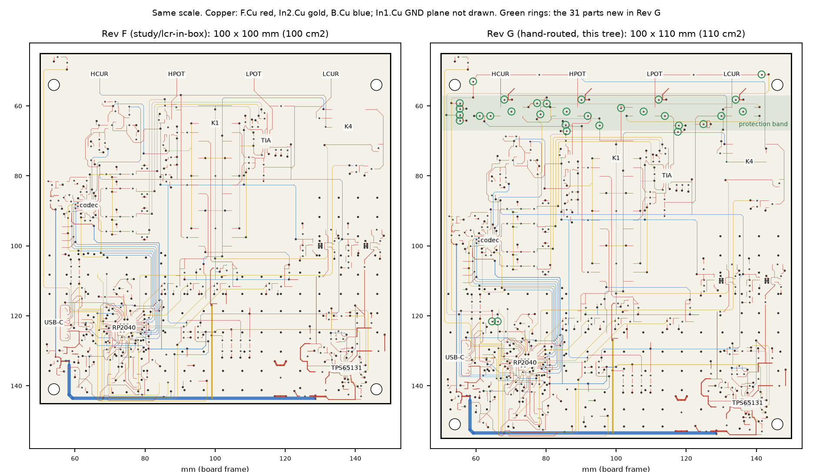

# Rev F against Rev G

Rev G is Rev F with protected jacks. Each jack gets a TVS, a normally-open photoMOS switch and a series resistor, with second-stage clamps on the board side and a residual-voltage sense on HCUR and LCUR. The 10 mm band that holds them sits under the jacks: Rev F below y 57 moved 10 mm back as one rigid body, so the board grows from 100 × 100 to 100 × 110 mm. The plan and its decisions are in [rev-g-plan.md](rev-g-plan.md); the protection study is in [rev-g-protection/README.md](../validation/rev-g-protection/README.md).

**Neither board is ordered, and neither has been built.** Rev F is on `study/lcr-in-box`; Rev G is on `study/lcr-rev-g`.

**Verdict.** Rev G keeps everything Rev F measures and adds protection, at +$53 per five boards and 10 mm more box depth.
- **Unchanged:** accuracy (the same LCR-6100 verdicts over the map) and stability (every loop within 0.35° of Rev F or better).
- **Added protection:** Rev F's jacks survive a charged 1 µF part only below 0.5 V. Rev G's survive 50 V unpowered and 200 V powered.
- **The cost of +$53:** almost half of it ($24) is JLC's bare-board price. 100 × 110 mm is past the 100 × 100 mm special offer.

**Reproducing the numbers.**
- `sh validation/rev-g/compare_f_g.sh` recomputes every number below from committed evidence and writes `validation/rev-g/compare-f-g.json`.
- `python3 validation/rev-g/before_after.py` draws the figure; it needs matplotlib, for example `uv run --no-project --with matplotlib`.
- Rev F's files are read from git: `study/lcr-in-box` at `9861d26c7`, board SHA-256 `49089212…76ca`, the board in `rev-f-handoff.md`.
- Rev G's board is `b7acaf7e…e3a0`.

## 1. Board

| | Rev F | Rev G |
|---|---|---|
| Outline | 100 × 100 mm (100 cm²) | **100 × 110 mm (110 cm², +10 %)** |
| Footprints | 251 | 281: 31 new (C119–C122, D21–D28, Q7, R122–R135, U18–U21), J6 (UART header) removed |
| Nets | 168 | 180 |
| Track segments / vias / teardrops | 1736 / 439 / 994 | 1900 / 464 / 1152 |
| Analog copper | — | 361 of 400 analog items identical to Rev F's under the transform; the changes are confined to y 51–77.5 (`copper-shift-delta.json`) |
| Build gates | ERC / DRC / parity 0 / 0 / 0, fab PASS | the same, plus the independent review and its re-check (MAJOR-1 fixed) |
| Box | 110 × 110 × 36 mm | 110 × 120 × 36 mm; the tallest part (13.75 mm BNC) is the same |

## 2. Cost, five boards at JLC

The same JLC library snapshot prices both BOMs (`validation/rev-g/prices/jlc-parts-2026-11-09.json`). The bare-board prices were read the same day on JLC's quote page with the same options (`validation/rev-g/fab-quote.json`). Rev F's own estimate from the 2026-10-30 snapshot was $357.43, so the new snapshot moves its total by +$0.74.

| Economic PCBA, 5 boards | Rev F | Rev G | Δ |
|---|---|---|---|
| Bare boards (4 layers, ENIG) | $25.70 | **$49.70** | +$24.00 |
| SMT parts (71 → 79 lines) | $221.91 | $238.11 | +$16.20 |
| Extended-part fees (27 → 31 lines) | $82.89 | $95.17 | +$12.28 |
| SMT joints (651 → 723 per board) | $5.21 | $5.78 | +$0.57 |
| Setup, stencil, X-ray, placement check | $22.46 | $22.46 | 0 |
| **Total** | **$358.17** | **$411.22** | **+$53.05 (+15 %)** |
| JLC hand-fits the four BNCs | $31.07 | $31.07 | 0 |

**The bare-board step.** At 100 × 100 mm JLC charges an $8.00 special-offer line. At 100 × 110 mm that line becomes a $25.00 engineering fee plus $6.80 for the board, and ENIG rises from $17.70 to $17.90. This is the same step Rev E paid at 140 × 105 mm. Getting back under 100 × 100 would mean re-placing Rev F's analog parts and re-extracting the board, the option rejected on 2026-11-09 (`rev-g-plan.md` §5).

**The four new extended lines** are TLP172AM, the 10 Ω and 100 Ω CRCW-HP pulse resistors, and the 1 nF C0G. H4V5HD3B and H3V3LD5B are preferred parts (no fee), and BAV99 is basic.

## 3. Parasitics

**Grid uncertainty differs between the two runs.**
- **The corners.** The corners in `extracted_rev{f,g}.json` are nominal × (1 ± U), where U is the grid-convergence uncertainty of the run (`assemble_reve.py`).
- **The two values.** Rev F's U is 0.219. Rev G's is 0.347, set by one term: the DUT_HI–HPOT mutual capacitance.
- **Why that term.** On Rev F that mutual was about 0.025 pF, because both nets reached the jacks. On Rev G the jack copper is on the JK_* nets, so it falls to about 0.004 pF, and its relative grid convergence is poor (×1.62 against ×1.20 for the mutual factor).
- **What this widens.** Its absolute error is about 0.001 pF, but the rule takes the largest relative spread over every term, so it widens every node's corners.

The last column therefore puts Rev G's high corner at Rev F's U. Every element of the high matrix scales with (1 + U), the thin-prepreg maximum included, so this rescale is exact.

| Node, pF to ground, worst range | Rev F nom / high (U 0.219) | Rev G nom / high (U 0.347) | **Rev G high at U 0.219** |
|---|---|---|---|
| source (SOURCE_BUF + selected RG), G1 ≤ 13.7 | 6.19 / 11.68 | 6.22 / 13.03 | **11.80** |
| tia (TIA_OUT + selected RF), G1 ≤ 14.7 | 8.03 / 14.02 | 8.20 / **15.95** | **14.44** |
| sum (TIA_SUM) | 0.68 / 0.86 | 0.71 / 0.99 | 0.90 |
| sum ↔ tia | 0.25 / 0.40 | 0.25 / 0.41 | 0.37 |
| DUT_LO | 7.95 / 14.42 | 4.24 / 10.19 | 9.23 |
| DUT_HI | 11.86 / 19.38 | 6.13 / 12.89 | 11.67 |
| HPOT | 4.50 / 7.01 | 1.90 / 4.50 | 4.07 |
| LPOT | 5.29 / 8.76 | 2.04 / 4.85 | 4.39 |

**Reading.**
- **The Kelvin nodes are lighter.** DUT_HI, DUT_LO, HPOT and LPOT lose 40–60 % of their capacitance, because the jack bodies and their runs now sit on the far side of the switches and series resistors.
- **The analog core matches.** Its copper is the same, and its nominal values agree within 2 % (TIA_OUT +0.17 pF). That is inside the grid's own spread: TIA_OUT moves 12 % between 0.2 and 0.05 mm. The likely cause is raster alignment. Rev G's whole-board window starts at x 60.0 and Rev F's at x 64.5, 22.5 cells apart, so the copper edges fall half a cell differently. This has not been tested.
- **Gate G1 at the high corner.**
  - At Rev G's own U, the tia node reads 15.95 pF, above the 14.7 pF limit (Rev E's value).
  - At the same U as Rev F, it reads 14.44 pF and passes, with 0.26 pF of margin against Rev F's 0.68 pF.
  - G1 was Rev F's proxy for the stability matrix. The matrix itself ran on Rev G's wider corners and passes (section 4), so it is the controlling evidence.
  - Open item: the U rule should leave out couplings below 0.01 pF, the threshold that already decides whether a pair gets its own factor (`rev-g-plan.md` §6).

## 4. Stability, 360-case full-chain matrix

| Loop | Rev F worst PM, min abs(1+T) (`revfcng100`) | Rev G (`revgxcng100`, extracted Rev G board) |
|---|---|---|
| drive | 47.76°, 0.594 | 47.41° (−0.35°), 0.595 |
| HIGH follower | 57.57°, 0.201 | 57.81° (+0.24°), 0.710 |
| LOW follower | 56.61°, 0.650 | 57.04° (+0.43°), 0.701 |
| TIA | 57.28°, 0.494 | **69.71° (+12.43°)**, 0.701 |

**Reading.**
- **TIA.** It gains 12° because the 10 Ω on LCUR and the switch separate the TIA from the coax capacitance; the protection study saw the same before layout (69.92°).
- **Drive.** The 0.35° drop is inside the change the wider U alone makes to the corners.
- **HIGH follower.** Rev F's minimum of 0.201 is the half-wave resonance of the 1 m HPOT coax under the lossless lead model (`rev-f-before-after.md` §3). Rev G's 100 Ω + 1 nF terminates that coax, and the dip is not in its run; that the network causes this is likely, not shown separately.
- **Crossings.** Neither run has an upward crossing.

## 5. Protection

| | Rev F | Rev G |
|---|---|---|
| Charged 1 µF part, lowest voltage at which every part stays within its rating | **0.5 V** (the HPOT follower's input current, unpowered) | **50 V** unpowered, 200 V powered; the 30 V target is met in every pattern and state |
| Bench rule for DUTs | discharge to below 0.5 V, verified with a DMM | the same rule stays for accuracy; a mistake up to 30 V no longer damages the meter |
| IEC 61000-4-2 contact on the centre pins | no clamp; the OPA2810 inputs take it | the jack TVS; MAJOR-1 fixed its return (0.5 mm and a via into In1) |
| Thinnest part margin at 30 V | — | the jack TVS (25.8 A vs 40 A) and the LCUR switch (0.61 A vs 1.5 A) |

Source: `protection-screen.json`, candidates `links` (Rev F) and `parts_jackside` (Rev G as built, 1.5 MΩ sense).

## 6. Accuracy and signal

| | Rev F | Rev G |
|---|---|---|
| LCR-6100 verdicts over the map, 1 m leads, ✓ / ~ / ✗ (linear; with drift) | 144 / 22 / 43; 144 / 22 / 43 | **144 / 22 / 43; 144 / 22 / 43** |
| The same, with amplitude dependence | 144 / 22 / 43 | 144 / 23 / 42 |
| Current into a short, 100 Ω range | 10.06 mA | 8.90 mA (SNR −1.06 dB; the 10 Ω in series) |
| Added noise | — | ≤ 0.33 % of the codec floor |
| USB current | — | 0.476 A typical with the switch drive (under the 0.5 A declared) |

Source: `normal-operation.json`, `parts_jackside`.

## 7. Firmware and use

- **Firmware.** One tree builds both boards (`firmware-rev-e/`, `LCR_REV_G=1`). Rev G adds the jack guard: the switches stay open until the sense reads a jack voltage under 1 V for 7 polls (35 ms). It also trips during a capture.
- **Debugging.** Rev G has no UART header; the console is USB CDC, and SWD (J4) remains.
- **What the user sees.** Range changes and measurements work as on Rev F. A charged part is refused instead of destroying the front end.

## 8. What Rev G costs, in one line

$53 more per five boards ($24 of it the bare-board size step) and 10 mm more box depth buy a meter that survives a 30 V charged part. Accuracy is unchanged, and the TIA loop gains margin.
