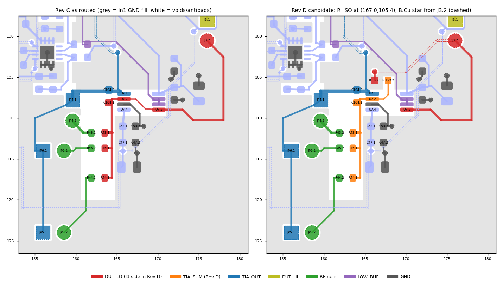

# PCB parasitics of the TIA, feedback and DUT nets — revision C

This extraction comes from the routed board, `cad/temper-lcr.kicad_pcb`, SHA-256 `5ec3e6e0…a9c0`. That is the same hash pinned by `../feedback-routing/results.json`. The CAD was only read. Every value below is printed by `report.py` from `extracted.json`, and `run.sh` regenerates all of them.

Each value is given as **low / nominal / high**. Units are pF and nH. None of these ranges is a mathematical bound unless the text says so.

## Findings

| Quantity | Simulation assumption | Extracted (low / nom / high) | Verdict |
|---|---|---|---|
| C104 branch loop L, including OPA2810 pins/bond wires | 5 nH (10 nH stress case) | **2.20 / 4.18 / 4.87 nH** | Conservative, but only by 0.13 nH at the high estimate |
| …same, board copper + C104 body only | — | 0.95 / 2.25 / 2.29 nH | — |
| RF/jumper branch L, 100 Ω (JP4) | 100 nH | **9.1 / 19.0 / 21.7 nH** | Conservative (≥4.6×) |
| RF/jumper branch L, 5 kΩ (JP5) | 100 nH | **16.9 / 36.6 / 50.5 nH** | Conservative (≥2×) |
| RF/jumper branch L, 100 kΩ (JP6) | 100 nH | **12.4 / 25.9 / 33.1 nH** | Conservative (≥3×) |
| `c_sum_gnd_pf`: summing node (DUT_LO) to AC ground | 0 or 100 pF per DUT terminal; no board capacitance | **3.09 / 3.86 / 5.62 pF** | 0 pF case is optimistic by about 4–6 pF. The 100 pF case covers it |
| `c_hi_gnd_pf`: DUT_HI to AC ground | 0 or 100 pF | **2.90 / 3.57 / 5.23 pF** | Same as above |
| `c_sum_tiaout_pf`: in parallel with C104, so it adds to CF | none | **0.17 / 0.26 / 0.40 pF** (all ranges) | Not modelled. It is 0.4 % of CF at most, well inside the ±5 % C104 corners |
| `c_hi_sum_pf`: across the DUT | none | **0.10 / 0.14 / 0.16 pF** | Not modelled. It acts as a 0.14 pF DUT in parallel; add it to the open-DUT case |
| `c_sum_lowbuf_pf`: bootstrapped by the LOW follower | none | 0.08 / 0.11 / 0.17 pF | Not a load. Model it from DUT_LO to LOW_BUF if at all |
| `c_tiaout_gnd_pf`: board load on U7A output | none | **6.3 / 8.9 / 10.6 pF** | Not modelled. Below the 35 pF that SBOS789 says the OPA2810 drives without an isolation resistor (`sources/ti/OPA2810.txt`, line 2133). Add it to the harness |
| Noisy copper to summing node | — | ≤0.32 fF nominal, ≤2.1 fF high (ADC SCLK, 27.8 mm away) | See the proximity section |

The per-range `c_sum_tiaout_pf` values are 100 Ω 0.185/0.263/0.395, 5 kΩ 0.172/0.247/0.378 and 100 kΩ 0.177/0.254/0.386 pF.

**Layout concerns, ranked by severity.** No extracted value is clearly worse than its assumption, so **no Rev C layout change is proposed**.

1. **The fixture-free case leaves out the board's own node capacitance.** The board adds about 4 pF on each of DUT_LO and DUT_HI, plus 9 pF on TIA_OUT. The "0 pF stray" cases are therefore slightly optimistic. Re-run them with the extracted board values as fixed elements. The 100 pF cases already dominate these values.
2. **The C104-loop margin is thin, and the package dominates it.** The board copper plus C104 body contributes 2.25 nH. The OPA2810 lead/bond-wire geometry contributes about 1.9 nH, and that geometry is assumed rather than published. The 5 nH case sits just above the high estimate, so keep the 10 nH stress case as the governing check.
   - A solid plane under the loop would cut only about 0.7 nH (3.52 nH full-plane against 4.18 nH nominal), at the cost of summing-node capacitance. That trade is not worth reversing the void.
3. **Most of the summing-node capacitance is the J3 route, not the TIA.** The 19 mm DUT_LO route from J3, the J3 PTH and the J3 post together are about 2.8 of the 3.9 pF. The Rev D R_ISO candidate below isolates them and leaves 1.07 pF on the summing node.

**Inductance shared between the branches.** The C104 and RF loops share the U7 pins and package: the mutual inductance is 3.85–3.87 nH. As a T-network, that is about 3.9 nH in series with the whole feedback network (C104 ∥ RF branch), and only about 0.3 nH is unique to C104. The simulation instead puts separate inductors in each branch. At frequencies where C104 dominates the feedback impedance, the two descriptions are equivalent.

## Noisy copper (for the supply-spur analysis)

Distances are exact minima between copper of the two nets on any layer. Mutual capacitance is the first-order image-dipole estimate described under Method, given as nominal / high in fF.

| Source nets | to DUT_LO mm | fF | to TIA_OUT mm | fF | to DUT_HI mm | fF |
|---|---:|---|---:|---|---:|---|
| TPS65131 SW_P (U13, L1) | 83.5 | 0.023 / 0.189 | 75.2 | 0.064 / 0.534 | 87.5 | 0.020 / 0.162 |
| TPS65131 SW_N (U13, L2) | 78.3 | 0.027 / 0.227 | 69.1 | 0.081 / 0.671 | 85.7 | 0.022 / 0.181 |
| RP2040 crystal XIN/XTAL_OUT/XOUT | 84.3 | 0.037 / 0.338 | 76.7 | 0.092 / 0.838 | 75.5 | 0.041 / 0.373 |
| QSPI clock | 76.7 | 0.022 / 0.182 | 68.4 | 0.060 / 0.497 | 74.7 | 0.022 / 0.177 |
| ADC SCLK | 27.8 | 0.321 / 2.082 | 21.7 | 1.140 / 6.897 | 22.5 | 0.386 / 2.422 |
| ADC CONVST | 26.5 | 0.173 / 1.788 | 20.5 | 0.650 / 6.312 | 21.1 | 0.215 / 2.378 |
| AD9833 MCLK (DDS_MCLK, DDS_CLK_RAW) | 68.6 | 0.047 / 0.430 | 57.6 | 0.118 / 1.077 | 54.7 | 0.056 / 0.500 |
| AD9833 SCLK | 65.5 | 0.055 / 0.521 | 54.0 | 0.138 / 1.321 | 50.8 | 0.066 / 0.615 |
| USB D+/D− | 77.2 | 0.092 / 1.081 | 69.2 | 0.232 / 2.753 | 72.1 | 0.096 / 1.124 |

Direct capacitive pickup is negligible. For example, a 3.3 V SCLK edge through 2 fF injects about 7 fC.

The larger couplings to the summing node come from its **F.Cu neighbours**. From the closed-form sampled-edge estimate in `proximity.json`: GND 0.35 pF, −12V 0.28 pF (0.45 mm gap), LOW_BUF 0.20 pF, TIA_OUT 0.19 pF and +12V 0.13 pF.

DUT_HI's neighbours are RG100K 0.37 pF, −12V 0.29 pF (0.16 mm gap), RG5K 0.23 pF, HIGH_BUF 0.22 pF and the FDA input B_INM 0.15 pF.

For the spur analysis, the coupling path is therefore **ripple left on ±12 V × about 0.3 pF**, not the switch-node fields. Magnetic coupling from L1/L2 is not covered here.

## Rev D candidate: 22 Ω R_ISO between J3 LO and the summing node

**Rev C topology.** The summing node is enclosed on F.Cu on every side:

- TIA_OUT runs above and to the left (U7.1 → C104.2 → JP4, and up to the FDA via at 165.1, 102.0).
- The −12V branch runs below (U7.4 → C53/C47).
- The U7 body is on the right. The only entry is the 0.15 mm under-body link U7.5 → U7.2.

There is no free F.Cu path from the J3 side to the spine. The candidate (`riso_variant.py`) therefore enters from **above** U7 and takes the J3 side down to B.Cu outside the voids.

**Proposed changes:**

1. **R_ISO**: 0603, 22 Ω, placed at **(167.0, 105.4), rotation 0**, in the free pocket between TIA_OUT (x = 165.1) and the LOW_BUF exit (x = 168.844).
   - Pad 1 at (166.175, 105.4) is on the J3 side. Pad 2 at (167.825, 105.4) is on the summing side.
   - The 0603 courtyard (y 104.625–106.175) clears U7's courtyard (top edge 106.205) by only 0.03 mm. Moving R_ISO and the via up 0.1 mm keeps every clearance at 0.15 mm or more. The minimum copper clearance to any other net is 0.52 mm.
2. **Summing side** (new net, e.g. `TIA_SUM`): U7.2, C104.1, R43/R44/R45.1 and the x = 164.4 spine.
   - Keep the first leg of the existing under-body polyline, (165.8875, 107.675) → (167.3, 107.675).
   - Replace the remaining legs with (167.3, 107.675) → (167.825, 107.15) → (167.825, 105.4), 0.15 mm wide.
3. **J3 side** (DUT_LO): the existing J3.2 → U7.5 polyline is unchanged, so **the LOW follower taps J3**. Add a star branch from J3.2:
   - F.Cu stub (166.175, 105.4) → (166.175, 104.35), 0.25 mm.
   - Via 0.6/0.3 mm at (166.175, 104.35). It is outside all keepouts.
   - B.Cu 0.25 mm route (166.175, 104.35) → (170.0, 104.35) → (173.81, 100.54) → (176.0, 100.54), ending on the J3.2 PTH. Clearance is 0.70 mm or more, and that B.Cu region is otherwise empty.
4. **New keepout** on In1/In2/B: rectangle (167.2, 104.9)–(168.6, 106.5), under R_ISO pad 2. It joins the existing U7 relief.

| Rev D candidate (worst over ranges) | low / nom / high |
|---|---|
| Summing side to ground (`c_sum_gnd_pf`) | **0.89 / 1.07 / 1.28 pF** (Rev C: 3.09 / 3.86 / 5.62) |
| Summing side to TIA_OUT | 0.17 / 0.27 / 0.40 pF (unchanged) |
| Across R_ISO (board + 0.05 pF body) | 0.03 / 0.07 / 0.12 pF |
| J3 side to ground (cable/fixture adds here) | 3.12 / 3.81 / 5.68 pF |
| J3 side to LOW_BUF (bootstrapped) | 0.07 / 0.10 / 0.15 pF |
| DUT_HI to J3 side / to summing side | 0.10 / 0.14 / 0.16 pF / 0.00 |

R_ISO does not change the C104 or RF loop inductances, because neither loop passes through the J3 path.

**routing.json edit count**: about 6 new or changed segments in 4 entries.

- 1 DUT_LO polyline is rewritten: the under-body link loses 2 legs and gains 2.
- 1 new F.Cu stub segment.
- 1 new B.Cu polyline with 3 segments.
- 1 new `vias` entry and 1 new `keepouts` entry.
- Net-name changes on the 5 spine/stub polylines and on the kept link leg (about 10 segments). These change no geometry.
- `design.json` needs the new part and the new net on U7.2, C104.1 and R43–R45.1.

All of these are hand edits as explicit segments. No autorouter is involved.

**Consequence outside layout:** LOW_BUF now senses J3, so channel B = LOW_BUF − TIA_OUT = I·(Zf + R_ISO). The host's Zf must become Zf + 22 Ω. On the 100 Ω range that is a 22 % term, so R_ISO needs to be a 0.1 % / low-TC part and included in calibration.

The In1 changes in this candidate are edits to the exported fill, not a KiCad refill: the keepout plus a 0.5 mm antipad at the new via. Stability with R_ISO is not assessed here.

## Rev D as built

`run_revd.sh` extracts the routed Rev D board (`eb2b4cf8…`, R94 fitted, net TIA_SUM) into `geometry_revd.json`, `inductance_revd.json` and `fd_results/*_revd.json`; `assemble.py` adds `rev_d_board` to `extracted.json`. The Rev C entries are unchanged. `LP_GEOMETRY`, `LP_SUM` and `LP_INDUCTANCE` select the variant.

| Rev D as built (worst over ranges) | low / nom / high |
|---|---|
| Summing side to ground | 0.89 / 1.06 / 1.27 pF |
| Summing side to TIA_OUT | 0.19 / 0.27 / 0.40 pF |
| Across R94 (board + body) | 0.03 / 0.07 / 0.12 pF |
| J3 side to ground | 3.09 / 3.78 / 5.67 pF |
| J3 side to LOW_BUF | 0.07 / 0.10 / 0.15 pF |
| DUT_HI to J3 side / to summing side | 0.10 / 0.14 / 0.16 pF / 0.00 |
| TIA_OUT to ground | 6.68 / 8.87 / 10.53 pF |

Every value is within 1 % of the proposed candidate above. Loop inductances are unchanged from Rev C (C104 4.87 nH, RF 21.65 / 50.46 / 33.14 nH at the high corner), as predicted. Stability with these values: `../stability-full-chain/fixture-envelope.md` (minimum 51.3°).

## Method

- **Geometry** (`export_geometry.py`, KiCad 10.0.4 pcbnew).
  - Every track, via, and pad polygon on all four copper layers.
  - The stored In1 GND fill. The exporter refills an in-memory copy and confirms the stored fill is current (relative area difference 0).
  - The rule areas.
  - Board paths reproduce the feedback-routing receipt exactly: 4.448, 16.903, 48.073 and 29.456 mm.
- **Stackup**: JLCPCB 4-layer 1.6 mm templates from jlcpcb.com/impedance, read 2026-10-20.
  - Nominal is the default **JLC04161H-7628**: prepreg 0.2104 mm with εr 4.4, core 1.065 mm with εr 4.6, 35 µm outer / 15.2 µm inner copper.
  - The high-capacitance / low-inductance corner is **JLC04161H-1080**: prepreg 0.0764 mm, εr 3.91.
  - `FABRICATION.md` does not fix a template. Confirm the offered stackup.
- **Capacitance, closed form** (`closed_form.py`).
  - Hammerstad–Jensen microstrip with thickness correction for tracks over In1. Pads use parallel plate plus the fringe derived from that formula.
  - Copper over a void is computed three ways: zero; coplanar coupling to the nearest In1 edge at slant gap √(s²+h²) via the conformal cross-ratio; and "as if no void". Adding a grounded plane can only raise a self-capacitance, so the last is an upper bound up to the formula's accuracy.
  - Inner-layer PTH/via rings use coplanar coupling across the actual antipad gap. Mutual terms use a sampled-edge method: Garg–Bahl coupled microstrip over the plane, coplanar strips over voids.
  - For DUT_LO the results are 2.23 (zero), 4.13 (edge) and 5.71 (no-void) pF. The FD self-capacitance of 3.4 pF lies inside that bracket. The edge estimate is 23 % high, and the closed-form DUT_LO–TIA_OUT mutual of 0.19 pF is 74 % above FD. **The voids make the closed forms unreliable**, so the FD solution is used for every capacitance in the tables.
- **Capacitance, 3-D finite-volume solve** (`fd3d.py`; pyamg CG, residual 1e-7).
  - The whole AFE window 152–181.5 × 81.5–127 mm, with all copper of every net.
  - The actual In1 fill, so voids and antipads are exact to the grid. Plated barrels span F.Cu to B.Cu. Dielectric is layered, with air 5 mm above and 3 mm below.
  - All non-extracted nets are held at AC ground. The output is the Maxwell matrix of DUT_LO, TIA_OUT, DUT_HI, RF100/5K/100K, LOW_BUF and HIGH_BUF.
  - **Validation**: on a straight microstrip, FD at 0.05 mm is 2–3 % below Hammerstad for zero thickness (`fd_results/fd_validate.json`). Coarser grids scatter by −10 % to +19 % because of width quantization.
  - **Convergence**: a zoom window over U7/C104/R43–45/JP4 at 0.1, 0.07, 0.05 and 0.04 mm gives the DUT_LO ground term as 0.873, 0.873, 0.915 and 0.908 pF. The DUT_LO–TIA_OUT mutual is 0.098, 0.109, 0.109 and 0.109 pF.
  - **Nominal** is the 0.07 mm whole-AFE solve scaled by the zoom ratio 0.04/0.07: ground ×1.040, mutual ×0.994. Low and high apply ±10 % grid uncertainty.
  - High also takes the larger ground terms of the 1080-stackup solve, and adds a +15 % solder-mask/copper-thickness uplift on board mutuals. The FD model has zero-thickness copper and no mask.
- **Terms outside the FD model** (`assemble.py`, `headers.py`), given as low / nominal / high:
  - U7 adjacent-lead coupling inside the mould: 0.02/0.04/0.08 pF for pin 2–1, 2–3 and 5–6. This is an estimate, not a datasheet value.
  - 0603 thin-film body capacitance: 0.02/0.05/0.10 pF.
  - Header posts by thin-wire method of moments with plane image, using TSW-07 dimensions (2.54 mm insulator, post tip 8.38 mm, 0.635 mm square post). Insulator εr is 1/3.6/4.2. Each post adds 0.25/0.62/0.70 pF to ground; the post-to-post mutual is 0.062/0.092/0.099 pF.
  - Per range, the selected RF net is merged into TIA_OUT and the two unselected RF nets float through their open headers (Kron reduction).
  - Fixture, cable, shunt metal and the amplifier's own input capacitance are excluded.
- **Inductance** (`inductance.py`).
  - Neumann partial-inductance double integral over the 3-D current path, using a thin-wire reduced kernel with geometric-mean-distance radii. This is the uniform-current (low-frequency, largest) value.
  - Validated against a circular loop to 6e-5. Over a plane it is 9–10 % above Hammerstad's microstrip L′, which biases over-plane parts high.
  - The In1 plane is modelled by images in three ways:
    - **None (free space)**: an upper bound for the modelled geometry, because induced currents can only lower loop inductance.
    - **Only where In1 copper exists**: closing with a 1.1 mm radius, so antipads count as plane and the voids do not. This is the nominal.
    - **Everywhere**: the lower case.
  - Low uses the 1080 stackup. There are no vias in any feedback loop. All feedback copper is F.Cu, and current leaves through the header posts above the board.
  - **Parts**:
    - Header: posts 0.635 mm square at 2.54 mm pitch. The shunt contact bridge sits at z = 4.5 / 6.9 / 8.4 mm. Samtec gives a 6.10 mm SNT body seated on a 2.54 mm insulator and a 5.84 mm post; the bridge height is not published.
    - 0603 resistor: film 0.45 mm up.
    - C104: electrodes at mid-height 0.3 / 0.4 / 0.5 mm.
    - VSSOP-8 package: lead 0.3 × 0.15 mm, 25 µm bond wires 0.35 / 0.6 / 0.9 mm, closed across the die. This geometry is assumed.
- **Proximity** (`proximity.py`).
  - Shapely minimum distances.
  - Mutual capacitance by first-order potential coefficients. Copper is cut into 0.25 mm cells, each with charge C·A/A_net at height h, with an image in In1: Cₘ = Σ CᵢpᵢⱼCⱼ.
  - Nominal: εeff 2.7, 0.8 mm effective height over voids, and inner-layer copper under solid In1 treated as screened.
  - High: εeff 1, 1.6 mm, and screened copper kept.

## Limits

- **The capacitance values come from field solves of the CAD geometry.** Etch tolerance, mask thickness, the εr spread and the as-built stackup are covered only by the stated corners. The FD model has zero-thickness copper.
- **The low/high values are engineering ranges, not bounds.** The exceptions are the stated directions: free-space L is an upper limit for the modelled geometry, and "as if no void" C is an upper limit on self-capacitance.
- **The package lead and die closure, the shunt contact height, the 0603 body capacitance and the header insulator εr are assumptions.** They should be replaced by measurement if they come to matter. The package is half of the C104-loop value.
- **Inductance is the low-frequency, uniform-current value.** Skin and proximity effects lower it at the TIA crossover.
- **Magnetic pickup from L1/L2 and switch-loop currents is not covered.** Only capacitive coupling is estimated.
- **The fixture, cable and mating connector are outside this extraction.** They belong to the existing 0/100 pF fixture allowance.
- **The Rev D numbers use an edited copy of the exported geometry,** including an approximated In1 cut, not a KiCad refill. Re-extract after the real Rev D edit.
- **First-board waveform checks remain required.** This is a pre-order extraction, not a measurement.

## Files

| File | Role |
|---|---|
| `run.sh` | Regenerates everything, about 1 h. `QUICK=1` skips the fine grids |
| `export_geometry.py` → `geometry.json` | Native copper/fill export (KiCad Python) |
| `riso_variant.py` → `geometry_riso.json` | Rev D R_ISO candidate copper |
| `closed_form.py` → `closed_form*.json` | Closed-form capacitance |
| `fd3d.py` → `fd_results/` | 3-D FD capacitance |
| `fd_validate.py` | Microstrip validation |
| `headers.py` → `headers.json` | Header posts |
| `inductance.py` → `inductance.json` | Loop inductance |
| `proximity.py` → `proximity.json` | Noisy copper and neighbours |
| `run_revd.sh` | As-built Rev D extraction, about 40 min |
| `assemble.py` → **`extracted.json`** | Harness values (`harness`), per-range matrices, Rev D proposed variant and `rev_d_board` |
| `report.py` | Prints the tables above |
| `plot_layout.py` → `layout.png` | Figure |
