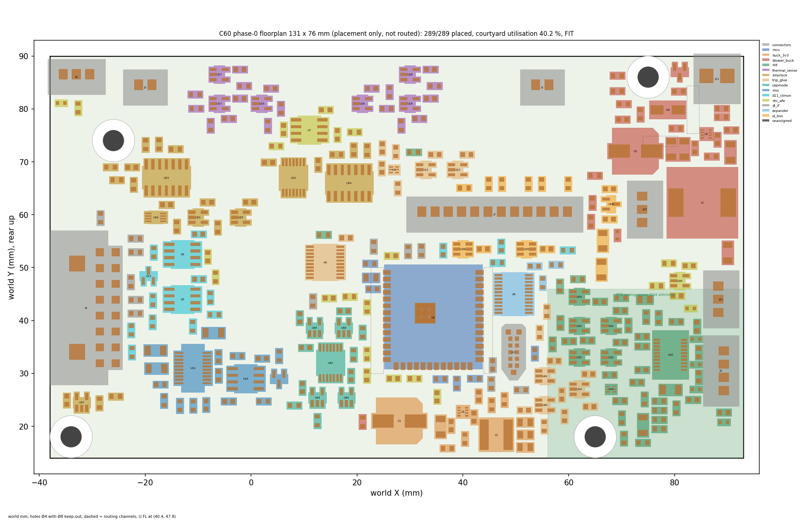

# Controller shrink, phase 0: placement-only floorplan (C60)

Study, 2026-10-27. Placement only: **nothing was routed.** No cargo, make, router, autorouter or Rust build ran.
The C49 board of record, its order package and the enclosure files were only read.

## Answer

- **131 × 76 mm fits.** All 289 C49 footprints are placed on one side, inside the rules C49 uses. Courtyards cover 40.2 % of the board (41.1 % without the hole keep-outs).
- **There is spare room.** The anchored parts still all fit with a 1.5 mm gap between courtyards. C49 uses 0.9 mm. The first failure comes at 1.8 mm.
- **Routing looks no harder than C49 [EST].**
  - Moving the module to the middle cuts the total net length (MST) by 41 %.
  - The board area drops by 36 %. So wiring per mm² is 0.93× C49's.
  - F.Cu demand against free area is 1.09× C49's.
  - The worst 1 % of congestion (RUDY p99) is 1.10× C49's.
- **Hand-routing on 4 layers with 0603 parts is plausible.** Neither 0402 nor 6 layers is needed on these numbers.
- **Enclosure changes:**
  - J3, J12, J10, the U.FL and J11 move.
  - Two holes go.
  - Two new limits come up:
    - the pan-RTD lead may pass its 500 mm limit (est. 505–540 mm);
    - the coax needs about 220 mm. Today's is 150 mm.
- **Verdict: GO for phase 1,** once the enclosure line accepts the landings (decisions D1–D5 below).

## Sources and how to re-run

- `C/` = `/Users/bennet/Desktop/temper/worktrees/ctrl-j13/zapote/controller` (branch `controller-j13-merge`, C49).
- `R43/` = `/Users/bennet/Desktop/temper/output/temper-manufacturing-r43`.
- `r1/` = `../temper-board-shrink-r1`.

Run from this folder, in this order. Each step needs only Python 3 with numpy and matplotlib. KiCad is not needed.

| Script | Reads | Writes |
|---|---|---|
| `scripts/extract_c49.py` | `C/pcb/controller.kicad_pcb`. Its sha256 `b3af25b8…` matches `C/ORDER.md:24-25` (checked by the script) | `results/c49-board.json`: footprints, local courtyards and pads, routed length per layer and net, vias |
| `scripts/floorplan_c60.py` | the above; `C/layout/floorplan.py` PLACE / ANCHOR, `C/layout/world.py`, `C/tools/verify_controller.py` MODELS (read-only, no bytecode written) | `results/floorplan-acut.json`, `renders/floorplan-acut.{png,svg}` |
| `scripts/gap_sweep.py` | the floorplan | `results/gap-sweep.json` |
| `scripts/routability.py` | C49 board + floorplan | `results/routability-acut.json`, `renders/congestion-acut.png` |
| `scripts/enclosure_deltas.py` | floorplan, `R43/assembly.json.gz` | `results/enclosure-deltas.json` |
| `scripts/render_c49.py` | C49 board | `renders/c49-placement.{png,svg}` |

Library files:
- `kicad_courtyard.py` is copied verbatim from `r1/scripts/`;
- `geom.py` and `render.py` are this folder's own.

## 1. Floorplan

Outline: world X−38…93, Y14…90, the r1 "A-cut" (`r1/results/shrink-options.json` `recommended_left_cut`). Holes kept: (−34, 18), (−26, 74), (65, 18), (75, 86).

C49 for comparison: `renders/c49-placement.png`.

### How parts are placed

The script follows `C/layout/build_board.py:339-566`:

| Placed as | Parts | Rule |
|---|---|---|
| C49 pose kept | 45 | Every C49 explicit pose left of X93: J1 J2 J4 J7 J9 J13, J4 analog, RMS, interlock, trip glue, thermal-sense, 3.3 V buck, UI bus, the blower buck's U2 + input caps + bulk + FB strip |
| Rigid group | 24 | **RTD core** (19): J3, the C37 TVS / 220 nF strip, the MAX31865, `c_rtd_input`, both filter rows and the 499 k pull-ups. They are moved as one body and turned −90° so J3 faces the new right edge. **C39 detector** (5 ICs): turned 90° into the front-left field |
| Moved (MOVE table) | 17 | L2, J10, J11, J12, U4, U8, U9, the RTD window logic, the reference, the runaway and rim trips, the rim follower |
| Anchored | 203 | The C49 ANCHOR rule: decoupling caps at their pin with a 0.4 mm gap; other parts at their anchor pin with a 0.9 mm gap; none in hole keep-outs, the U.FL circle or a routing channel |

### Checks (`results/floorplan-acut.json` `checks`)

| Check | Result |
|---|---|
| All 289 placed, no overlaps, every part inside the board | PASS |
| Hole keep-outs (Ø8), U.FL 3 mm clear circle | PASS |
| Kept landings J1 J2 J4 J7 J9 J13 | PASS (same pose as C49) |
| Decoupling ≤ 5 mm, pad to pin (the `check_layout.py:248-279` rule) | PASS, worst 3.75 mm (C49: 2.53 mm, `C/LAYOUT.md:175`) |
| L2/U2 to RTD analog parts ≥ 10 mm (gated, `check_layout.py:434`) | PASS, 10.9 mm (C49: 10.5) |
| L1/U1 to RTD analog parts (C49 76.7 mm; held here at ≥ 10 mm too) | 10.9 mm |
| Blower buck to thermal-sense / J4 analog | 44.7 / 63.9 mm |
| 3.3 V buck to thermal-sense / J4 analog | 52.2 / 36.1 mm (C49: 52.0 / 36.0) |
| `c_rtd_input` to MAX31865 pins 10/11 | Same as C49 (rigid group): 3.91 mm centre to centre |

How the 10 mm keep-apart works here:
- C49 keeps a band free of parts (`C/layout/floorplan.py:254`).
- This floorplan applies the rule directly instead: no RTD analog part may be placed within 10 mm of either buck's inductor or IC.

### Utilisation

| Quantity | Value |
|---|---|
| Board | 131 × 76 = 9 956 mm² |
| Courtyards | 4 005.6 mm², i.e. **40.2 %** (C49: 25.6 %) |
| Placement-rectangle sum (courtyard ∪ pads) | 4 135.8 mm² |
| Largest gap that still places everything (`gap-sweep.json`) | 1.5 mm. At 1.8 mm `r_runaway_bot` finds no spot; at 2.0 mm 9 RTD-region parts fail |

**Parts that do not fit: none.** The RTD region (X56…93, Y14…46) is the tightest area. It is also the first to fail when the gap grows.

### What the floorplan changes, block by block

- **Module U4:**
  - Moves from the far right into C49's empty front-middle field (X25…44, Y31…50), U.FL end still at the rear.
  - Its nets now run a short way to J7 (behind it), the read-back buffer and interlock (left), and the expander, J11 and RTD SPI (right).
- **RTD block:**
  - Sits in the front-right corner. J3 and J12 land on the new right edge.
  - The window logic forms a 2 × 3 array left of the MAX31865.
  - The C34 stitching region moves to X56…93, Y14…46 (`RTD_STITCH`).
- **Blower buck:**
  - U2, J13, the bulk cap and the feed strip are unchanged.
  - L2 moves from right of U2 (off the new edge) to directly in front of it.
  - J10 lands beside L2 as a mid-board top-entry header, like J7.
- **Interlock and J4:** the interlock box (X−20.6…23.1, Y57.8…70.9) and every J4-side part keep their C49 poses. The module sits in front of the box, so MCU nets have no reason to cross it.
- **Not placed:** the silk text ("TEMPER CONTROLLER", SELV mark). It needs a free spot in phase 1.

## 2. Routability (ESTIMATES, `results/routability-acut.json`)

How it is estimated:
- Same netlist, two placements. There are 181 signal nets and 374 connections.
- `selv_gnd` and `v3v3` are left out: they are via-to-plane, with 413 plane vias on C49.
- The C49 figures are measured from the board file. The C60 figures are predictions.

| Measure | C49 | C60 | C60 / C49 |
|---|---|---|---|
| Net length, Euclidean MST, sum | 8 488 mm | 4 985 mm | **0.59** |
| Signal track length | 10 152 mm routed | 6 027 mm predicted (MST × C49's per-net detour, median 1.15) | 0.59 |
| Routable area (board less Ø8 keep-outs) | 15 354 mm² | 9 755 mm² | 0.64 |
| Wiring density, signal only (layer-equivalents at 0.30 mm pitch) | 0.198 | 0.185 | **0.93** |
| F.Cu demand / free area (pads, vias, 0.15 mm halo removed) | 0.160 | 0.174 | **1.09** |
| B.Cu, In2.Cu demand / free area | 0.046, 0.034 | 0.046, 0.034 | 1.00 |
| RUDY congestion, 5 mm windows, p95 / p99 / max (mm/mm²) | 1.69 / 2.08 / 2.60 | 1.64 / 2.29 / 2.68 | 0.97 / **1.10** / 1.03 |
| Cells above C49's measured p99 routed density (1.88 mm/mm²) | 1 % (by definition) | 1.8 %; 0.03 % above 1.25× | — |
| Worst vertical cut (nets per mm of 76 mm cut) | 50 at X115 (0.66/mm) | 48 at X17 (0.63/mm) | 0.96 |
| Worst horizontal cut | 56 at Y61 (0.27/mm) | 60 at Y39 (0.46/mm) | 1.68 |
| Capacity of a cut, F+B / F+B+In2 at 0.30 mm pitch | 6.7 / 10 per mm | same | — |
| Nets between blocks (96), MST | 6 995 mm | 3 766 mm | 0.54 |
| RUN_EN / `line` (RTD_HW_FAULT) / RUNAWAY_FAULT, MST | 189 / 163 / 146 mm | 75 / 101 / 94 mm | 0.39 / 0.62 / 0.65 |

**Calibration.** On C49, RUDY correlates with the measured routed density at r = 0.75, scale 0.89 (`calibration`). `renders/congestion-acut.png` shows three panels: C49 measured, C49 RUDY, and C60 RUDY.

**Where it is tight.** The two C60 hot spots are both module escapes:
- the left pin column against U9 (X19…27, Y41…50);
- the right column against U8 and J11 (X43…47, Y42…50).

This is the same kind of hot spot as C49's. C49's densest measured area is beside its module's left pin column and the expander (X125…142, Y42…57). Module nets were also the ones its router left open (`C/LAYOUT.md:142`).

**Verdict.**
- **Hand-routing on 4 layers is plausible.**
  - The shrink takes area away, but moving the module to the centre takes away wire length about as fast.
  - Every global measure stays within ±10 % of C49's, except the horizontal cut at Y39. That one is 0.46 nets per mm against a capacity of 6.7 per mm.
- **0402 is not needed** for placement (a 1.5 mm gap still fits) or routing. Keep it as a fallback for the module-escape hot spots, where the series and pull-up resistors around U4 and U9 crowd the escape.
- **6 layers is not needed:** B.Cu and In2 stay at about 5 % and 3 % of their free area.
- **Sensitivity [EST]:** if dense routing detours 20 % more than C49 did, F.Cu demand/capacity is 1.30× C49's. That is still far from full, at 0.21 of the free area.

What the estimate cannot see:
- C49 also failed locally. Its router left 1 net open on 2 of 3 runs (`C/DECISIONS.md:726`), and the RTD analog nets are restricted to F.Cu and In2 (C34).
- So phase 1 should hand-route the module escapes and the RTD family first. Those are the parts that decide closure.

**JLC cost effect** (no new quote):

| Choice | Effect | Source |
|---|---|---|
| Smaller board | C49 bare board: 5 pcs at about USD 34.70, i.e. USD 6.94 each, the whole bare-PCB price. The shrink saves at most that per board at prototype quantity | `C/DECISIONS.md:724`; r1 §4 |
| 6 layers | No controller quote in the repo. Native-21's Gerber quote: 6 L on a pinned stack is USD 1.83/board dearer than 4 L at 500 (+10.6 %), and 10–11 days against 5–6. At qty 5 with no stack requirement, 6 L was USD 196.59 against USD 186.99 for 4 L (+5 %) | `zapote/power-stage-120v/DECISIONS.md:1263-1281`; `…/c33-six-layer/jlc-quote-2026-10-14.json` |
| 0402 | No fab price change. It brings new MPNs for 111 parts, a `bom/controller-parts.json` and verify `bom` update, and a stock re-read. JLC's per-type extended-part fee is not in the repo (`C/ORDER.md:159`); 83 of 89 lines are already extended | r1 §3 D |

## 3. Requests and new inputs

### To the enclosure line (`results/enclosure-deltas.json`; cable lengths are [EST])

| Item | C49 / R43 | C60 | Effect |
|---|---|---|---|
| Board outline | X−38…168, Y14…90 | **X−38…93**, Y14…90 | Frees X93…168: 75 × 76 mm |
| Support holes | six | (164, 18) and (164, 80) **deleted**, with their snap supports and spot-faced base holes | BOM −2 supports |
| J3 pan RTD (6-core cartridge cable) | (152, 86) rear edge, body along X | body centre **(88.75, 30.5) on the right edge**, rotated 90° (rect X85.4…92.1, Y23.8…37.2) | Cable 421 mm today → **505–540 mm, over the 500 mm lead limit** (`C/ENCLOSURE-HANDOFF.md:32`). Needs a shorter route or a limit decision (D3) |
| J12 rim NTC breakout | (126, 86) | **(88.75, 44.0) on the right edge**, rotated 90°, 13.5 mm above J3 | The breakout is shorter than R38's (J3 and J12 are adjacent) |
| J10 blower | (139, 86) rear edge | **(74.4, 61.0) mid-board**, top entry, rotated 90° (X71.0…77.8, Y55.6…66.5) | Lead 702 → 771–792 mm. Check against the PS3 DC pair's route over the controller (R42/R43) |
| U.FL / coax | (156, 67); 150 mm coax, 103 mm used | **(40.4, 47.8)**, under the fascia UI board (Z43.4+) | The same route from the new spot is 217 mm; straight line 142 mm. **The 150 mm coax is too short.** Needs about 250 mm, or an antenna move; the coax must leave sideways below Z43. Re-run E4 / T4 |
| J11 TC2050 land | (138, 19) | (49.6, 34.0) | Bring-up probe access from above, beside the module |
| Re-run | — | — | R28 "every SELV cable ends on its plug" (`R43/design/r43/HANDOFF.md:36`) for J3, J12, J10 and the coax; `check_route_landings.py`; `check_service_loops.py` |

Unchanged:
- J1, J2, J4, J7, J9 and J13;
- holes (−34, 18), (−26, 74), (65, 18) and (75, 86);
- board Z23, the Z40 limit and J13's local allowance;
- the J4 harness and R43's J13 barrier (X60…124 strip behind Y90). Its 2.20 mm to the board edge and J13 still holds over X60…93.

### Controller checks that need new inputs

| Tool | What changes |
|---|---|
| `layout/world.py` | `BOARD`, `HOLES` (4), `CONNECTORS` J3/J10/J12 (plus a rotation field), `WROOM` box, `UFL_SPEC`, `REVISION`; J11 pose |
| `layout/floorplan.py` | PLACE: this folder's MOVE and GROUPS. UNPIN the 9 C49-specific poses. New CHANNELS. KEEP_APART as a placement rule. `RTD_STITCH`, `SILK` |
| `layout/build_board.py` | Support rigid groups and rotated connectors. `buck_pours()` draws the SW band to the right of U (`build_board.py:419-428`); L2 is now in front of U2, so it needs a new band shape |
| `layout/check_layout.py` | `connectors`: J3's "along the rear edge" test (`:173-177`) becomes right edge, plus J10/J12 rotation. `holes` and `outline` come from world.py automatically. `wroom` box. Add L1 → RTD ≥ 10 mm as a gate. `rtd_j3_protection` distances must equal C49's (rigid group) |
| `tools/controller_calcs.py landings()` | New holes and landings |
| `tools/verify_controller.py` | **Unchanged** (schematic only, 233 checks) unless 0402 is adopted (then the `bom` section) |
| `layout/fab.py` + CPL audit | All 288 placements move. J3, J10 and J12 change rotation, so the rotation audit and JLC preview are redone (C50 needed two passes) |
| Block validators (`evidence/block-validators/run.sh`) | **Need a zapote-harness (Rust) build. Not run here.** Run them on the remote box after routing |

## 4. Go / no-go and phase 1

**GO**, on the controller side. The outline fits with margin, and the routing estimate is at C49's level. Phase 1 should not start routing until D1–D5 are settled.

### Decide first

| # | Decision | Owner |
|---|---|---|
| D1 | The enclosure has a use for the freed X93…168 strip. The owner approved the shrink; the enclosure line confirms it takes the space | Owner / enclosure |
| D2 | The enclosure revision for the new landings: R44 is reserved for Codex controls, so either **R45**, or fold into R44 if that has not started | Enclosure |
| D3 | **Decided 2026-10-27 (owner: the enclosure adapts): raise the pan-RTD lead limit to 600 mm.** The 500 mm figure is an underived guideline (`docs/CONNECTORS_AND_WIRING.md` §3.3 on origin/main, "Max 500mm", no basis given). The 4-wire connection cancels lead resistance: 0.54 m of AWG28 is about 0.12 Ω per conductor [EST, 0.21 Ω/m], about 0.5 mV at the MAX31865's ~3–5 mA bias, carried on the force leads. Cable capacitance of about 30–55 pF [EST, 50–100 pF/m] is small next to the planned differential RC. Pickup from the coil depends on routing and the shield, not on 40 mm of extra length. Keep it shielded twisted, drain at the controller end only, routed away from the winding. | Closed |
| D4 | **Decided 2026-10-27: 250 mm U.FL 1.13 mm coax,** a stock length, routed out sideways under the UI board below Z43. The extra 100 mm adds roughly 0.3–0.4 dB at 2.4 GHz [EST, ~3–4 dB/m for 1.13 mm coax]. Wi-Fi is optional and its range is unqualified (C21), so this is not a constraint. Keep the antenna board's placement clear of metal; that matters far more than the cable. Re-run E4 when the antenna position is final | Enclosure |
| D5 | Keep 0603 and 4 layers (recommended on this study's numbers; 0402 only as a module-escape fallback) | Controller |

### Phase 1 (hand-routed in the layout source, never autorouted)

Branch: new `controller-c60-shrink` from `controller-j13-merge`. C49 stays the board of record and is not touched.

1. **Parameters.** Port the floorplan into `world.py` and `floorplan.py` (table above). Extend `build_board.py` for groups, rotated landings and the L2-in-front SW band.
2. **Placement gate.** Run `build_board.py` with KiCad Python (no Rust). Explicit poses must match `results/floorplan-acut.json` within 0.1 mm. Then run `check_layout.py`, updated as above.
3. **Hand-route.** Write the routes as explicit waypoint tables in `layout/` (one file per block). Apply them with `apply_routes.py`, extended to In2.Cu. Keep `fanout.py` for the plane vias. Route in this order, running `kicad-cli` DRC for the unconnected count after each step:
   - power: SW nodes, BLW_FEED, V_BLOWER at 0.8 mm from L2 to J10;
   - the RTD analog family on F.Cu/In2 only, with the C34 stitching;
   - module escapes, left column (U9 side) first;
   - interlock and trip lines, with MCU nets kept out of the interlock box;
   - long nets: RUN_EN, PWM/ZC, `ct_buf_out`, RTD SPI to U15;
   - everything else.
4. **Gates.** DRC 0 / 0 / 0, `jlc_dfm_check.py`, `check_layout.py`, `via_hygiene.py`, `fab.py`, `review_fab.py`, `verify_controller.py`.
5. **Validators and fab.** Block validators (Rust harness, remote box). `controller_calcs.py landings()`. CPL rotation audit and JLC preview.
6. **Hand-off.** Give the enclosure revision (D2) the `world.py` numbers. It re-runs the plug-end and landing checks for J3, J12, J10 and the coax.

Carried over unchanged from C49:
- U15 (MCP3202) still sits at the far left on the RTD SPI bus, not between the MCU and the RTD block as `C/ENCLOSURE-HANDOFF.md:91` asks. The bus is 80 mm (MST) instead of 172–188 mm.
- The RTD SPI return over v3v3 (validator W4, open item 14) is unchanged.
