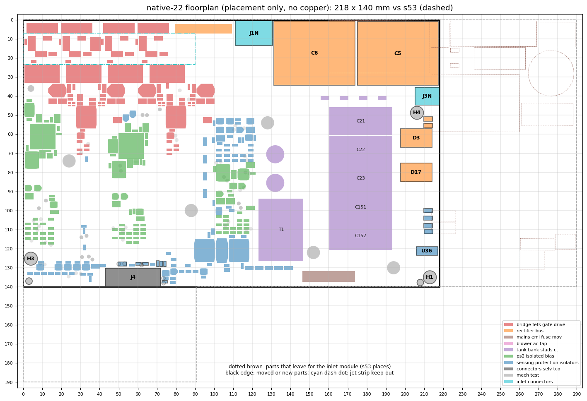

# Power board production shrink (native-22), phase 0: floorplan and thermal gate

Date 2026-10-27. Placement only. **No copper was routed, no autorouter, no Rust or chain build.** The prototype lot
stays s53, unchanged. Every number below comes from a script in `scripts/` (output in `results/`, `renders/`) or
from a cited file. Estimates are labelled **[EST]**. Path prefixes: **PS** = `zapote/power-stage-120v`, **B3** =
`PS/validation-results/04-board-current-thermal/round5-native21`.

## 1. Answer

- **The target outline fits.** All parts that stay on the board fit in **218 × 140 mm** (30,520 mm², 68 % of
  s53). Courtyards cover 42.1 % of it (s53: 39.7 %). The packer also fits **210 × 140**, but that variant is worse
  (longer mains lanes, hotter bus caps). It does not fit at 209 or below.
- **The power core does not move.** 398 parts keep their exact s53 poses: the FET row, BR1, the HF film row, R5,
  the gate networks, the bias islands, T1, the bank and the coil studs. 29 parts move, 2 connectors are new, and
  17 parts leave (15 to the inlet module, 2 empty holes).
- **Thermal gate: it passes, narrowly, in still air.** B3 was run on a floorplan proxy (section 3). The 17.5 A
  release case gives **+0.2 K** at h 10 W/m²K. s53 gives +1.3 K under the same settings. **h ≈ 10.4** restores
  s53's margin. At 28 A on the jets route, the board needs **h ≥ 16.2** (s53: 15.4).
- **That holds only if the vacated rear band gets plane copper.** Left bare, the needs rise to h 11.2 and 18.0.
- **The shrink costs much less heat margin than the r1 estimate.** r1 estimated −2.6 to −4.8 K; the proxy B3 gives
  −1.1 K. The board loses 18 % of its heat along with the area (L1, PS2, mains copper). The R10 hot spot is set
  by the core, and the core does not change.
- **New risk found: the bus caps.** C5/C6 now sit beside the FET row. Their advisory case row reads 105.6 °C
  against TDK's 105 °C at 28 A (s53: 93.9 °C). Phase 1 must fix this by placement or airflow.
- **Go / no-go: not yet.** Do not route until four things are true: bench h is measured on s53, the inlet module is
  designed, the lab has answered on insulation, and R45 accepts the outline (section 5).

## 2. Floorplan

Script: `scripts/floorplan.py` (about 5 s). Results: `results/floorplan_native22_218.json` (every part's pose,
transform and bbox) and `renders/floorplan_native22_218.{svg,png}`. The 210 variant has the same files with the
suffix `_210B`. The width scan is in `results/width_scan.json`.



**Rules.**
- Parts keep their s53 pose unless they are outside the new outline or leave the board.
- Moved parts are placed by a greedy raster packer (0.25 mm grid). Each placement must keep:
  - a courtyard gap of at least 0.5 mm, on the same side (THT parts block both sides);
  - at least 0.5 mm to the board edge (connectors with an edge rule may sit flush, as s53's J1 and FET tabs do);
  - every pad at least 8.0 mm + 2 cells from copper of the other isolation side, counting the s53 copper of fixed
    parts and the pads of parts already placed;
  - clear of the jet-strip keep-out and 10 mm from each coil stud.
- Among the legal spots, the part takes the one nearest its anchor (the intent: J1N beside BR1, J4 on the front
  edge, and so on). The anchors are listed in `RECIPES`.

| Item | Result |
|---|---|
| Outline | 218 × 140 mm rectangle, no tongue (recipe A). Smallest found: 210 × 140 (recipe B). Recipe A fails at 217 and below, recipe B at 209 and below: C5 no longer fits the rear band |
| Utilisation | 12,855 mm² of courtyard (union) = 42.1 % (210: 43.7 %) |
| Parts | 398 fixed, 29 moved, 2 new (J1N, J3N), 17 removed |
| Leave for the inlet module | J1, F1, RV1, C1, C2, C3, C4, R1, R2, L1, PS2, J3, F2, R130, J11: 5,386 mm² of courtyard |
| Dropped | H2, H9 (empty in R43, DECISIONS 76) |
| Moved | C5, C6 to the rear band; D3, D17, R3, R4, the LINE_ZC string R67–R70 and U36 to the right strip; J4 to the front edge; the six J4 parts and four test pads beside J4; C176 and TP19 out of J4's slot; holes H1/H3/H4/H8 and fiducials FID2/FID3 |
| Barrier audit (exact pad polygons) | min HOT–SELV/PE pad gap between different parts 8.17 mm; for moved or new parts 8.27 mm; nearest moved SELV pad to RES_A outer copper 40.4 mm (rule 12.6) |
| Parts that did not fit | none at 218 or 210 |

**Why 218 and not smaller.** The bank's right edge is at x 193.25 and stays put. C5 and C6 (42.4 × 33.5 mm each)
can only go on the rear band, next to J1N. Laid side by side after J1N, they end at x 217.5. Recipe B moves J1N
to the far end of the band and turns C6, which reaches 210. The cost: J1N's centre moves from 22–29 mm to 100–107 mm from BR1's AC pins
(`j1n_centre_to_br1_ac_pins_mm`), so the L/N lanes grow, and the bus caps run hotter (section 4).

**What the floorplan does not settle.** Copper, routability of the right strip and of J4's escape, the J4 harness
length, and the enclosure fit. Those are phase 1 and R45 items.

## 3. Thermal gate: method

**B3 can run on a floorplan, through a proxy, with no build.** B3 is pure Python (numpy / scipy / shapely). It
needs four inputs:
- per-layer copper masks;
- pads (for the part networks);
- the A4 copper Joule-heat fields;
- the heat rows and part bodies.

A floorplan has none of the copper. `scripts/proxy.py` therefore builds a **transplant proxy**: s53's own copper
travels with each part.

1. **Territory.** Each board cell belongs to the part whose courtyard is nearest. Holes, fiducials and test pads own
   nothing. This is computed on s53 and on the new floorplan.
2. **Copper.** A native-22 cell takes the s53 copper (all four layers, at B3's 0.0625 mm) from the same spot
   relative to its owner, if that spot was the same part's territory on s53. Fixed parts keep their copper bit for
   bit. 92.6 % of cells are filled this way.
3. **Gaps** (7.4 % of cells; 5.7 % get filled). A gap cell takes the owner's mean s53 fill fraction per layer,
   dithered. SELV/PE owners fill only ≥ 8 mm from HOT copper, and HOT owners only ≥ 8 mm from SELV/PE copper, so the
   moat stays bare. Parts that straddle the barrier fill nothing.
4. **Pads and vias.** Pads are placed at their new poses. Vias move with their owner. 36 of 3,108 via primitives (4 layers
   each) are dropped with removed parts.
5. **A4 heat.** Each heat cell moves with its s53 owner.
   - Heat owned by parts that leave goes with them: 0.43 W of the unscaled case losses, almost all of it the mains
     lanes by RV1 / L1 / F1.
   - All other heat is kept wherever it lands, even 0.70 W that now falls outside its owner's new territory. No lane
     is shortened, so this is conservative for the bus path to C5/C6.
6. **Heat rows.** L1 and PS2 are removed. C5, C6 and R67–R70 move with their parts.

Result (`results/proxy_native22_218.json`): copper fractions F / In1 / In2 / B are 18.0 / 52.8 / 39.4 / 26.7 %.
s53 has 18.7 / 51.8 / 42.1 / 23.5 %. `renders/proxy_copper_native22_218.png` shows every layer.

`scripts/run_b3.py` runs **the committed B3 code unchanged**: `body_runs.run_case`, `run_basis.inputs` /
`region_for` / `LEAD_G`, `fet_case.t_case`, and `b3_ratings_gate.evaluate` / `probe_rows` / `module_rows`. It only
points them at the proxy's geometry, A4 cells, heat rows and part bodies.
- Settings for both boards: bay 61 °C; I_line 13.5 A; hot copper; FET drain-lead path; probes on; 0.25 and 0.5 mm
  meshes with the gate's K_MESH extrapolation; every gated row.
- 17.5 A: the c17.5 case (18.375 A) with h on both faces.
- 28 A: c28 (29.4 A) on the declared S24 route: jets at h_top 100 on `JET_REGION`, plus base h.

**Control.** s53 goes through the same runner and reproduces the committed release solve
(`B3/b3-ratings/runs/c17.5_h10_p0p25.json` and `_p0p5`) exactly: the same source watts, 1 mm-block peak and every
part pad (difference 0.0 K). Gated, it gives +1.3 K on R10, which is `margins.json`'s value
(`results/b3_s53.json` `s53_control`).

## 4. Thermal gate: results

Source: `results/thermal_gate.json`, `results/b3_<board>.json`. The plot is `renders/thermal_gate.png`. "Margin"
is the worst gated B3 row on the board. s53's PS2 local-air row (+4.2 K at every h; it is set by the 15 K air rule,
not by h) is left out of the comparison, because PS2 leaves the board.

**17.5 A release basis (still-air form), bay 61 °C**

| h W/m²K | s53 | native-22 218 | Δ | native-22 210 | 218 with a 2 W-class R_on [EST] |
|---|---|---|---|---|---|
| 10 | +1.3 (R10) | **+0.2 (R10)** | −1.1 | +0.5 | +3.4 (laminate 1 mm block) |
| 12 | +6.3 | +5.4 | −0.9 | +5.6 | +8.5 |
| 16 | +13.3 | +12.6 | −0.7 | +12.8 | +14.8 (U26) |
| 19 | +17.1 | +16.6 | −0.5 | +16.7 | +17.9 |
| 25 | +22.3 (U26) | +22.1 (laminate) | −0.2 | +22.3 | +22.1 |

**28 A, S24 jets (h_top 100) + base h, bay 61 °C.** In every column the binding row is the FET-row laminate.

| h W/m²K | s53 | native-22 218 | Δ | native-22 210 |
|---|---|---|---|---|
| 10 | −9.8 | −11.3 | −1.5 | −11.5 |
| 12 | −5.5 | −6.9 | −1.4 | −6.9 |
| 16 | +0.9 | **−0.2** | −1.1 | −0.2 |
| 19 | +4.5 | +3.5 | −1.0 | +3.6 |
| 25 | +10.1 | +9.2 | −0.9 | +9.3 |

**h needed** (linear between the solved points):

| Case | s53 | native-22 218 |
|---|---|---|
| 17.5 A, margin ≥ 0 | ≤ 10 (+1.3 K at 10) | ≤ 10 (+0.2 K at 10) |
| 17.5 A, keep s53's +1.3 K | 10 | **10.4** |
| 28 A on jets, margin ≥ 0 | 15.4 | **16.2** |
| 28 A, DECISIONS 69 bench pass rule (nominal ≥ 1.2 × h_req) | 18.5 | **19.4** |
| The four needs above with the vacated band left bare (sensitivity below) | — | 10.8 / 11.2 / 18.0 / 21.6 |

**Why the loss is small.**
- The board heat falls from 16.63 W to 13.57 W at the release case.
- Face convection falls from 13.33 W to 11.58 W, and the mean face rise rises from 14.8 K to 19.0 K.
- The R10 / laminate hot spots sit in the unchanged core. The far field there rises by about 1 K, not by the
  whole-board factor that r1's lumped model applied.
- With R_on unchanged, R10 still binds. A 2 W-class R_on moves the binding row to the laminate block (+3.4 K), the
  same row that binds s53 with that part (+3.8 K).

**Advisory rows that got worse (bus caps, TDK B32676 Top,max 105 °C case; package path assumed).**

| Case | s53 hotter cap | 218 hotter cap | 210 hotter cap |
|---|---|---|---|
| 17.5 A, h 10 | 80.8 °C (C5) | 87.7 °C (C6) | 95.3 °C (C6) |
| 28 A, h 16 + jets | 93.9 °C (C5) | **105.6 °C** (C6) | **116.7 °C** (C6) |
| 28 A, h 19 + jets | 91.7 °C | 101.4 °C | 111.6 °C |

C6 now sits next to J1N and BR1, on the hot rear band. The proxy keeps all of the s53 bus-path heat that moved with
C5/C6 (no lane shortened), so these readings lean high. They are still a real flag (RELAYOUT S7). OPEN-ITEMS S8
already limits C5/C6 at 28 A to a cap ambient ≤ 80 °C.

**Proxy copper sensitivity: the vacated rear band must be poured.** The same 218 board was re-solved with every
gap cell left bare (`proxy.py --no-gap-fill`, board `native22_218_nofill`). The filled gap is 1,748 mm². Most of it
is In1/In2 plane copper owned by C6 and J1N, beside BR1 and the FET row (x 110–135), and on the right strip.

| Case | gaps filled (expected) | gaps bare (pessimistic) |
|---|---|---|
| 17.5 A, h 10 | +0.2 K | −2.1 K |
| 17.5 A, h 12 | +5.4 K | +3.4 K |
| 17.5 A, h for margin ≥ 0 / to keep s53's +1.3 K | ≤ 10 / 10.4 | 10.8 / 11.2 |
| 28 A jets, h 16 / h 19 | −0.2 / +3.5 K | −2.7 / +1.3 K |
| 28 A jets, h for margin ≥ 0 | 16.2 | 18.0 |

So the result holds only if phase 1 pours the HV_RET / BUS_P planes across the rear band, from the FET row to
C5/C6. That is the natural plane layout, but it is now a requirement (RELAYOUT S10).

**Limits.**
- The proxy is not a routed board. The real native-22 copper will differ, mostly in the bus planes between the FET
  row and C5/C6. Re-run B3 on the routed board before release (RELAYOUT S10).
- Board h is uniform on both faces (the B3 basis). The 28 A jets use s53's `JET_REGION`, and the core keeps its
  coordinates, so they line up.
- Bay air is held at 61 °C. A larger inlet module carrying ≥ 10.6 W in the bay could raise it; that is an R45 item.
- PS2's local-air limit (80.2 °C, 0.948 ledger ratio) moves to the module. The board no longer carries it, but the
  module must.
- Comparison with r1's lumped model (`output/temper-board-shrink-r1/POWER-BOARD.md` §6): r1 gave h ≈ 12 at 17.5 A
  and ≈ 19 at 28 A. The proxy B3 gives 10.4 and 16.2. r1 called its own numbers first-order.

## 5. Go / no-go before routing

**No-go today.** Routing may start when all of these are true:

1. **[AIR] Board-face h measured on s53 prototypes** by the DECISIONS 69 inversion. The still-air release needs
   h ≥ 10.4 at the worst condition. If it reads below 10, either fit a 2 W-class R_on (S11), or ship native-22 with a
   still-air ceiling below 17.5 A. For 28 A, nominal h ≥ 19.4 (1.2 × 16.2).
2. **[INLET] The inlet module is designed** with everything in RELAYOUT S2:
   - a DM inductor chosen;
   - the EMI model (s19b) re-run with L1 and the Y caps in the module;
   - touch current re-run (today 8.8 µA of margin);
   - PS2 local air and module heat (≥ 10.6 W) checked in the R45 bay.
3. **[CERT] The certifier has answered:**
   - insulation-basis r1 §5 Q1–Q3: is basic insulation acceptable at the sink, and how is R38 / PELV classified;
   - the F1 / J1 / Y-cap items, which now sit on the module.
   These fix the sink insulator (S8) and whether the 8.0 mm floor stands (S9).
4. **[R45] Enclosure R45 accepts:**
   - the 218 × 140 outline;
   - the new J4 landing and harness (S4);
   - the moved standoffs (S12);
   - the bigger module;
   - the C5/C6 bodies in the S24 base-flow box.
5. **[PART]** Pick the 2 W-class R_on part, or rule it out.

## 6. Phase 1 plan (hand-routing, after the go)

Every lane is written explicitly in the layout source. No Freerouting, no autorouter.

1. Fork `PS/native-21/layout/` into a native-22 layout source. Set the 218 × 140 outline and take the poses from
   `results/floorplan_native22_218.json`.
2. **Copy s53's core copper verbatim:**
   - FET row, film row, R5 / Kelvin, gate and F6 networks, bias islands, bank / tank lanes;
   - then run `leg_region_diff.py` s53 → native-22. It must report both legs UNCHANGED.
3. Move the bus caps and fix the S7 flag:
   - place C5/C6 and pour the In1 HV_RET / In2 BUS_P planes across the whole rear band to them (the thermal
     result depends on it, section 4);
   - move C6 off the BR1 end, or get flow onto the caps;
   - re-run B3 on that copper, and finish this step before the SELV-side work.
4. Hand-route J1N → BR1 (L/N lanes, 13.5 A) and J3N → the LS bias. Lay the LINE_ZC string and U36 at the right end
   of the SELV corridor.
5. **J4 on the front edge:**
   - escape the SELV island to it;
   - re-check the D-10 / D-20 return allocation and the SELV spine lock.
6. Pours and planes:
   - check the 8.0 mm barrier and RES_A 12.6 mm with `barrier_gate21`-equivalent gates;
   - check the PE branch (J6 / R38) at ≥ 8 mm.
7. Gates:
   - DRC / ERC, source audit, JLC DFM;
   - Kelvin band (`kelvin_plane.py` / `kelvin_budget.py`, ≥ 44 A);
   - F6 decks if any leg changed;
   - B3 ratings on the routed board with the measured h;
   - R45 fit (`fit_gate.py --mode plan`);
   - scorecard.
8. A new order package (not the s53 one).

## 7. Reproduce

From `scripts/`. Standard Python with numpy / scipy / shapely / matplotlib. The s53 run folder
`worktrees/runs-native21/s53/c53int` (outside git) must exist; the script checks its SHA-256. Large regenerable
files go to `work/` (gitignored).

```
python3 floorplan.py --scan                    # 218 floorplan + width scan (~4 min)
python3 floorplan.py --width 210 --recipe B    # the compact variant
python3 proxy.py --board s53                   # control inputs
python3 proxy.py --board native22              # 218 proxy  (--floorplan ../results/floorplan_native22_210B.json for 210)
python3 run_b3.py --board s53 --cases c17.5_h10@61 --check-s53   # control: reproduces the committed solve
python3 run_b3.py --board s53 --workers 3      # 10 cases x 2 meshes, ~5-8 min per 0.25 mm solve
python3 run_b3.py --board native22_218 --workers 3
python3 run_b3.py --board native22_210B --workers 3
python3 proxy.py --board native22 --no-gap-fill && python3 run_b3.py --board native22_218_nofill \
    --cases c17.5_h10@61,c17.5_h12@61,c28_h16_jet100@61,c28_h19_jet100@61   # sensitivity
python3 summarize.py                           # thermal_gate.json, inlet_module_budget.json, thermal_gate.png
python3 render_proxy.py                        # proxy copper render
```
