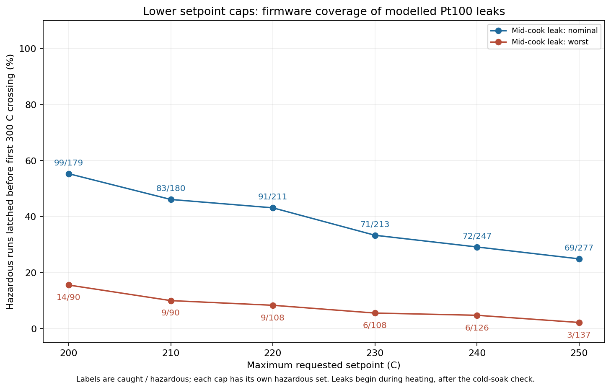

# T2 — maximum user setpoint and Pt100 leak coverage

This is a sensitivity study for a human product decision. No firmware constants, existing studies, or existing evidence are changed.

**Hazard definition (owner, 2026-10-16).** A run is hazardous when its untripped pan-centre temperature crosses 300 °C at any time, transient overshoot included (`leak_checks.hazardous()`, the unrounded first crossing). Until 2026-10-16 the studies used the final-tail mean (`T_c_steady`) instead; that count is kept for information as `caps.<cap>.<ensemble>.steady_rule_hazardous_info`, and `hazardous_settling_at_or_below_bar` counts the hazardous runs that overshoot and settle at or below the bar.

## Combined coverage

The plot and mid-cook columns cover any first firmware latch in `leak_checks.LATCHES`, including the leak chain, rim limit and rim over-range. The leak begins during heating, so cold soak contributes no catches to those runs. The last column reports the cold check alone for temperature-independent leakage already present at an eligible cold start, with a measured rail at the stated ambient. These are distinct onset scenarios, with no assumed probability of a cold-present leak. They cannot be combined into a physically validated cold-start trajectory by adding or joining counts: leakage from cold can change D1 and the subsequent trajectory. That would require a separate coupled cold-start simulation.

Source: `combined_table[]`; each count and percentage is regenerated into `setpoint-cap.json`. Nominal/worst denominators are separate ensembles. `caps.<cap>.{nominal,worst}.highest_hazardous_R_ohm` gives the highest hazardous resistance (weakest hazardous conductance); lowest resistance is also recorded, since the older study calls that the largest leak.

| Cap C | Nominal before / hazardous (%) | Worst before / hazardous (%) | Never, nominal / worst | Highest hazardous R, nominal / worst (ohm) | False, benign / stress | Cold check alone at 25 C, measured rail, nominal / worst (%) |
|---:|---:|---:|---:|---:|---:|---:|
| 200 | 99/179 (55.31) | 14/90 (15.56) | 0 / 0 | 965.5 / 965.5 | 0 / 0 | 100.00 / 80.00 |
| 210 | 83/180 (46.11) | 9/90 (10.00) | 0 / 0 | 965.5 / 965.5 | 0 / 0 | 100.00 / 80.00 |
| 220 | 91/211 (43.13) | 9/108 (8.33) | 0 / 9 | 1293.2 / 1293.2 | 0 / 0 | 100.00 / 66.67 |
| 230 | 71/213 (33.33) | 6/108 (5.56) | 0 / 9 | 1293.2 / 1293.2 | 0 / 0 | 100.00 / 66.67 |
| 240 | 72/247 (29.15) | 6/126 (4.76) | 9 / 18 | 1732.1 / 1732.1 | 0 / 0 | 86.23 / 57.14 |
| 250 | 69/277 (24.91) | 3/137 (2.19) | 4 / 21 | 2319.9 / 2319.9 | 0 / 0 | 76.53 / 52.55 |



## First mechanism and timing

Source: `caps.<cap>.<ensemble>.by_first_mechanism`; pairs are before / after the first crossing. `none.never` is the never-latched count within the run horizon. A same-tick latch and crossing counts as after, matching the original strict-before rule. The JSON retains all other mechanisms separately, including the sensor guard and supervisor.

| Cap C | Ensemble | Leak before / after | Rim limit before / after | Rim over-range before / after | Other before / after | Never |
|---:|---|---:|---:|---:|---:|---:|
| 200 | nominal | 0 / 0 | 99 / 80 | 0 / 0 | 0 / 0 | 0 |
| 200 | worst | 0 / 0 | 14 / 76 | 0 / 0 | 0 / 0 | 0 |
| 210 | nominal | 0 / 0 | 83 / 97 | 0 / 0 | 0 / 0 | 0 |
| 210 | worst | 0 / 0 | 9 / 81 | 0 / 0 | 0 / 0 | 0 |
| 220 | nominal | 1 / 0 | 90 / 120 | 0 / 0 | 0 / 0 | 0 |
| 220 | worst | 0 / 0 | 9 / 90 | 0 / 0 | 0 / 0 | 9 |
| 230 | nominal | 1 / 0 | 70 / 142 | 0 / 0 | 0 / 0 | 0 |
| 230 | worst | 0 / 0 | 6 / 93 | 0 / 0 | 0 / 0 | 9 |
| 240 | nominal | 1 / 0 | 71 / 166 | 0 / 0 | 0 / 0 | 9 |
| 240 | worst | 0 / 0 | 6 / 102 | 0 / 0 | 0 / 0 | 18 |
| 250 | nominal | 1 / 0 | 68 / 204 | 0 / 0 | 0 / 0 | 4 |
| 250 | worst | 0 / 0 | 3 / 113 | 0 / 0 | 0 / 0 | 21 |

## Late-latch exposure

Sources: `caps.<cap>.<ensemble>.late_thermal` (ranges), and `setpoint-cap-rows.json.gz` `<cap>.<ensemble>[].late_thermal` (every late hazardous run). Passive-until-latch reports the original trajectory up to its first latch. Passive-full-horizon reports continued heating with every latch passive, exactly as `leak_checks.run_case` operates. Both peak temperature and time above the bar are reported for each window; full-horizon metrics are not a post-shutdown prediction. Coverage counts detection timing and does not establish that an early-latched pan remains below the bar after power removal. The existing API has no actuation argument. Minimal extension needed, not made under this task's rules: add an optional `actuate_latches=False` argument to `leak_checks.run_case`; when enabled, remember the first latch and force plant input power to zero from the next control period onward, keeping the default passive path unchanged. That would permit shutdown peak/exposure measurement with the existing truth plant; its first latch should be checked against the passive run. No functions or truth-model classes are replaced by this script.

Exposure counts sampled periods at 0.1 s resolution; peak temperatures are rounded to a tenth of a degree. A final sample still above the bar means the duration is censored by the 1800.0 s horizon.

| Cap C | Ensemble | Late runs | Passive through latch: peak C range | Through latch: seconds above range | Passive full run: peak C range | Passive full run: seconds above range | Still above at horizon |
|---:|---|---:|---:|---:|---:|---:|---:|
| 200 | nominal | 80 | [301.1, 381.6] | [0.5, 38.1] | [309.6, 783.8] | [113.6, 1496.8] | 77 |
| 200 | worst | 76 | [300.1, 486.1] | [0.7, 200.4] | [309.3, 782.6] | [203.1, 1496.4] | 70 |
| 210 | nominal | 97 | [300.2, 392.6] | [0.4, 60.7] | [324.1, 819.5] | [152.8, 1496.8] | 92 |
| 210 | worst | 81 | [301.4, 501.1] | [3.0, 234.5] | [324.9, 816.4] | [235.7, 1496.4] | 78 |
| 220 | nominal | 120 | [300.2, 403.3] | [0.5, 72.8] | [304.8, 819.5] | [163.8, 1496.8] | 106 |
| 220 | worst | 90 | [300.1, 515.6] | [0.4, 437.5] | [305.0, 816.5] | [213.4, 1496.4] | 80 |
| 230 | nominal | 142 | [300.6, 413.2] | [0.5, 84.2] | [318.4, 819.5] | [146.4, 1496.8] | 133 |
| 230 | worst | 93 | [302.0, 529.7] | [6.7, 488.2] | [319.1, 816.5] | [215.3, 1496.4] | 86 |
| 240 | nominal | 166 | [300.2, 422.5] | [0.5, 107.7] | [306.4, 819.5] | [103.7, 1496.8] | 141 |
| 240 | worst | 102 | [302.2, 543.1] | [9.2, 532.1] | [306.4, 816.5] | [213.2, 1496.4] | 92 |
| 250 | nominal | 204 | [300.0, 431.1] | [0.1, 329.1] | [300.0, 819.5] | [3.8, 1496.8] | 176 |
| 250 | worst | 113 | [300.1, 556.2] | [1.6, 608.3] | [300.1, 816.5] | [17.7, 1496.4] | 98 |

## Cold soak: before heating, only if the leak is present when cold

The existing check runs at eligible PREHEAT entry, before any heating; it is not an unconditional power-up latch. The original idle/history, heatsink, flatness and rim-saturation conditions still apply. A leak forming later during a cook cannot be caught by this layer for that cook. `window` denotes the existing RTD low-resistance fault rather than D-SOAK.

Source: `caps.<cap>.cold.<ensemble>.coverage.<rail>.<family>.<ambient>`. The script reweights committed `cold-soak.json` `hazardous.per_leak_value` by the newly hazardous runs at each cap, rather than carrying over the original denominator. Fractions in the table count hazardous runs; each JSON cell also records `distinct_leak_values` and `caught_R_ohm` for the fraction of distinct hazardous resistance values. Nominal uses the nominal cold corner; worst uses the cold check's miss corner as well as the dynamic cold-stack ensemble. Rail unknown is `rail_fallback`. The same committed benign cold-start sets are retained at their original cook temperature, a conservative envelope for lower caps: `model.cold_benign`.

The next table gives temperature-independent leakage fractions at the displayed ambient and the minimum/maximum percentages across the source ambient grid. All Arrhenius families, ambients and counts are also in the JSON; no distribution over ambients or leak families is assumed.

| Cap C | Ensemble | Rail | At 25 C: caught / hazardous (%) | Range across ambients (%) | Arrhenius range across all Ea and ambients (%) |
|---:|---|---|---:|---:|---:|
| 200 | nominal | rail_fallback | 179/179 (100.00) | 100.00–100.00 | 0.00–100.00 |
| 200 | nominal | rail_measured | 179/179 (100.00) | 100.00–100.00 | 0.00–100.00 |
| 200 | worst | rail_fallback | 54/90 (60.00) | 20.00–80.00 | 0.00–80.00 |
| 200 | worst | rail_measured | 72/90 (80.00) | 20.00–100.00 | 0.00–80.00 |
| 210 | nominal | rail_fallback | 180/180 (100.00) | 100.00–100.00 | 0.00–100.00 |
| 210 | nominal | rail_measured | 180/180 (100.00) | 100.00–100.00 | 0.00–100.00 |
| 210 | worst | rail_fallback | 54/90 (60.00) | 20.00–80.00 | 0.00–80.00 |
| 210 | worst | rail_measured | 72/90 (80.00) | 20.00–100.00 | 0.00–80.00 |
| 220 | nominal | rail_fallback | 211/211 (100.00) | 85.31–100.00 | 0.00–100.00 |
| 220 | nominal | rail_measured | 211/211 (100.00) | 100.00–100.00 | 0.00–100.00 |
| 220 | worst | rail_fallback | 54/108 (50.00) | 16.67–66.67 | 0.00–66.67 |
| 220 | worst | rail_measured | 72/108 (66.67) | 16.67–83.33 | 0.00–66.67 |
| 230 | nominal | rail_fallback | 213/213 (100.00) | 84.51–100.00 | 0.00–100.00 |
| 230 | nominal | rail_measured | 213/213 (100.00) | 100.00–100.00 | 0.00–100.00 |
| 230 | worst | rail_fallback | 54/108 (50.00) | 16.67–66.67 | 0.00–66.67 |
| 230 | worst | rail_measured | 72/108 (66.67) | 16.67–83.33 | 0.00–66.67 |
| 240 | nominal | rail_fallback | 213/247 (86.23) | 72.87–86.23 | 0.00–86.23 |
| 240 | nominal | rail_measured | 213/247 (86.23) | 86.23–100.00 | 0.00–86.23 |
| 240 | worst | rail_fallback | 54/126 (42.86) | 14.29–57.14 | 0.00–57.14 |
| 240 | worst | rail_measured | 72/126 (57.14) | 14.29–71.43 | 0.00–57.14 |
| 250 | nominal | rail_fallback | 212/277 (76.53) | 64.98–76.53 | 0.00–76.53 |
| 250 | nominal | rail_measured | 212/277 (76.53) | 76.53–89.53 | 0.00–76.53 |
| 250 | worst | rail_fallback | 54/137 (39.42) | 13.14–52.55 | 0.00–52.55 |
| 250 | worst | rail_measured | 72/137 (52.55) | 13.14–65.69 | 0.00–52.55 |

Cold and dynamic catches are not added as independent percentages. The dynamic sweep does not simulate temperature-varying resistance for the Arrhenius families. Those families illustrate how leakage that disappears when cold can evade D-SOAK. The source study also reports benign latches outside its gated assumptions, including frozen-pan plateaus, a room below the budgeted band, and an unusually slow heatsink relaxation. Those source results are retained in `model.cold_reported_outside_assumptions` and `model.cold_reported_latched`; they are reference results at the original cook condition, not new cap-specific trajectories. A cap does not establish that those cases are safe or eliminate their bench prerequisites.

## Model scope and control

The nominal ensemble retains glass offsets [12.0, 46.0] K, both bead corners (the cited bead budget is ±10.2 K at the reference temperature), and a 60.0 s glass lag. The stress ensemble is exactly `rim_limit.stress_leak`: both its leak-envelope and flat/cool-eye geometries, cold bead/rail stack at 3367.0 mV, glass lag 106.0 s, eye 45.0 C, and weights 0.7075 / 0.9554. It is an adverse sampled model ensemble, not a proof over every possible pan or tolerance combination. `caps.<cap>.worst_by_glass` separates its geometries.

The cap changes the requested frying-pan final target and clips all requested profiles. Initial targets, pan physics, seeds, leak values, onset ramps, C thresholds, gains, D1 response and supervisor behavior are preserved. Stress-benign hold/down/hot-pan profiles come from the existing factory with its top target capped. The stress factory's fixed initially hot glass is retained, including the original high-temperature envelope even for a lower cap. Original benign hot-glass cases are retained too. These explicit conservative thermal initial conditions are not reduced to manufacture a false-latch pass.

Hazardous means the untripped pan-centre temperature crosses the bar at any time within the horizon (`leak_checks.hazardous()`). D1 LOST still removes power and may alter which runs are hazardous. `max_abs_tail_drift_K` is reported per ensemble for the steady figures given as information. Both ends of the hazardous resistance range are sampled sweep values, not continuous critical-resistance bounds. Percentages describe this grid of runs, not probabilities or field failure rates.

`control_250.checks` compares the committed C-loop headline counts and the rim study's offline chosen/existing headline counts exactly. The offline rim evaluation has its original decimated sampling and differs from the authoritative C result; it is retained only to reproduce that control, while cap results use the C latches. A control mismatch raises an error before any lower cap runs. `gate` also checks unchanged source inputs, unchanged rim constants, benign latches, and pre-leak latches. A modeled coverage shortfall is reported, not turned into a passing safety claim.

## Firmware integration and re-verification

Exact source lines/excerpts are in `firmware_cap_inventory`. A real product cap belongs in the config manifest's `MAX_TEMP`/`max_temp` entry and generated header, with both independent UI clamps reconciled. The target setter rejects targets beyond `MAX_TEMP`; heating handlers also clamp to it. Runtime config/environment metadata is present in the generated header; a change must preserve agreement between the runtime config, compile-time limit, UI, persistence and all entry points. No limit is changed here.

Re-verify D1 excitation/acceptance, contact-loss and retry behavior, food/batch and hot-pan behavior, estimator/contact-shift and online gain identification, PID gain scheduling and the latent-plateau guard across the reduced target range. The rim rule is setpoint-relative: its glass envelope, hot-tolerance interpolation, decaying reference and not-falling window still require coverage/false-latch checks, with bench glass transients and sensor tolerances. Do not simply lower the absolute runaway, RTD-window or independent hardware comparator limits along with the UI cap. Revisit overshoot/recovery bars, thermal and cooking performance, stored targets, UI feedback, SIL/runtime tests, cold-soak restart histories, production calibration and hot insulation/ingress qualification. This sweep does not replace physical fault injection or qualification.

## Reproduce

Evidence reference platform: the remote box (linux x86_64; `reference_platform` in the JSON and rows). Regenerate there; anywhere else `--check` compares counts, classifications and gates exactly and floats within `../evidence_compare.py`'s tolerance (DECISIONS.md D-EVPLAT). From the repository root:

```bash
# on the box (the reference): ssh bennet@100.121.239.87, cd ~/WS-sensor/temper, put ~/router-scratch/env/bin first on PATH, then:
python3 output/temper-sensor-r3/leak-barrier/setpoint_cap.py                    # regenerate the JSON, rows, PNG and these notes (box only)
python3 output/temper-sensor-r3/leak-barrier/setpoint_cap.py --check            # full check, every cap
python3 output/temper-sensor-r3/leak-barrier/setpoint_cap.py --check --caps 250,200   # the run.sh step 5d subset
cd output/temper-sensor-r3/firmware && ./run.sh
```

The script rebuilds the unchanged C cosimulation library on each invocation. `--check` reruns the sweep and compares the regenerated `setpoint-cap.json` and `setpoint-cap-rows.json.gz` with the committed files by content; it does not rewrite them. Only the toolchain strings in `TOOLCHAIN_KEYS` (interpreter and package versions, machine, compiler, library hash) are exempt; on the reference platform every count, temperature and source-input hash must match, and elsewhere floats follow `evidence_compare.py` (summary floats tight, per-run rows within 0.5 s / 0.5 K, listed outliers) while every count, flag and source hash stays exact. `--caps` restricts both the run and the comparison to the listed caps (250 always runs first, for the control). The input manifest (`apparatus.input_sha256`, leak-barrier/input_manifest.py `T2_INPUTS`) is re-verified after the sweep. `--jobs` affects throughput only. `T2 PASS` means evidence/control/benign gates pass, not that the every-hazard-before-bar requirement is met.

## Review observations

A cap changes both the hazardous population and the detector signal. Hazardous counts generally fall, but the identities are not strictly nested: D1 power interruptions can make a case qualify at one cap and not at another. The physical case identities and seeds are fixed; compare `setpoint-cap-rows.json.gz` `<cap>.<ensemble>[].{case_id,T_c_max,t_T_c_over_300_s,d1_lost}`. The before-bar percentage alone does not describe the tradeoff: `caps.<cap>.<ensemble>.never` records hazardous runs that never latch within the horizon. The mechanism table retains all after/never counts.

`caps.<cap>.benign.<set>.d1_lost` records nonlatched contact-loss interruptions separately from false latched faults. Some stress-benign cases have these interruptions. Zero false-latch counts do not mean that every benign trajectory is uninterrupted.

Provenance: the study was written by a Codex cloud agent on Linux (commit 0ab4a857f, steady hazard rule) and ported to the peak hazard rule and regenerated on the Mac. The cloud and Mac runs of the unchanged script are compared in the port's commit message.
