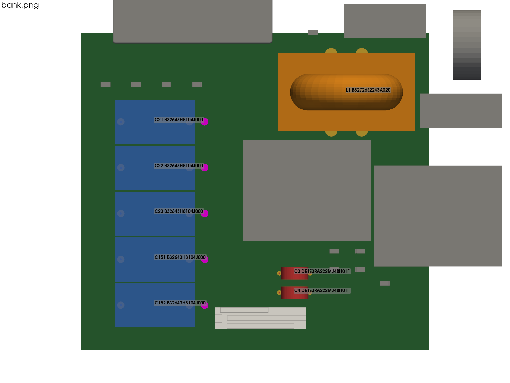
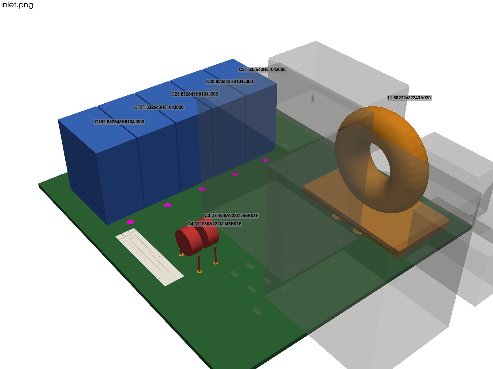

# Stage 52 footprint and 3D-model review: bank B32643H8104J000, L1 B82726S2243A020, C3/C4 DE1E3RA222MJ4BH01F

Read-only review, 2026-10-16.

> Committed copy (integration, 2026-10-16). Left out: `datasheets/` (the PDFs), the datasheet extracts in `work/`
> (`*.txt` from pdftotext and the page renders `l1*.png`, `mur-*.png`, `p3-03.png`; the TDK sheet forbids
> reproduction), and `work/board.kicad_pcb` / `work/board.step`, which are copies of the lane build
> `runs-native21/s52/c52/` (sha256 `32665572…` / `10ccab43…`). The review is of the lane board 32665572. The
> integration board has the same copper key and identical geometry; see `../README.md`, Integration.

- **Board:** `runs-native21/s52/c52/section.kicad_pcb`, sha256 `32665572a651…` (the board of record). It was copied to
  `work/board.kicad_pcb` before KiCad python opened it.
- **STEP:** the chain's `c52/board.step`, sha256 `10ccab43…`, which equals `step_sha256` in
  `validation-plan/enclosure-fit/native21-boxes.json`.
- **Lane:** `ps-selv/zapote/power-stage-120v` @ df9f46f68. Footprint sources are under `libraries/temper.pretty/`.

## Datasheets

Each datasheet sits in its own directory under `datasheets/`. They were read with pdftotext and pdftoppm only.

| Part | File | sha256 | Pages used |
|---|---|---|---|
| B32643H | `bank/mmkp_b32641h_b32643h.pdf`, the owner's copy, TDK B3264*H 6/26 | 69b56e62… | p.3 drawing, e 22.5 ±0.4, d1 0.8 ±0.05; p.14 100 nF/2000 V: 14.5 × 29.5 × 26.5 max (w × h × l), code 000 = untaped, lead length 6 −1 mm; p.29 selective/manual soldering, body ≤ 120 °C |
| L1 | `l1/b82726s22x3_tdk.pdf`, TDK 5/26 (the ledger's copy) | e8002bfe… | p.3 drawing IND2421-G-E: 45 max × 25 max, ø2 ±0.1 pins, 10 ±0.5 / 25 ±0.5 grid, 3.5 ±0.5 lead, windings 1–4 and 2–3, "No polarity", "Tin tips permissible"; p.4 both codes on the one sheet |
| L1 | `l1/B82726S2243A020_lcsc.pdf`, EPCOS 07/12 (LCSC C7084710) | 34d6930c… | p.3: **41 max** height. The 5/26 sheet draws the height arrow but prints no value. |
| C3/C4 | `c3c4/DE1E3RA222MJ4BH01F_lcsc.pdf`, Murata Type RA EGD08G, Jun 2023 | c959488a… (the lane's copy) | p.6 approvals and ratings; p.9 J4: D 9.0, T 4.0, F 10.0 ±0.8, d 0.6 ±0.05, crimp ≤ 3.0 mm, 3.5 +1.0/−0.5 mm below the crimp |
| JLC rules | jlcpcb.com/capabilities/pcb-capabilities, read 2026-10-16 | — | legend line ≥ 0.15 mm, text ≥ 1.0 mm, width:height 1:6 preferred, pad–silk ≥ 0.15 mm; PTH ring on a multilayer 2 oz board ≥ 0.254 mm; PTH hole +0.13/−0.08 mm |

## Results

`work/fp-dump.json` holds the pads, nets, drills and models of the board's footprints. The other evidence files are
`work/part-boxes.json`, `work/enclosure-r43-poseA.json`, `work/bottom-clear.json` and `work/fit-mark.json`. Board
thickness is 1.653 mm (`native-21/stackup.json`, `board_thickness_mm`).

| # | Part | Check | Grade | Evidence |
|---|---|---|---|---|
| 1 | Bank (C21–C23, C151, C152) | Pitch, lead and drill | **PASS** | Pad 1 sits at x 163.0 and the pad-2 holes at 185.5 and 190.5: 22.5 and 27.5 mm (fp-dump). B3264*H p.3 gives e 22.5 ±0.4. The drill is 1.2 mm against a 0.8 ±0.05 lead, so the hole is lead + 0.40 mm nominal and + 0.35 mm over the largest lead, inside IPC-2222's 0.2–0.4 mm. At JLC's −0.08 mm hole tolerance it is still 0.27 mm over the largest lead. The ring is (2.4 − 1.2) / 2 = 0.60 mm, and 0.535 mm at the +0.13 mm hole limit; JLC needs ≥ 0.254 mm. |
| 2 | Bank | Fitted leads in the 22.5 mm hole | **PASS** | The model's lead solids are at x 162.6–163.4 and 185.1–185.9 (part-boxes C21), so they land on pad 1 and the 22.5 mm hole. The **27.5 mm holes at x 190.5 are unused on all five parts**: (190.5, 53.2 / 68.2 / 83.2 / 98.2 / 113.2), magenta in the renders. Both pad-2 holes are on sw_b (fp-dump), so a part in the wrong hole would still be electrically correct. |
| 3 | Bank | Body against courtyard and silk | **PASS** | The datasheet maximum body (p.14) is 26.5 × 14.5, which is F.Fab's dashed rectangle at x −2.0 to 24.5, y ±7.25. The courtyard runs from −2.75 to 30.25 in x and ±7.45 in y; the silk from −2.37 to 29.87 and ±7.37 (`Bank_Film_DualPitch…kicad_mod` lines 19–22). At the 15.0 mm column pitch, neighbouring maximum bodies are 0.5 mm apart and neighbouring courtyards 0.1 mm apart. Silk and courtyard wrap both holes. |
| 4 | Bank | Pin 1 and polarity | **PASS** | The film capacitor is non-polar. Pad 1 is round on purpose (footprint descr, HOT-SELV 8.325 mm). |
| 5 | Bank | Height and enclosure | **PASS** | h is 29.5 mm max (p.14); KNSCHA at s51 was 20 mm. In pose (a) of DECISIONS 2026-10-09 against the R43 catalog, the body spans world Z 27.65–57.15. That is **23.85 mm below the coil-plenum floor** (Z 81, `electronics_coil_plenum_floors`) and 18.5 mm below the R43 component envelope top (Z 75.613). The nearest solid in plan is the H7 standoff/screw, 6.7 mm from C152. The chain's FIT gate gives 0 overlaps and 0 hits (`blk-fit.log`). See row 22 for the gate's pose. |
| 6 | Bank | Neighbour 3D boxes | **PASS** | `native21-body-collisions.json`: 424 solids, 0 unattributed, 0 overlaps. The nearest body that overlaps in Z is the next bank cap, 0.5 mm away (part-boxes). |
| 7 | Bank | 3D model | **PASS** | `${KIPRJMOD}/../models3d/capacitors/TDK_B32643B8104J000.step` is tracked (`git ls-files`). Its body is 161.0–187.5 × 14.5 × 29.5 mm on a 0.5 mm standoff, so the top is 30.0 mm above the board, 0.5 mm conservative. That is the p.14 maximum, centred on the 22.5 mm pitch. The file is named B32643B, but p.14 gives the B32643H the same body. |
| 8 | Bank | CPL centre and rotation | **PASS** | The CPL places C21–C152 at x **174.250**, rotation 0. That is pad 1 + 22.5/2, which is also the body centre ((161.0 + 187.5)/2). `audit.py` lines 529–536 assert 11.25 / 13.75 / KeyError, and `audit.json` meta gives a centre error of 0.0 mm. The part is non-polar, so 0° and 180° are equivalent. |
| 9 | Bank | JLC assembly class | **PASS** | THT, no LCSC number, BOM marked "consign or hand-assemble". The rotation audit excludes it as not placed by JLC (`audit.json` excluded). |
| 10 | Bank | Bottom side and soldering | **PASS** | The only B-side footprints are 47 test points, the nearest ≥ 41.7 mm from any bank pad. There are no B.Cu SMD pads within 6 mm (`bottom-clear.json`). The untaped 000 lead is 5–6 mm (p.14), so it protrudes **3.35–4.35 mm** and must be trimmed to ≤ 2.5 mm. FAB-NOTE line 64 says "trim every THT lead". p.29: body ≤ 120 °C for selective or manual soldering. |
| 11 | L1 | Pin count and pinout against the 2203 | **PASS** | It is the same 4-pin part on the same 5/26 sheet: one drawing (IND2421-G-E, p.3) and both codes in the p.4 table. Footprint `B82726S2_ReviewOnly` is unchanged: pads 1 (0,0), 2 (10,0), 3 (10,25), 4 (0,25), the p.3 top view "1 2 / 4 3". |
| 12 | L1 | Winding orientation against the schematic | **PASS** | Board pad nets: 1 l_f, 4 l_filt (winding 1–4) and 2 ac_n_in, 3 n_filt (winding 2–3). The frozen netlist (`native-21/frozen/default.net`) carries the same pin-to-net map, as does `parts.ato` Cmc24A (a_in 1 / a_out 4 / b_in 2 / b_out 3). Both inputs are on the 1–2 row, so the windings are in common mode. A 180° rotation reverses both windings and keeps CM. A 90° turn cannot insert on a 10 × 25 grid. |
| 13 | L1 | Pin, drill and ring | **PASS** | The 2.5 mm drill against ø2 ±0.1 pins is +0.5 over nominal and **+0.4 over the largest pin**, at the top of the IPC band. Up to 2.63 mm at JLC's tolerance. The ring is 0.75 mm. The footprint is unchanged from the 2203 and the pins carry tin tips (p.3 note 1), so the generous hole is reasonable. Pad 1 is square as the pin-1 marker. |
| 14 | L1 | Body against courtyard and silk | **PASS** | Maximum 45 × 25 (p.3), centred on the pin grid: x −17.5 to 27.5, y 0 to 25. F.Fab is 45 × 26 (y −0.5 to 25.5), the courtyard −18 to 28 by −2.5 to 27.5, the silk −17.5 to 27.5 by −2.35 to 27.35. |
| 15 | L1 | Height and neighbours | **PASS** | 41 mm max (07/12 p.3), so world Z 27.65–68.65 in pose (a): **12.35 mm below the coil-plenum floor** (Z 81) and 7.0 mm below the envelope top. The datasheet envelope (local x 214.5–259.5, y 31–56) is 1.6 mm from C2's body, 3.1 mm from C5 and 3.3 mm from PS2 (part-boxes). |
| 16 | L1 | 3D model | **FLAG** | The model is `B82726S2203A020_provisional.step`, which is acceptable because both codes share a drawing. It is undersized against the datasheet: the toroid is 40.05 × **12.0** (y) × 40.05 on a 45 × 25.5 × 3 base plate, with the top **40.52 mm** above the board against 41 max. The y-width of 25 max is drawn as 12 above 4.6 mm (part-boxes L1). The FIT and collision gates therefore see a thinner, 0.5 mm lower body than the datasheet's. The datasheet envelope still clears (row 15). Fix: model only, no footprint or copper change. |
| 17 | L1 | JLC CPL and sourcing | **FLAG** | The CPL centre (237.000, 43.500) is the pin-grid centre, which is also the body centre; rotation 0. The rotation audit says NEEDS-PREVIEW (no EasyEDA footprint). It is fool-proof (row 12). The BOM line, however, reads **C7084710 "JLC (Extended)"** while JLC holds **0** (`sourcing/STOCK-2026-10-16.csv` line 3), and the s52 README says "consigned". `apply_lcsc.py` says global sourcing. Fix: BOM only. Mark the line global-sourcing (JLC buys from Mouser/DigiKey) or consigned, so the order does not stall on a shortage. |
| 18 | L1 | Bottom side and soldering | **PASS** | The nearest B-side item is ≥ 112 mm away, and there is no B.Cu SMD within 6 mm. A 3.5 ±0.5 lead protrudes 1.35–2.35 mm, already ≤ 2.5. p.4 rates it for wave soldering at 260 °C for 10 s. |
| 19 | C3/C4 | Pitch, lead, drill and ring | **PASS** | Pads at 10.0 mm, against F 10.0 ±0.8 (p.9). The 0.9 mm drill against a 0.6 ±0.05 lead is +0.30 nominal and +0.25 over the largest lead, inside IPC. The ring is 0.30 mm, above 0.254 by design. At the +0.13 mm hole limit it would be 0.235 mm; the reduced pad is unchanged since it was set for the 8.5 mm creepage. |
| 20 | C3/C4 | Body, polarity and neighbours | **PASS** | F.Fab is 10.5 × 5.0 against D 9.0 × T 4.0 (p.9). The courtyard is 12.5 × 5.5. The part is non-polar. The C3 and C4 bodies are 2.3 mm apart (part-boxes). Pad nets: C3 1 l_filt / 2 pe, C4 1 n_filt / 2 pe, the same as the netlist. |
| 21 | C3/C4 | Height and 3D model | **PASS** | The J4 part seats on its crimp, so its top is ≤ 12.0 mm (D 9.0 + crimp ≤ 3.0, p.9). The model (`Murata_DE1E3RA222MA4BP01F.step`, the A4 part) stands **14.0 mm**, 2 mm conservative, and its D and T plan matches (215.5–224.5 × 4.0). Pose (a) puts it at world Z 27.65–39.65, far below every R43 solid above it. J4 lead protrusion is 1.35–2.85 mm, trimmed by the FAB-NOTE rule. |
| 22 | L1, C3/C4 | Model file on disk | **FLAG** | The models for L1, C3 and C4 resolve through `${KIPRJMOD}/models3d/…` with KIPRJMOD = `native-21` (chain.sh line 106). `native-21/models3d/` is **untracked** in the lane, not ignored, and absent from git. The files exist in the lane, ps-integrate, ps-layers and loop-timing, and are byte-identical to the tracked `models3d/` copies (sha1 f45c466e…, 092abf66…). A clean checkout would export the STEP without them, and chain.sh never reads `step.log` for "Could not add". The FIT gate would then pass without L1's 41 mm body. Fix: process. Track the folder, or point the three model paths at `${KIPRJMOD}/../models3d/` as the bank does, and fail the chain on any missing model. |
| 23 | All | FIT gate pose | **FLAG** | chain.sh line 110 calls `board_in_enclosure.py` without `--pose`. The script then defaults to `mirror-legacy` (line 24) against the **R4** catalog (`fit_gate.py` line 39). DECISIONS 2026-10-09 calls that pose a reflection and says R31+ checks run with `--pose translate`. The pose-(a)/R43 check above passes for all eight parts, but the chain's "FIT … 0" is not evidence for the real enclosure. Fix: gate only, not part of this BOM. |
| 24 | C3/C4 | JLC assembly | **PASS** | C7170908, JLC Extended, 104 in stock. CPL (220.000, 102.800 / 109.100), rotation 180. The audit grades it OK on pin evidence (`audit.csv`). |
| 25 | Fit mark | Off pads and courtyards | **PASS** | Board F.SilkS block from x 193.925 to 223.711, y 113.952 to 121.075. Measured box to box (conservative), it is 2.225 mm from the nearest mask opening (C152.2), against JLC's ≥ 0.15 mm, and 0.63 mm from the nearest courtyard (C152). The lane's polygon check gives 3.469 / 0.65 (`results/bank-mark-s52.json`). It is mirrored = false and on F side, readable from the top. |
| 26 | Fit mark | Legibility | **FLAG** | Three texts at 1.0 mm height and 0.15 mm stroke, with 2.15 mm tick boxes at 0.15 mm. That is **exactly JLC's floor**: "less than 0.15 mm … unidentifiable", "less than 1.0 mm … unidentifiable". The stroke-to-height ratio is 1:6.7, thinner than JLC's preferred 1:6. On HASL/green it will likely be legible but thin. Fix: silk only, which regenerates the Gerbers but changes no copper. Use a 0.2 mm stroke (1:5), or 1.2 mm text at 0.2 mm if the block can grow about 20 % (there is 18.9 mm to the edge). |
| 27 | Bank | FAB-NOTE for JLC | **FLAG** | `fab/FAB-NOTE.md` is still the stage-51 text. Lines 3–17 say "KNSCHA fills the 27.5 mm holes" and "the five unused 22.5 mm holes … stay open", and line 28 says the bank is "in stock at JLC". For s52 every one of those is reversed. Fix: documentation only, in the BOM package. Rewrite it at adoption (DECISIONS 74) before the order: the B32643H is consigned into the 22.5 mm holes, the x 190.5 holes stay open, tick H, and L1 is global-sourced or consigned. |

## Renders

These are VTK (PyVista off-screen) renders of the chain's `board.step`, made by `scripts/render.py`. Bank bodies are
blue, L1 orange and C3/C4 red. Fitted pads are gold. The **unused 27.5 mm holes are magenta**. The fit-mark block is
the white rectangle. Neighbour bodies are grey, drawn translucent in the oblique view.

**bank.png** is a top view of the bank column and the L1 / C3 / C4 area. The bank is drawn translucent, so you can see
the leads in pad 1 and in the 22.5 mm hole.



**inlet.png** is an oblique view of the same region. The L1 model's 12 mm thick toroid is visible (row 16).



## Verdict for the prototype order

There is **no FAIL**. No footprint or copper change is needed: pitches, drills, rings, pinouts, winding nets, the CPL
centres and rotations, heights and neighbour clearances all check against the datasheets.

Five FLAGs:
- **Before the order** (BOM or documentation): 17 (L1 marked as JLC stock while JLC has 0) and 27 (stale FAB-NOTE).
- **Silk only:** 26 (fit mark at JLC's minimum stroke and height). Recommended, not blocking.
- **Model and gate hygiene, not blocking the parts:** 16 (L1 model undersized), 22 (untracked model folder) and 23
  (FIT gate in the mirror pose against R4).

## Reproduce

```
S=/Users/bennet/.claude/jobs/fbfc46b4/tmp/fp3d-s52; KP=/Applications/KiCad/KiCad.app/Contents/Frameworks/Python.framework/Versions/Current/bin/python3
E=<lane>/validation-plan/enclosure-fit
$KP -I $S/scripts/dump_fp.py $S/work/board.kicad_pcb $S/work/fp-dump.json C21,C22,C23,C151,C152,L1,C3,C4
python3 -I $S/scripts/part_boxes.py $E/native21-boxes.json $E/native21-courtyards.json $S/work/part-boxes.json
python3 -I $S/scripts/enclosure_clear.py $S/work/r43-catalog-solids.json $S/work/enclosure-r43-poseA.json   # R43 catalog minus harness/envelope AABBs
$KP -I $S/scripts/bottom_clear.py $S/work/board.kicad_pcb $S/work/bottom-clear.json
$KP -I $S/scripts/fit_mark.py $S/work/board.kicad_pcb $S/work/fit-mark.json
uv run --no-project -p 3.10 --with cadquery-ocp --with pyvista python $S/scripts/render.py $S/work/board.step $E/native21-courtyards.json $S/work/fp-dump.json $S/work/fit-mark.json $S
```
